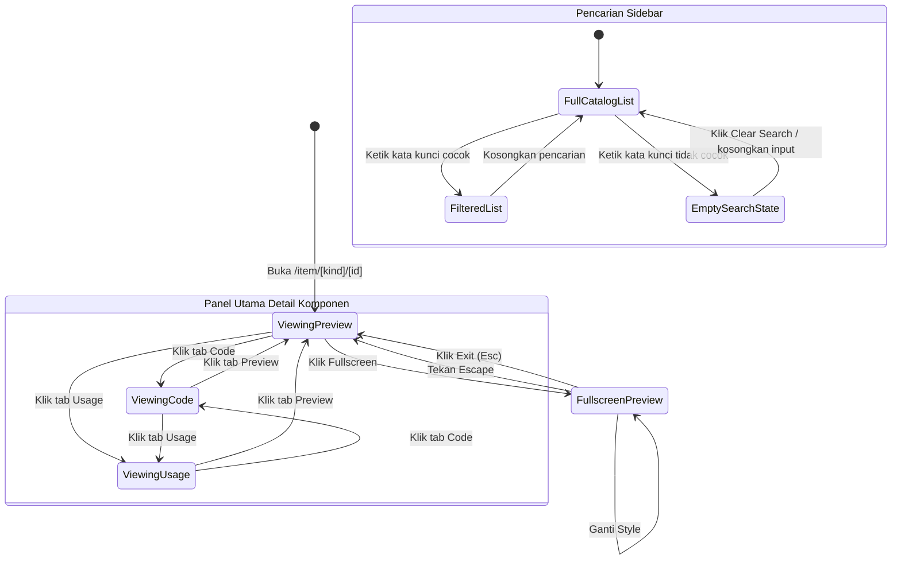

# Spesifikasi Alur Inspeksi Komponen Showcase Rakitek

Dokumen ini mendefinisikan diagram langkah pengguna dan aturan invariant untuk alur inspeksi komponen di halaman detail showcase (`/item/[kind]/[id]`), termasuk perpindahan tab, mode layar penuh, dan pencarian sidebar.

## Diagram Langkah Pengguna



## Daftar Aturan (Invariants)

1. **Tidak ada modal tertinggal atau scroll terkunci (Safety):**
   Ketika pengguna keluar dari layar penuh (lewat tombol keluar atau `Escape`), elemen `[role="dialog"][aria-modal="true"]` harus hilang sepenuhnya dan `document.body.style.overflow` tidak boleh tertahan di `"hidden"`.
2. **Konsistensi tab aktif tunggal (Safety):**
   Di dalam `main`, tepat satu tombol tab (`Preview`, `Code`, atau `Usage`) berstatus `aria-pressed="true"`, dan konten yang tampil selalu cocok (`iframe` saat tab `Preview`, elemen `<pre>` saat tab `Code` atau `Usage`).
3. **Pratinjau iframe selalu valid tanpa overflow shell (Safety):**
   Saat berada di `Preview` atau `FullscreenPreview` pada viewport mana pun (`Desktop`, `Tablet`, `Phone`), `iframe` memiliki lebar dan tinggi > 0 serta halaman utama tidak mengalami horizontal overflow (`scrollWidth <= innerWidth + 1`).
4. **Pencarian sidebar selalu bisa dipulihkan (Liveness):**
   Setelah pencarian memfilter atau masuk ke kondisi tidak ditemukan, mengosongkan input `#rk-sidebar-search` selalu mengembalikan jumlah tautan komponen sidebar ke jumlah penuh awal.
5. **Nol error runtime sepanjang urutan aksi acak (Safety):**
   Sepanjang rangkaian interaksi cepat dan acak, konsol browser memiliki 0 error, 0 uncaught exception, dan 0 respons jaringan `4xx`/`5xx`.

## Verifikasi Property-Based

Dijalankan terhadap build showcase aktif di browser Brave headless dengan skrip deterministik ber-seed:

```bash
npm run verify:properties -- --base-url http://127.0.0.1:3000
```

- **Batasan (bounds):** 2 seed deterministik (`42`, `1337`), masing-masing 24 langkah aksi UI beruntun (total 48 transisi nyata di Brave headless), dengan pemeriksaan kelima invariant di setiap langkah.
- **Bukti keluaran:** `artifacts/verify-web/properties-report.json`.
