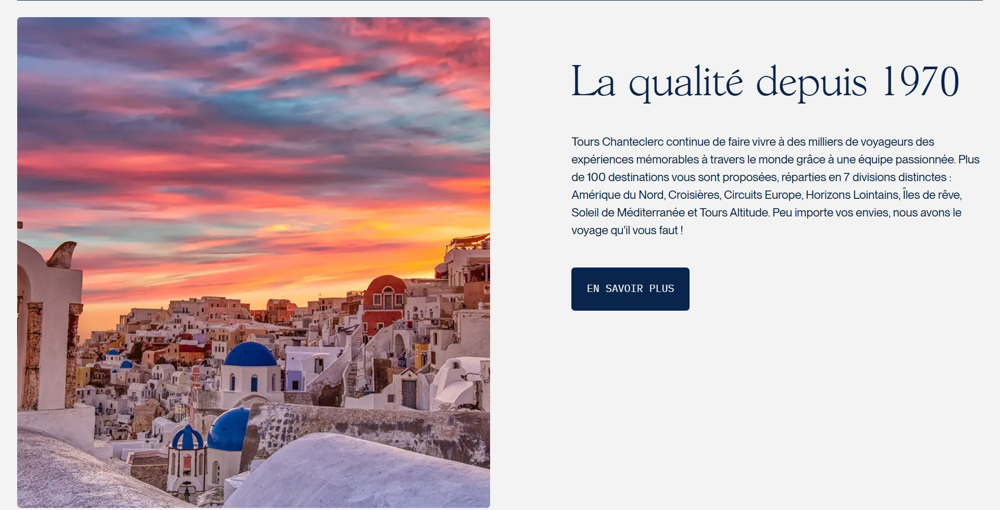
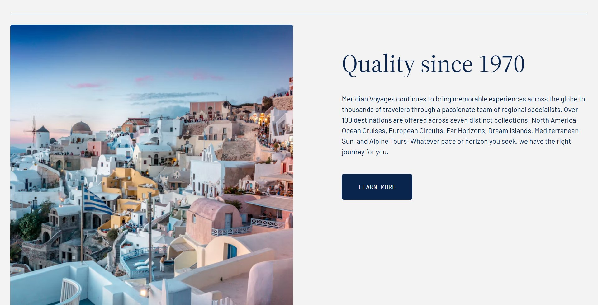
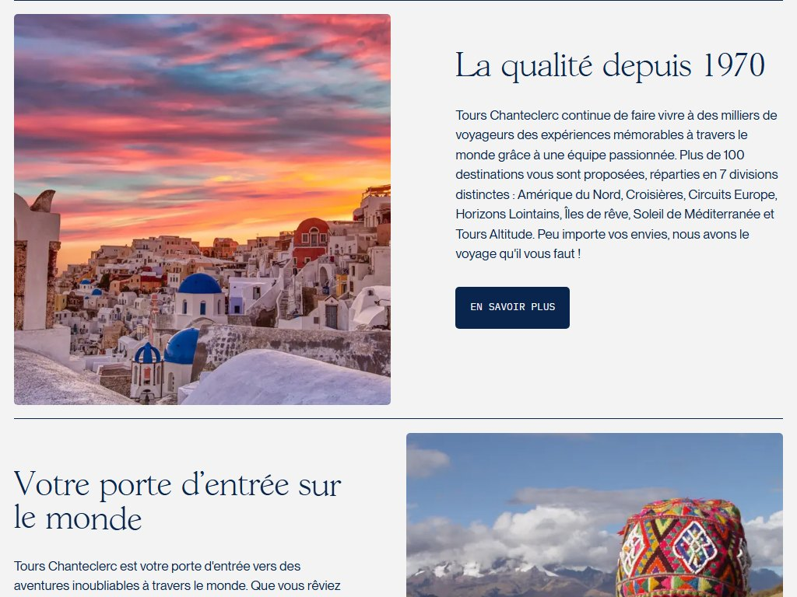
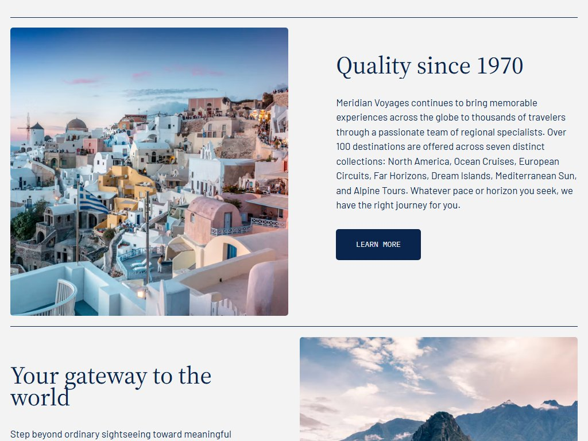

# Fidelity Report: alternating-story-split

Sumber: `travel-services/tours-chanteclerc-nextjs` (`.mediaAndText` dual-row split section pada `localhost:3001/`)
Ekstrak: `registry/sections/alternating-story-split` (`http://localhost:3005/preview/section/alternating-story-split?style=azure-editorial`)
Keadaan: dua baris split-layout kiri/kanan bolak-balik lengkap dengan judul serif, paragraf, CTA button, dan gambar media pada `1920x980` dan `1024x768`.

## Hasil `npm run fidelity:all`

- 1920x980: 6 elemen (`section`, `firstRow`, `firstMedia`, `firstTitle`, `firstBody`, `firstCta`), **0 FAIL**, 16 WARN
- 1024x768: 6 elemen (`section`, `firstRow`, `firstMedia`, `firstTitle`, `firstBody`, `firstCta`), **0 FAIL**, 16 WARN

## Screenshot berdampingan

| Viewport | Asli | Ekstrak |
| --- | --- | --- |
| 1920x980 |  |  |
| 1024x768 |  |  |

## Beda yang disengaja (WARN)

- **Font display & body**: `Gascogne` -> `Source Serif 4`, `PP Neue Montreal` -> `Barlow`.
- **Teks & foto**: cerita brand Tours Chanteclerc ("La qualite depuis 1970", "Un demi-siecle de voyages...") diganti dataset editorial netral berbahasa Inggris (`Quality since 1970`, `Half a century of journeys`).
- **Composes UI**: tombol CTA memakai atom `rolling-cta-button`.
