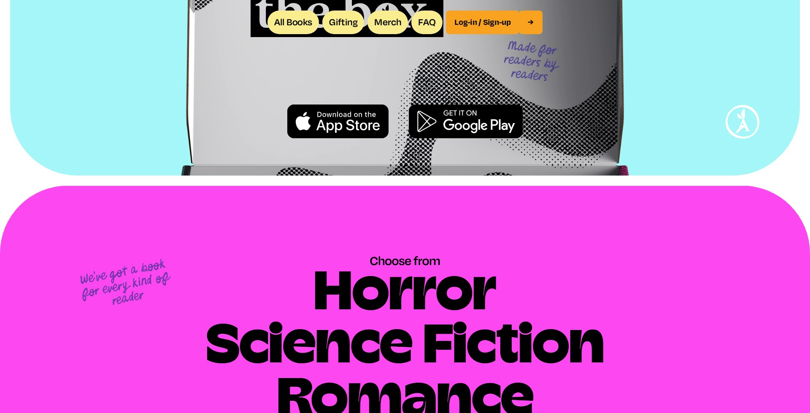
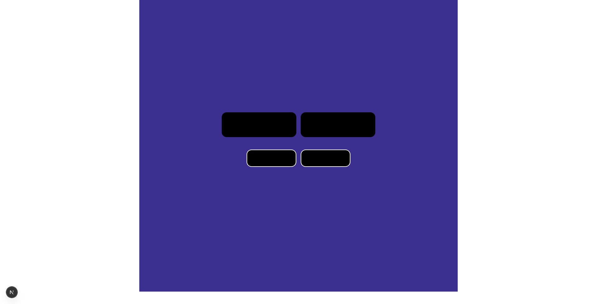
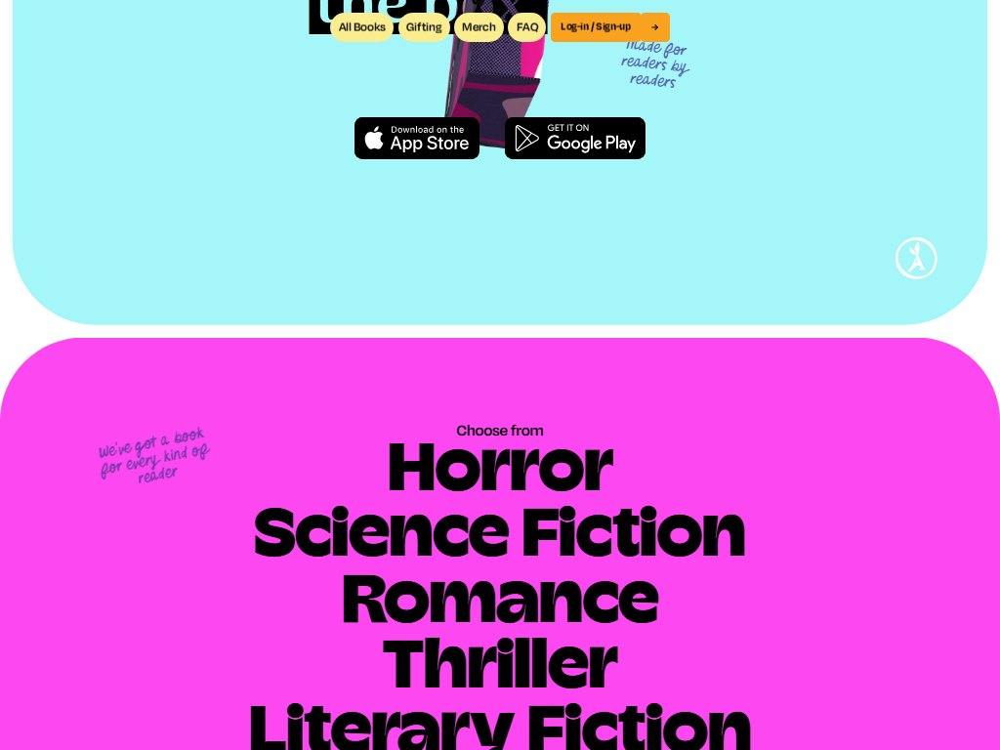
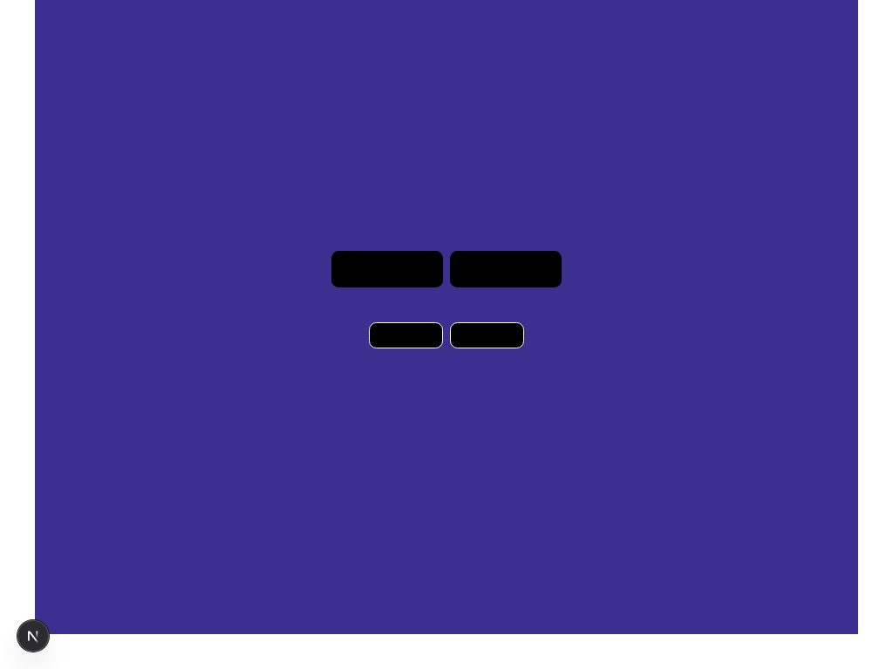

# Fidelity Report: `bookclub-app-badges`

- **Kind / Level:** `ui` (lihat `meta.json`)
- **Sumber:** `ecommerce-d2c/aardvark-book-club/src/components/ui/AppStoreBadges.tsx` (`http://localhost:3031/`)
- **Preview ekstrak:** `http://localhost:3035/preview/ui/bookclub-app-badges` (showcase dev, port blok N=3)
- **Pembanding:** `npm run fidelity -- fidelity/bookclub-app-badges/original-<lebar>.json fidelity/bookclub-app-badges/extract-<lebar>.json`

## Hasil ukur

| Viewport | Elemen | FAIL | WARN |
| --- | ---: | ---: | ---: |
| `1920x980` | 2 | **0** | 10 |
| `1024x768` | 2 | **0** | 10 |

## Screenshot berdampingan

| Viewport | Asli | Ekstrak |
| --- | --- | --- |
| `1920x980` |  |  |
| `1024x768` |  |  |

## Beda yang disengaja (WARN)

- Properti ber-WARN: `fontRendered`, `letterSpacing`, `text`, `x`, `y`.
- Font berbayar/webfont asli diganti font gratis: Degular -> Barlow (body), Champ -> Rubik (display), Hello Organichand -> Shadows Into Light (tulisan tangan). Ini sumber seluruh WARN `fontRendered` dan sebagian WARN `x`/`width`/`y` (lebar huruf beda).
- `text`: salinan contoh netral tanpa merek menggantikan teks asli; gambar sampul/foto privat diganti placeholder bertoken.
- `x`/`y`/`width`: posisi asli diukur pada halaman utuh (ada header/layout situs), preview hanya komponen; lebar huruf font pengganti menggeser lebar elemen inline.
- `fontWeight`/`letterSpacing`: pembulatan atau nilai bawaan font pengganti.

## Catatan perbaikan
- Bukti diukur ulang setelah CSS varian `outline` berubah (tinggi tombol 3.5em).

## Catatan teknis
- Pengukuran headless (Brave) dengan `scripts/fidelity/measure.js` apa adanya; scrollbar disembunyikan otomatis. Tidak ada perubahan toleransi atau `compare-core.ts`.
