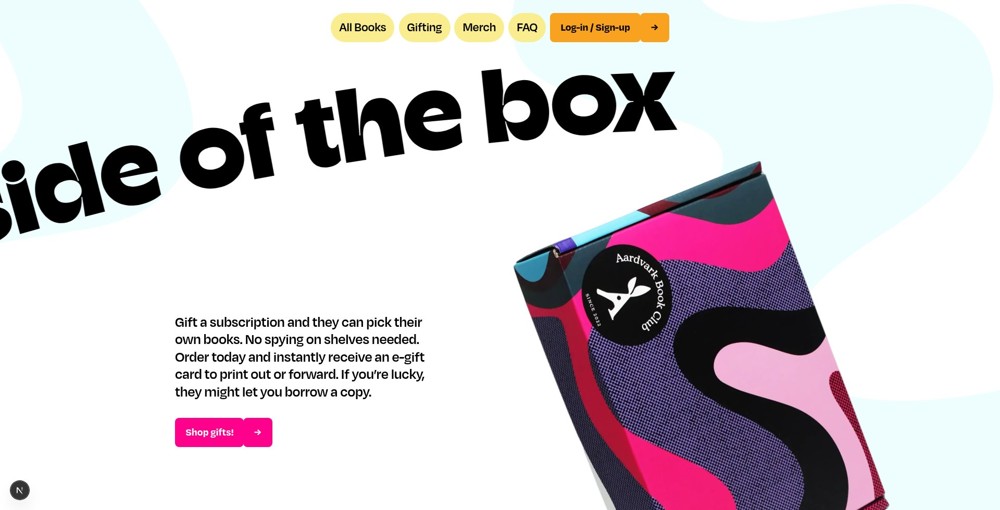
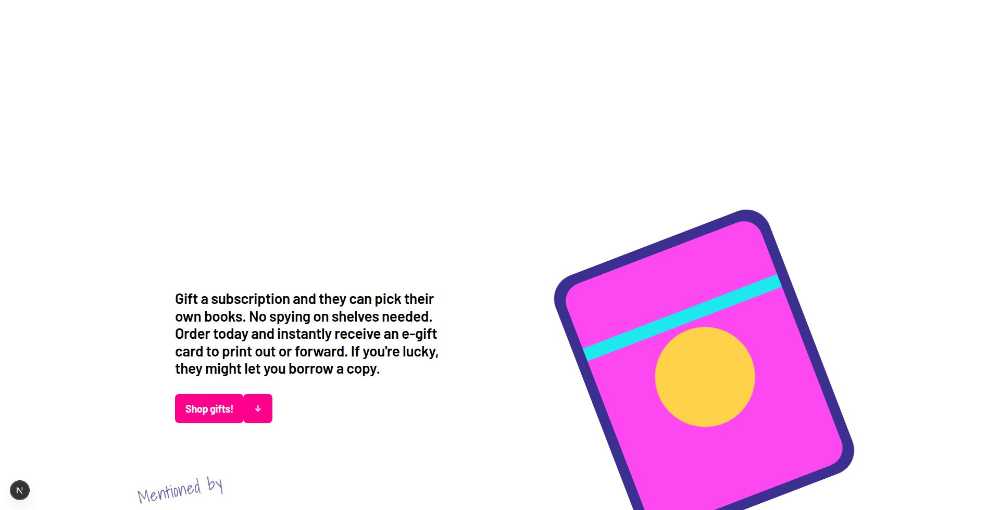
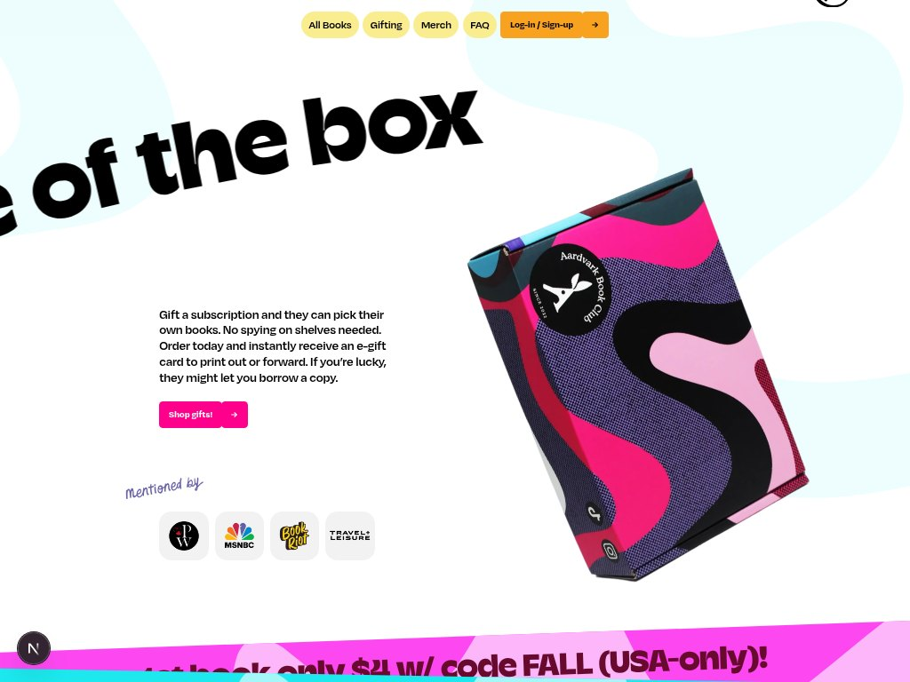
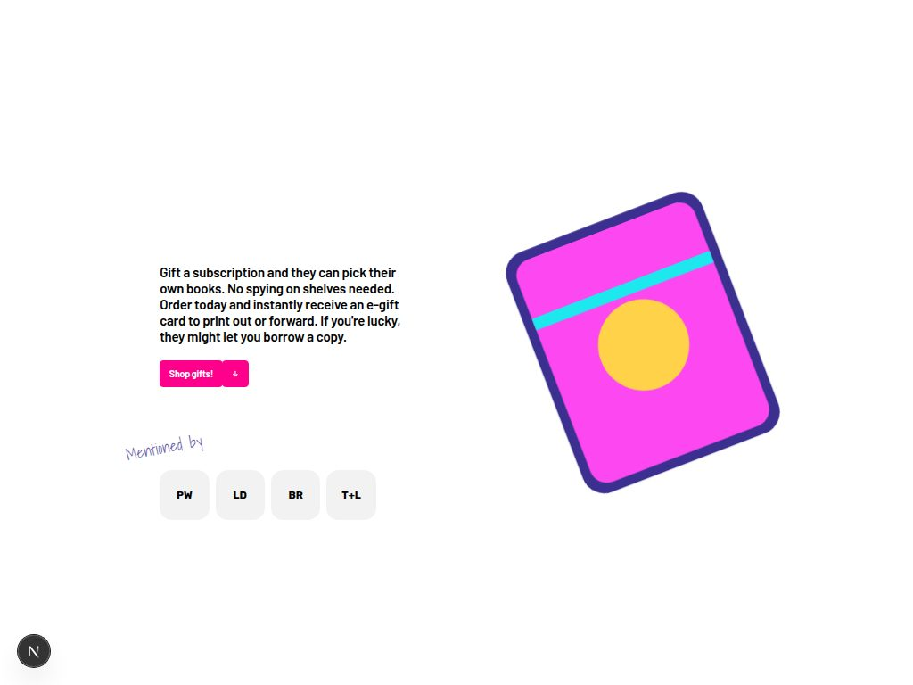

# Fidelity Report: `bookclub-gift-feature`

- **Kind / Level:** `section` (lihat `meta.json`)
- **Sumber:** `ecommerce-d2c/aardvark-book-club/src/components/sections/GiftSection.tsx` (`http://localhost:3031/`)
- **Preview ekstrak:** `http://localhost:3035/preview/section/bookclub-gift-feature` (showcase dev, port blok N=3)
- **Pembanding:** `npm run fidelity -- fidelity/bookclub-gift-feature/original-<lebar>.json fidelity/bookclub-gift-feature/extract-<lebar>.json`

## Hasil ukur

| Viewport | Elemen | FAIL | WARN |
| --- | ---: | ---: | ---: |
| `1920x980` | 5 | **0** | 11 |
| `1024x768` | 5 | **0** | 11 |

## Screenshot berdampingan

| Viewport | Asli | Ekstrak |
| --- | --- | --- |
| `1920x980` |  |  |
| `1024x768` |  |  |

## Beda yang disengaja (WARN)

- Properti ber-WARN: `fontRendered`, `letterSpacing`, `y`.
- Font berbayar/webfont asli diganti font gratis: Degular -> Barlow (body), Champ -> Rubik (display), Hello Organichand -> Shadows Into Light (tulisan tangan). Ini sumber seluruh WARN `fontRendered` dan sebagian WARN `x`/`width`/`y` (lebar huruf beda).
- `x`/`y`/`width`: posisi asli diukur pada halaman utuh (ada header/layout situs), preview hanya komponen; lebar huruf font pengganti menggeser lebar elemen inline.
- `fontWeight`/`letterSpacing`: pembulatan atau nilai bawaan font pengganti.

## Catatan perbaikan
- `letter-spacing: 0.023em` pada teks tulisan tangan (aslinya -0.02em) mengompensasi lebar font Shadows Into Light yang 10% lebih sempit dari Hello Organichand; bounding box rotasi -11deg kini sama.
- Panah CTA mengarah ke bawah karena preview memakai `href="#gift"`; aturan asli `.button-alt[href^="#"] .icon{rotate:90deg}` sengaja ditiru.

## Catatan teknis
- Pengukuran headless (Brave) dengan `scripts/fidelity/measure.js` apa adanya; scrollbar disembunyikan otomatis. Tidak ada perubahan toleransi atau `compare-core.ts`.
