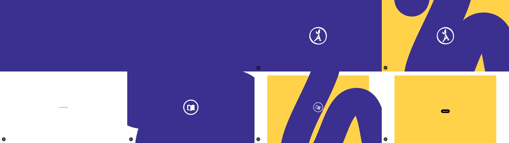
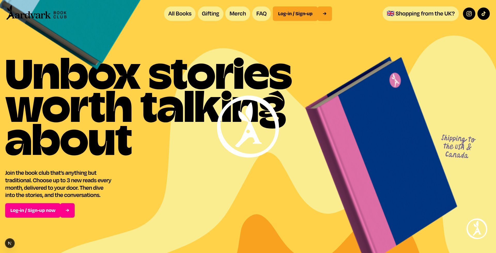
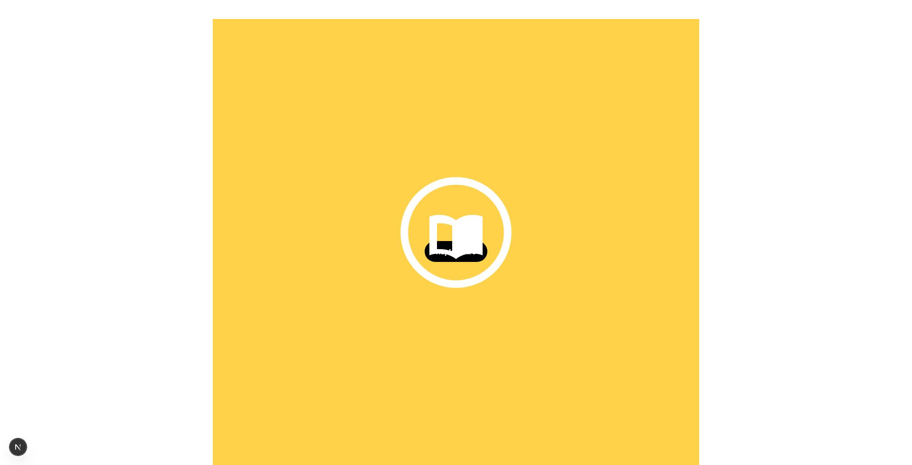
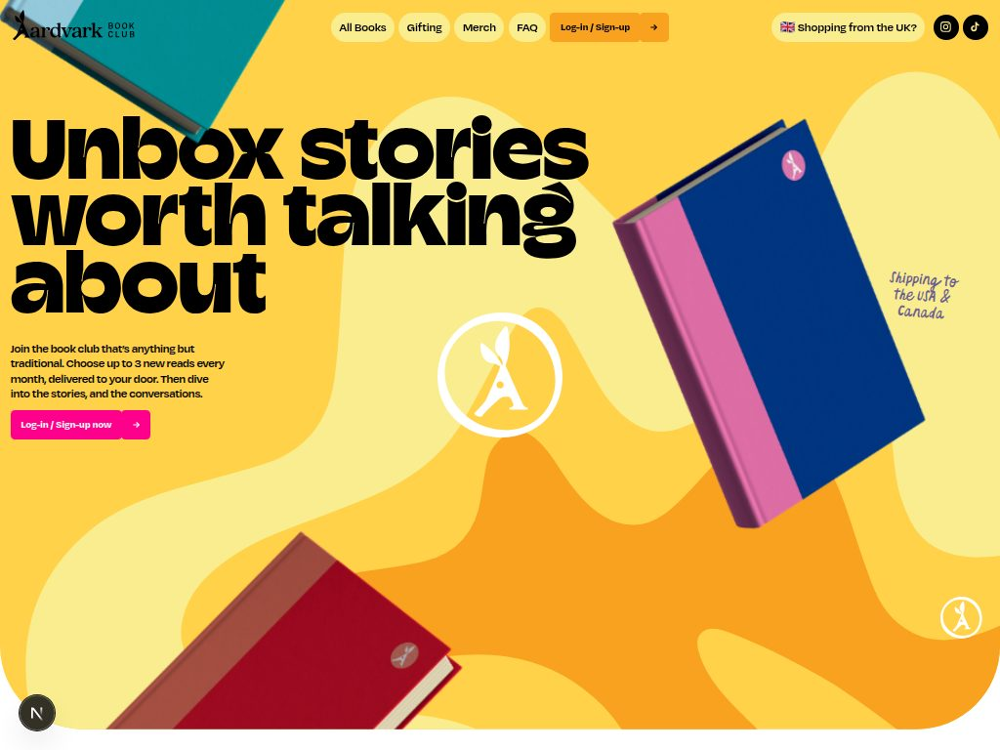
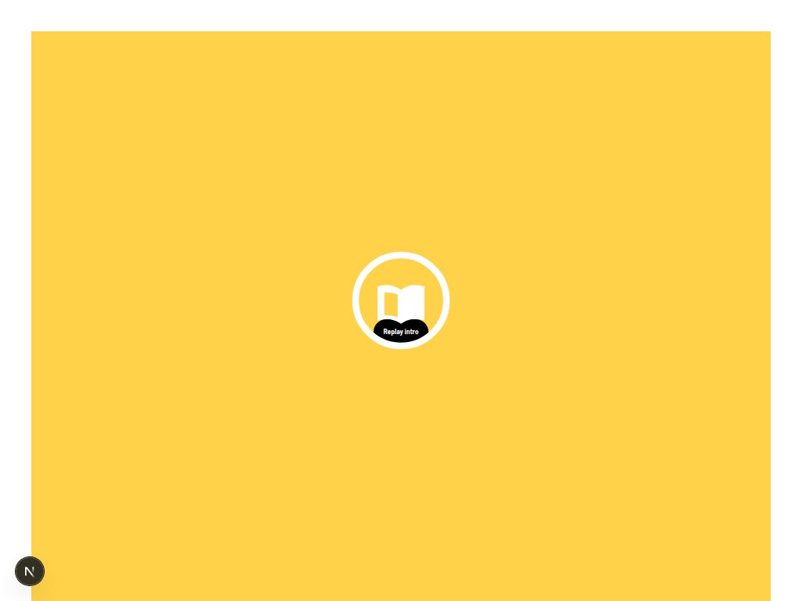

# Fidelity Report: `bookclub-intro-splash`

- **Kind / Level:** `ui` / `organism` (overlay layar penuh, bukan section halaman; `composes: []`)
- **Sumber:** `ecommerce-d2c/aardvark-book-club/src/components/layout/TransitionSplash.tsx` + `lib/animations/introAnimation.ts` (bagian transisi) + CSS `.transition*` (`http://localhost:3031/`)
- **Preview ekstrak:** `http://localhost:3035/preview/ui/bookclub-intro-splash` (ada tombol "Replay intro")
- **Disambungkan ke:** `templates/bookclub-landing-template` (slot `intro`) dan `pages/bookclub-landing-demo-page` (prop `showIntro`)

## Cara ukur
Overlay hanya tampil sekitar 1,65 detik, jadi geometri statisnya diukur setelah animasi selesai (5 detik): `root` (fixed, inset 0), `shape` (kotak 1:1 di desktop, tinggi penuh di mobile), `svg` (120%), `logo` (wadah 15em) dan `logoSvg`. Transform/opacity logo dinetralkan lewat JS di kedua sisi (GSAP meninggalkan skala 0 setelah selesai). Di preview, `holdAfterDone` menjaga overlay (tak terlihat) tetap ada supaya bisa diukur. Viewport 375 tidak dibandingkan: situs asli melebar ke 430px pada emulasi mobile, jadi pasangannya tidak sama.

| Viewport | Elemen | FAIL | WARN |
| --- | ---: | ---: | ---: |
| `1920x980` | 5 | **0** | 5 |
| `1024x768` | 5 | **0** | 5 |

## Bukti animasi (bukan hanya geometri)
Bingkai pada 0,3 / 0,7 / 1,1 / 1,5 detik setelah muat (baris atas situs asli, baris bawah ekstrak): kuas ungu menutup layar, logo muncul dengan pegas elastis lalu mengecil, kuas tersapu bersih.

| Viewport | Asli | Ekstrak |
| --- | --- | --- |
| `1920x980` |  |  |
| `1024x768` |  |  |

## Beda yang disengaja (WARN dan perubahan perilaku)
- `fontRendered`: Degular -> Barlow (tidak ada teks di overlay, hanya mewarisi).
- Logo bawaan adalah lingkaran + buku netral; logo merek asli diganti, bisa diganti lewat prop `logo`.
- Jalur kuas dan timeline (delay 0.4, durasi 1.25, pegas elastis logo) disalin dari aslinya; `drawSVG` memakai `gsap/DrawSVGPlugin`.
- Pemakaian di luar situs asli: `show` (matikan), `delay`, `speed`, `label` (pengumuman aksesibilitas, kosong = disembunyikan dari AT), `holdAfterDone`, `failSafeMs` (overlay dihapus paksa bila animasi tak pernah selesai, bawaan 6 detik), `onComplete`.
- `prefers-reduced-motion: reduce`: overlay tidak digambar sama sekali (CSS) dan langsung selesai (`respectReducedMotion`, bawaan aktif). Overlay `pointer-events: none`, jadi tidak pernah menghalangi klik.
- Aslinya timeline ini juga menggeser header dan hero; itu bagian komponen lain dan tidak diubah di sini. `lenis.resize()` tidak dipakai (aturan: tidak ada Lenis di komponen).
