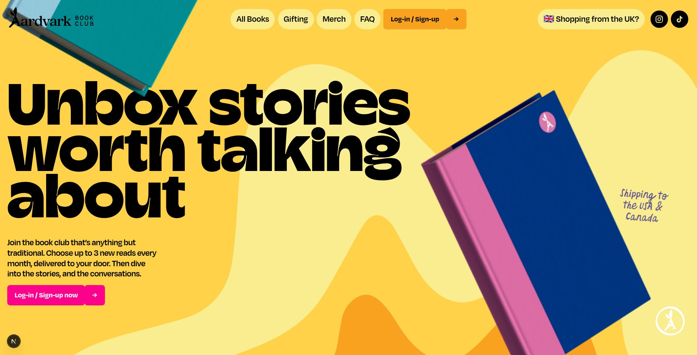
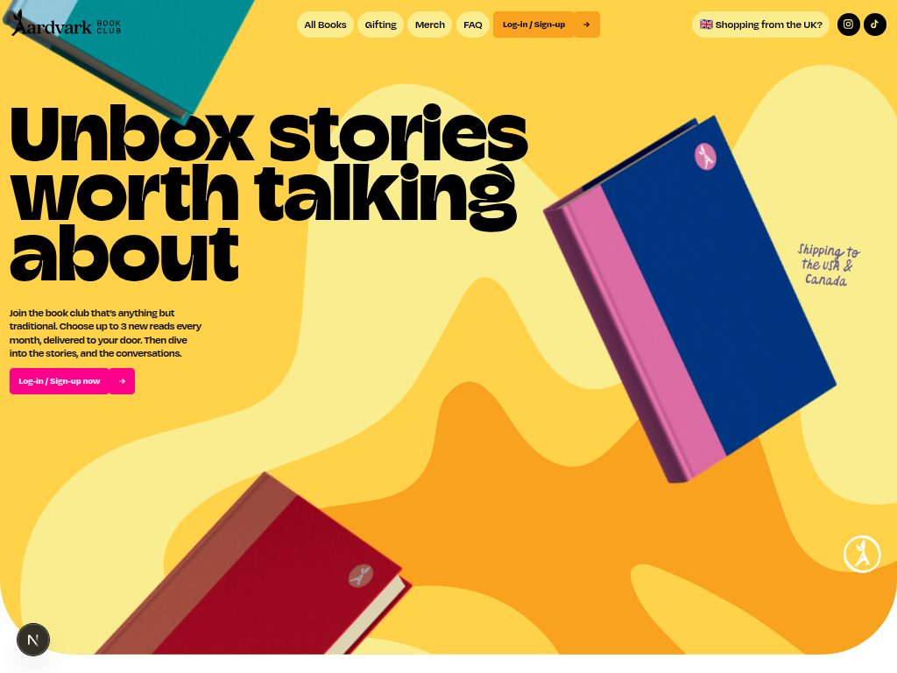
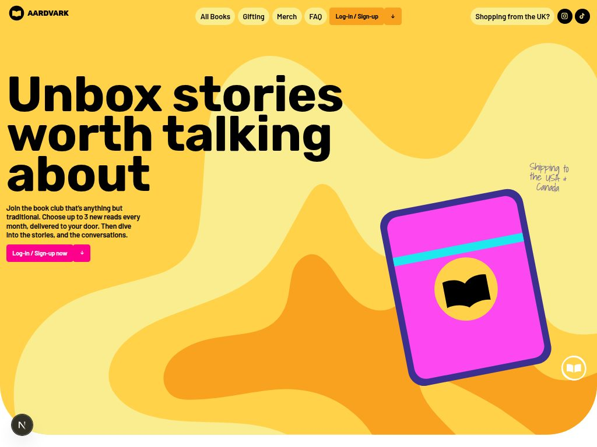
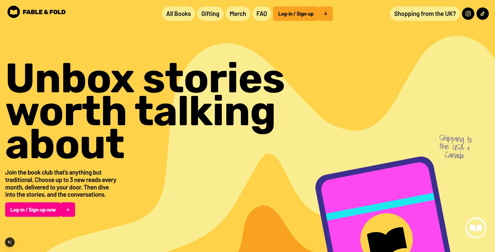
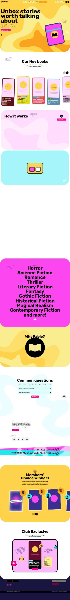
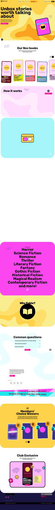

# Fidelity Report: `bookclub-landing-demo-page`

- **Kind / Level:** `page` / `page`
- **Composes:** `templates/bookclub-landing-template`, `ui/bookclub-intro-splash` (overlay intro, prop `showIntro`, default aktif, hilang sendiri setelah sekitar 2 detik) dan 12 section `bookclub-*` (header, hero, books, how-it-works, box-sequence, genres, benefits, faq, gift, promo-banners, winners, exclusive, wave-footer).
- **Sumber (bukti perakitan Langkah 1):** `ecommerce-d2c/aardvark-book-club` (`http://localhost:3031/`)
- **Preview ekstrak:** `http://localhost:3035/preview/page/bookclub-landing-demo-page`
- 13 wilayah diukur di kedua sisi: `header`, `hero`, `books`, `howItWorks`, `boxSequence`, `genres`, `benefits`, `faq`, `gift`, `promo`, `winners`, `exclusive`, `footer` (`Math.random` dikunci 0.5 di kedua sisi karena rotasi kartu slider acak).

## Langkah 1: bukti perakitan (salinan asli vs halaman asli utuh)

`demo-data` sementara diisi salinan asli (6 judul buku, 4 pemenang, pertanyaan FAQ, teks exclusive, langkah how-it-works, hak cipta). File sementara dihapus setelah ukur.

| Viewport | Elemen | FAIL | WARN | Tinggi total (`footer.y + footer.height`) | Hasil |
| --- | ---: | ---: | ---: | --- | --- |
| `1920x980` | 13 | **0** | 16 | asli 16250.6px vs ekstrak 16252.2px | PASS |
| `1024x768` | 13 | **0** | 16 | asli 9437.1px vs ekstrak 9433.4px | PASS |

| Viewport | Asli | Ekstrak (salinan asli) |
| --- | --- | --- |
| `1920x980` |  |  |
| `1024x768` |  |  |

Beda terbesar: `gift` 1292px vs 1293.8px (1920) dan 693.8px vs 690px (1024), keduanya di dalam toleransi 2% (maks 4px).

### WARN yang disengaja (Langkah 1)
- `*.fontRendered`: Degular -> Barlow, Champ -> Rubik, Hello Organichand -> Shadows Into Light (font berbayar/webfont asli).
- `header.text`, `benefits.text`, `footer.text`: logo merek dan judul "Why Aardvark?" aslinya berupa SVG/gambar; ekstrak memakai teks. Emoji bendera dan gambar sampul/foto diganti placeholder bertoken.

## Langkah 2: data contoh netral tanpa merek

`demo-data.ts` / `demo-books.ts` memakai merek fiktif (`FABLE & FOLD`), judul buku dan nama penulis fiktif. Diukur ulang (`neutral-*.json`) dan dicek visual penuh halaman (`neutral-overview-*.jpg`).

| Viewport | Lebar dokumen vs viewport | Tumpukan `hero -> footer` | Overlap / terpotong / overflow |
| --- | --- | --- | --- |
| `1920x980` | `scrollWidth` 1920 = `innerWidth` 1920 | y=0 -> 16216px, berurutan tanpa celah | 0 overlap, 0 teks terpotong (hanya teks `sr-only`), 0 overflow horizontal |
| `1024x768` | `scrollWidth` 1024 = `innerWidth` 1024 | berurutan | sama |

| `1920x980` netral | `1024x768` netral | Ikhtisar penuh 1920 | Ikhtisar penuh 1024 |
| --- | --- | --- | --- |
|  |  |  |  |

Setelah `bookclub-intro-splash` disambungkan (slot `intro` di template), Step 1 dan Step 2 diukur ulang: hasil tetap 13 elemen, 0 FAIL di 1920 dan 1024, dan tumpukan slot tidak bergeser (slot `intro` bertinggi 0, overlay `position: fixed`).

Catatan: sebagian animasi bergantung scroll (rangkaian kotak, teks lengkung gift) berada pada keadaan awal di ikhtisar penuh, jadi tampak lebih kosong dari saat di-scroll.
