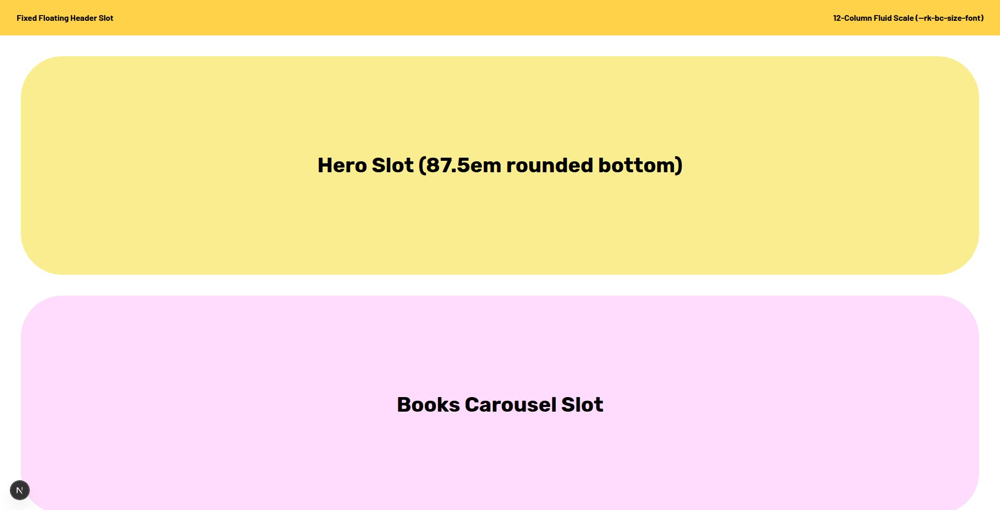
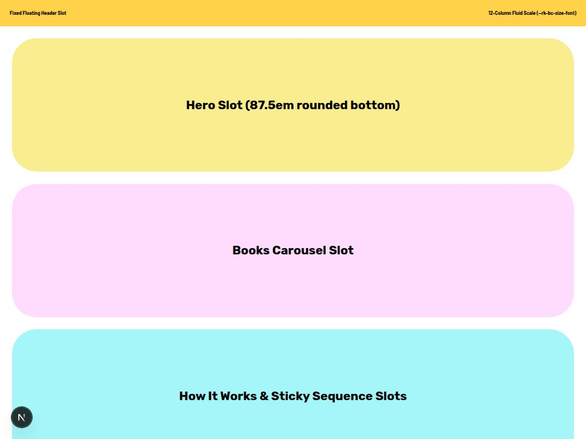
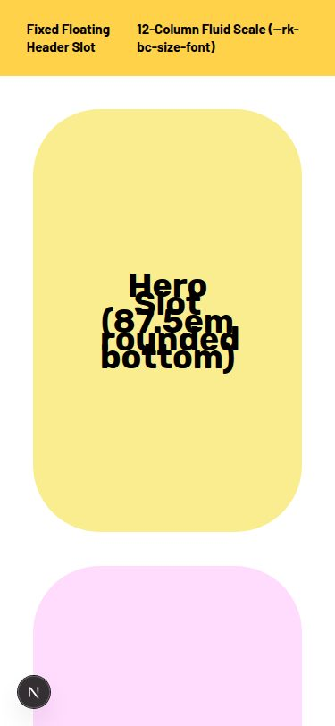

# Fidelity Report: `bookclub-landing-template`

Sumber: aturan shell halaman di `ecommerce-d2c/aardvark-book-club/src/styles/aardvark-custom.css` (font-size akar fluid `clamp(992px, 100vw, 3840px) / 120`, `overflow-x: clip`, header tetap, footer yang menumpuk). Ekstrak: `registry/templates/bookclub-landing-template` (`http://localhost:3035/preview/template/bookclub-landing-template`). Style: `playful-bookclub`.

## Geometri shell (diukur headless)

| Viewport | Lebar shell | `--rk-bc-size-font` terpakai | Slot (`hero -> howItWorks`) | `scrollWidth` vs `innerWidth` | `overflow-x` |
| --- | ---: | ---: | --- | --- | --- |
| `1920x980` | 1920px | 16px (1920/120, sama dengan situs asli) | 1920px penuh, berurutan | 1920 = 1920 | `clip` |
| `1024x768` | 1024px | 8.53px (1024/120) | 1024px penuh, berurutan | 1024 = 1024 | `clip` |
| `375x812` | 375px | 14.93px (375/25.125) | 375px penuh, berurutan | 375 = 375 | `clip` |

Tidak ada overflow horizontal dan tidak ada tumpang tindih antar slot (`y` slot ke-n+1 = `y + tinggi` slot ke-n). `overflow-x: clip` dipakai agar `position: sticky` di dalam slot (rangkaian kotak, carousel) tetap bekerja.

| Desktop `1920x980` | Laptop `1024x768` | Mobile `375x812` |
| --- | --- | --- |
|  |  |  |

Bukti perakitan penuh bersama 12 section ada di `fidelity/bookclub-landing-demo-page/REPORT.md` (0 FAIL terhadap halaman asli utuh).
