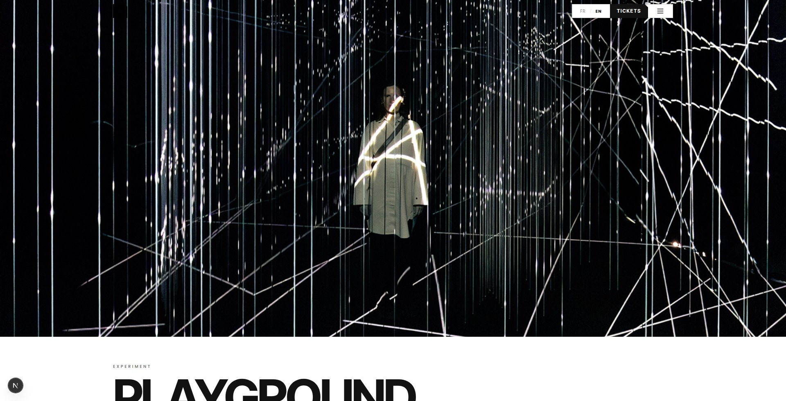
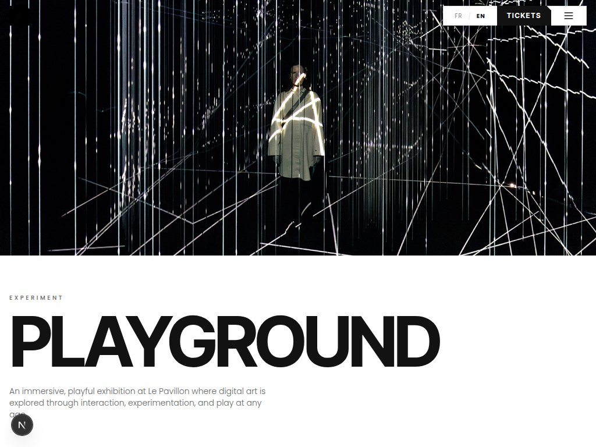

# Fidelity Report: `cinematic-media-banner`

- **Kind / Level:** `section` / `organism`
- **Source:** `education-event/kikkfestival-be-nextjs` (`src/components/home/ImageBanner.tsx` & `VimeoBanner.tsx`, `http://127.0.0.1:3011/`)
- **Extract:** `registry/sections/cinematic-media-banner` (`http://127.0.0.1:3015/preview/section/cinematic-media-banner`)
- **Style:** `neon-brutalist` (`css-modules`, 100% `--rk-*` tokens)

## Results (`npm run fidelity`)

- `1920x980`: 3 elements (`section`, `frame`, `image`), **0 FAIL**, 6 WARN.
- `1024x768`: 3 elements (`section`, `frame`, `image`), **0 FAIL**, 6 WARN.

Exact `21 / 9` frame dimensions match (`1920 x 822.8px` at `1920`, `1024 x 438.8px` at `1024`) with `0.0px` difference.

## Side-by-Side Screenshots

| Viewport | Original (`127.0.0.1:3011/`) | Extract (`127.0.0.1:3015/preview/section/cinematic-media-banner`) |
| --- | --- | --- |
| `1920x980` |  |  |
| `1024x768` |  |  |

## Intentional Differences (WARN)

- **White-label media:** Original exhibition photograph replaced with neutral Unsplash hall photography; optional `videoSrc` iframe embed is preserved via props.
- **Zero-width border color:** `0px` computed border inherits `rgb(18, 18, 18)` vs Tailwind global `rgba(18, 18, 18, 0.15)`.
