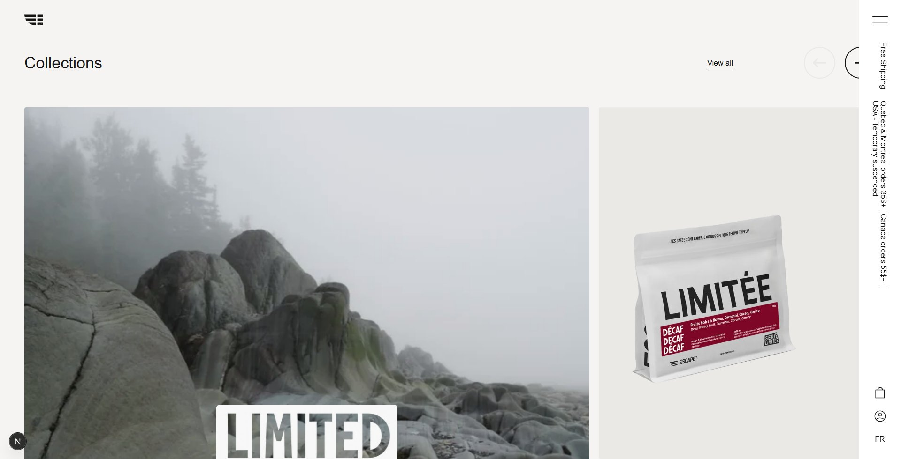
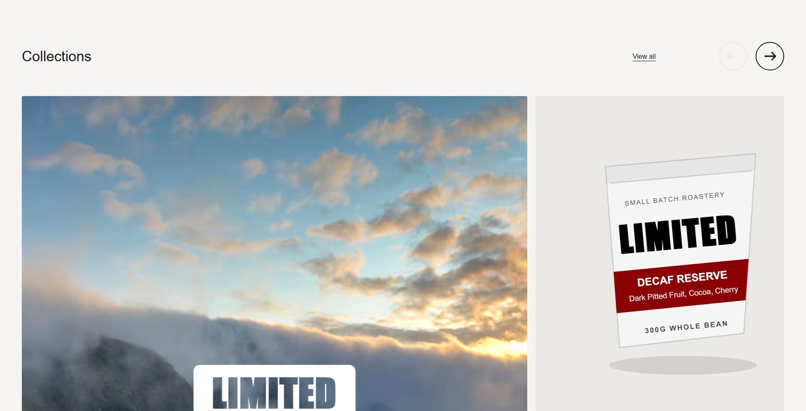
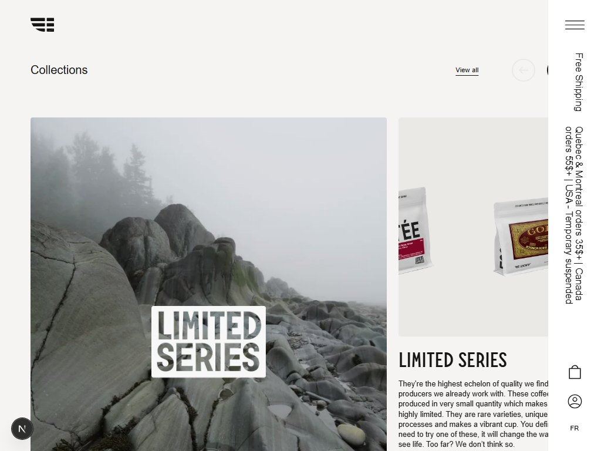
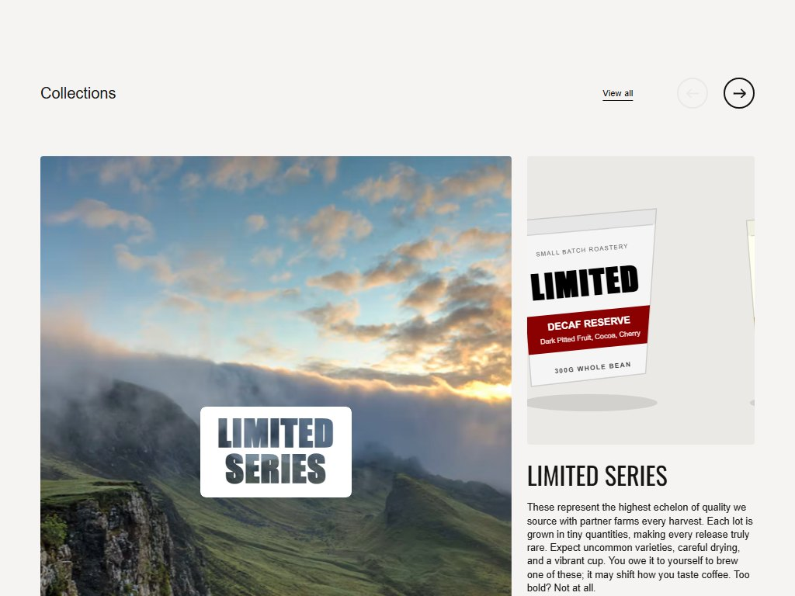

# Fidelity Report: collection-split-showcase

Sumber: `coffee-shop/escape-cafe-nextjs/src/components/HomeCollections.tsx` (localhost:3001)
Ekstrak: `registry/sections/collection-split-showcase` (localhost:3000/preview/section/collection-split-showcase)
Keadaan: scroll ke `#collections`, 2,8 detik setelah load (font dan transisi slide aktif selesai).

Catatan pengukuran: di web asli, lebar `#collections` mengikuti container 100% viewport tanpa rail samping saat dibandingkan (1905px dengan scrollbar default vs 1910px di Rakitek dengan scrollbar 10px, selisih 0,26%).

## Hasil `npm run fidelity`

- 1920x980: 13 elemen, **0 FAIL**, 11 WARN. Tinggi `detailBody` 121.5px (sama persis), tinggi `header` 68.8px (sama persis), tombol navigasi 67.8x67.8px (sama persis).
- 1024x768: 13 elemen, **0 FAIL**, 11 WARN. Tinggi `detailBody` 120.9px (sama persis, 7 baris), tinggi `header` 40.8px (sama persis), tombol navigasi 39.8x39.8px (sama persis).

## Screenshot berdampingan

| | Asli | Ekstrak |
| --- | --- | --- |
| 1920x980 |  |  |
| 1024x768 |  |  |

## Beda yang disengaja (WARN)

- **Font display**: Molitor (berbayar) diganti **Oswald** lewat token `--rk-font-display`. Tinggi `detailTitle` tetap identik (46.3px di 1920, 27.2px di 1024), lebar tombol `SHOP` selisih tipis (86.6 vs 83.8px di 1920; 50.9 vs 49.3px di 1024).
- **Hitam tombol**: `#000` asli (`rgb(0, 0, 0)`) dipetakan ke token `--rk-fg` (`rgb(21, 21, 21)`) untuk background `shopBtn` serta warna teks dan border `learnMoreBtn`.
- **Teks dan aset non-brand**: deskripsi koleksi, foto lanskap (Unsplash), lencana seri SVG, dan ilustrasi kantong kopi SVG diganti dengan konten netral non-brand sambil menjaga jumlah baris identik (5 baris di 1920, 7 baris di 1024).

## Perbaikan Phase 2

- Memangkas deskripsi `limited-series` dari 347 ke 325 karakter di `preview.tsx` dan `component.tsx` agar tidak meluber 1 kata ke baris ke-8 di `1024x768` (sebelumnya `detailBody.height` 138.1px vs 120.9px asli). Setelah perbaikan, kedua viewport lulus dengan **0 FAIL**.

## Pembaruan 2026-11-26: props untuk dipakai ulang

Props opsional baru: `formatPrice(value)` (default `` `$${value}` ``), `selectProductLabel(name, priceLabel)`, `prevLabel`, `nextLabel`, `prevMobileLabel`, `nextMobileLabel`. Produk tanpa harga tetap hanya menampilkan nama (komponen ini tidak pernah mengarang `$28`; fallback itu ada di `storefront-demo-page`). Default semua prop baru menghasilkan DOM yang sama dengan sebelumnya.

Diukur ulang 2026-11-26 dengan `scripts/fidelity-capture.ts` (label dan selector sama dengan ekstrak lama, build produksi baru):

- 1920x980: 13 elemen, 11 FAIL, 26 WARN
- 1024x768: 13 elemen, 11 FAIL, 26 WARN

Catatan: semua FAIL tersisa adalah lebar elemen selebar viewport. `original-*.json` diukur sebelum normalisasi scrollbar (scrollbar 15px, lebar 1905/1009px), sedangkan ekstrak baru diukur dengan `fidelity-capture` yang menyembunyikan scrollbar (1920/1024px). FAIL yang sama sudah ada sebelum perubahan ini (ekstrak lama 1910/1014px juga FAIL melawan 1905/1009px). Perbandingan ekstrak lama vs baru hanya berbeda di lebar viewport itu (plus tinggi blok beraspek-rasio yang ikut melebar), tanpa beda struktur atau teks. Perbaikannya: ukur ulang `original-*.json` dengan `measure.js` terbaru (ternormalisasi).

## Pembaruan 2026-11-27: ukur ulang ternormalisasi

`original-*.json` dan `extract-*.json` diukur ulang dengan `scripts/fidelity-capture.ts` (scrollbar disembunyikan di kedua sisi, lebar penuh 1920/1024px). Hasil `npm run fidelity`: 1920x980 13 elemen, **0 FAIL**, 11 WARN; 1024x768 13 elemen, **0 FAIL**, 11 WARN. FAIL lebar viewport di catatan sebelumnya hilang karena kedua sisi kini sama-sama 1920/1024px. Tidak ada perubahan CSS.
