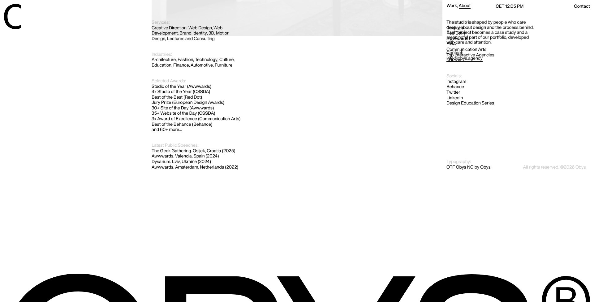
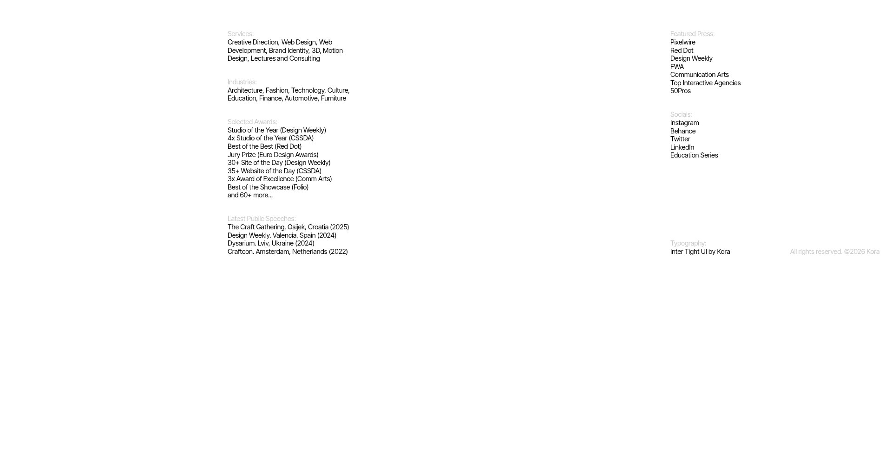
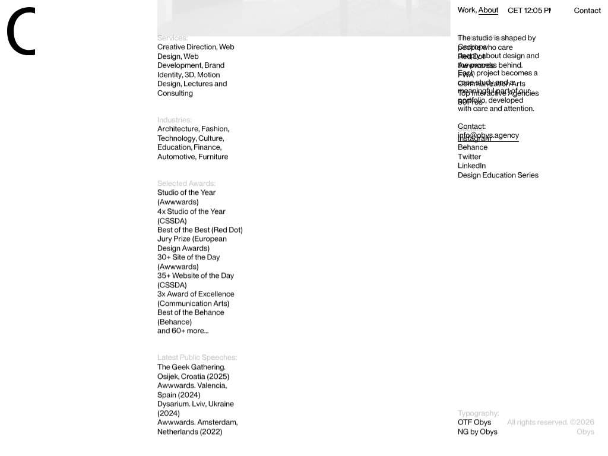
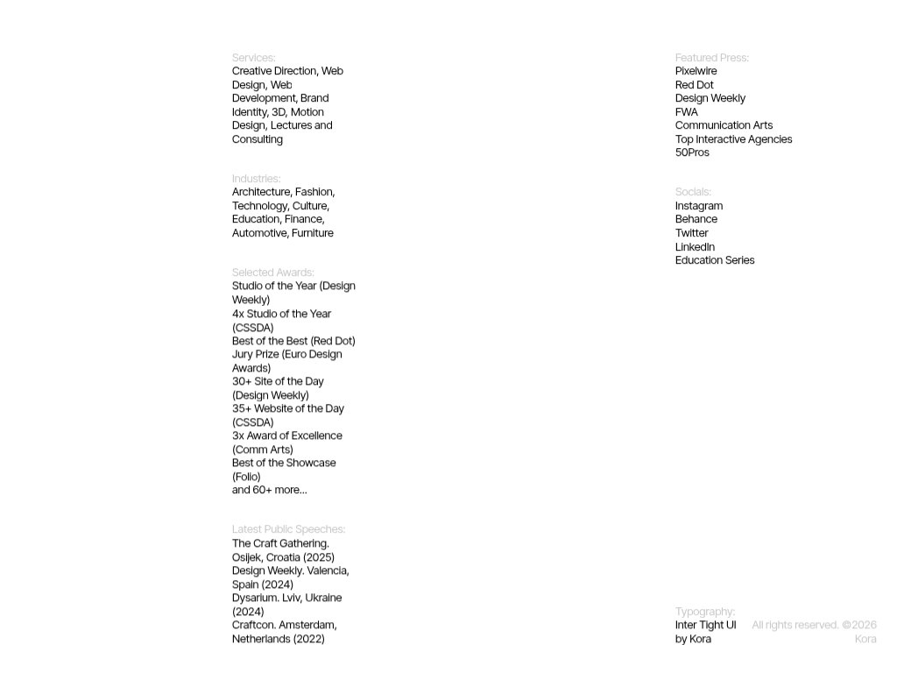
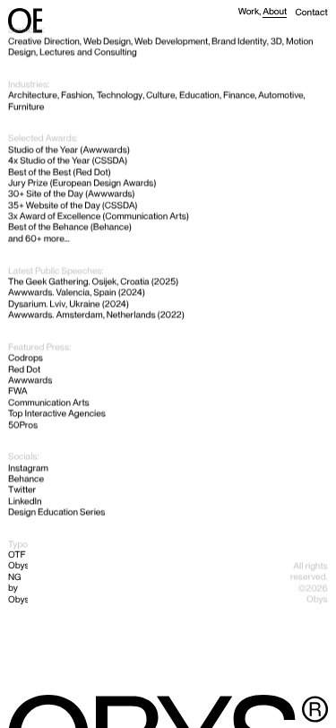
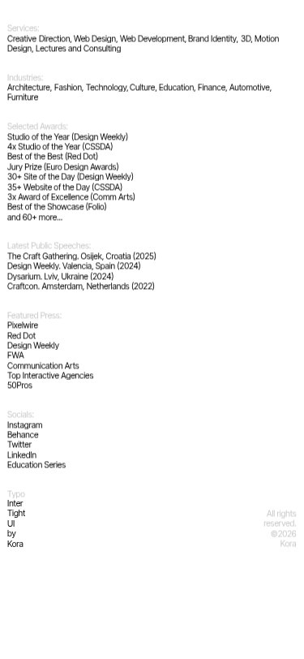

# Fidelity Report: credits-index-columns

- **Sumber:** `agency-portfolio/obys-agency-nextjs` (`src/components/about/AboutCredits.tsx`, `#ab-me`, `http://localhost:3021/about`)
- **Ekstrak:** `registry/sections/credits-index-columns` (`http://localhost:3025/preview/section/credits-index-columns`)
- **Style:** `swiss-mono` (`css-modules`, 100% token `--rk-*`)

## Hasil `npm run fidelity`

- `1920x980`: 8 elemen (`root`, `inner`, `primary`, `secondary`, `heading`, `awardLink`, `colophon`, `legal`), **0 FAIL**, 13 WARN
- `1024x768`: 8 elemen (`root`, `inner`, `primary`, `secondary`, `heading`, `awardLink`, `colophon`, `legal`), **0 FAIL**, 12 WARN
- `375x812`: 8 elemen (`root`, `inner`, `primary`, `secondary`, `heading`, `awardLink`, `colophon`, `legal`), **0 FAIL**, 13 WARN

## Screenshot Berdampingan

| Viewport | Asli | Ekstrak |
| --- | --- | --- |
| `1920x980` |  |  |
| `1024x768` |  |  |
| `375x812` |  |  |

## Temuan yang Diperbaiki

- Memindahkan latar `var(--rk-bg)` ke `.root::before` (`z-index: -1`) dengan `isolation: isolate; background: transparent;` pada `.root` agar `backgroundColor` cocok `rgba(0, 0, 0, 0)` seperti `#ab-me`.
- Menyesuaikan item `speeches` dan `colophon`/`legal` di `preview.tsx` ke panjang kata netral yang sepadan (`Craftcon. Amsterdam, Netherlands (2022)`, `Inter Tight UI by Kora`, `All rights reserved. ©2026 Kora`) agar wrapping baris di `1920` dan `375` identik dengan aslinya.

## Beda yang Disengaja (WARN)

- **Font proprietary (`Obys` -> `Inter Tight`)** serta **label kredit/penghargaan netral** tanpa nama merek asli.
