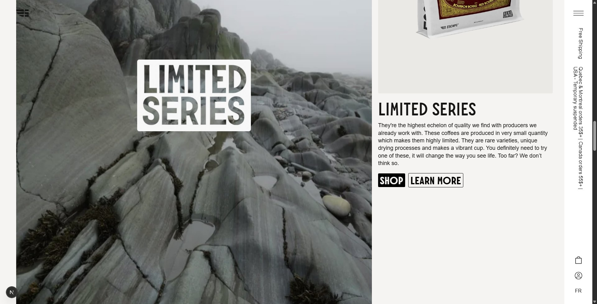
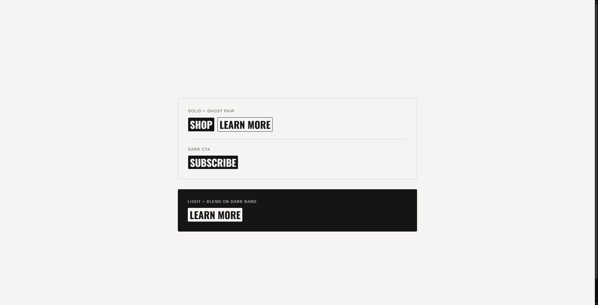
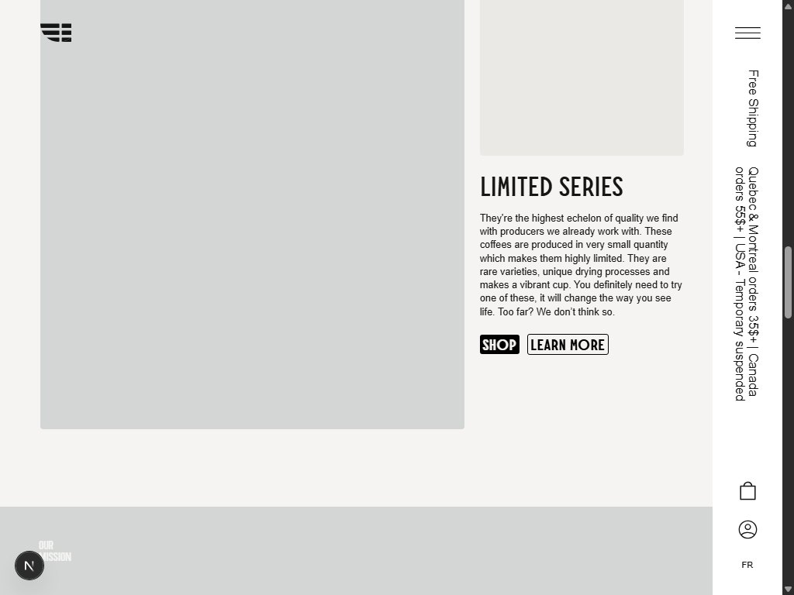
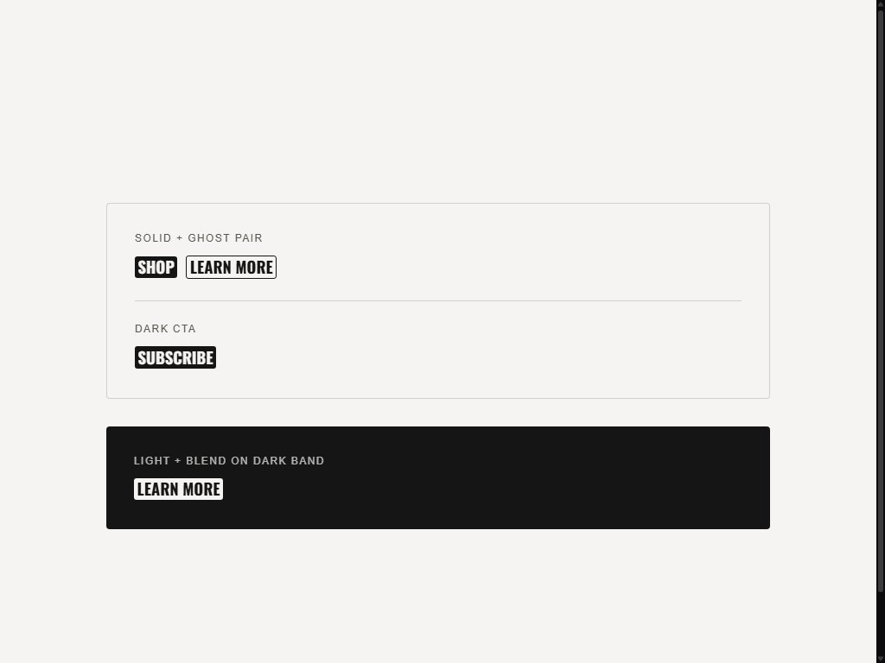

# Fidelity Report: editorial-button

Sumber: `coffee-shop/escape-cafe-nextjs` (`.btn`, `.btn--ghost`, `.btn--dark`, `.btn--light`, `.btn--blend` di `#collections`, `#manifest`, `#mission` pada `localhost:3001`)
Ekstrak: `registry/ui/editorial-button` (`localhost:3000/preview/ui/editorial-button`)
Keadaan: preview halaman komponen penuh pada `1920x980` dan `1024x768`, 2,2 detik setelah load (`document.fonts.ready`).

Catatan pengukuran: di web asli, keempat varian tombol (`solidBtn`, `ghostBtn`, `darkBtn`, `lightBtn`) tersebar di tiga section berbeda (`#collections`, `#manifest`, `#mission`). Di preview ekstrak, keempat varian ditampilkan dalam satu kanvas showcase agar dapat diukur bersamaan, sehingga perbedaan koordinat `x`/`y` bersifat wajar.

## Hasil `npm run fidelity`

- 1920x980: 4 elemen, **0 FAIL**, 22 WARN.
  - Tinggi tombol identik: `solidBtn` 43.5px, `ghostBtn` 45.5px, `darkBtn` 43.5px, `lightBtn` 43.5px.
  - Ukuran font (`31.5px`), `line-height` (`31.5px`), `padding` (`6px` semua sisi), `border-radius` (`3px`), `border` ghost (`1px`), dan jarak pasangan `SHOP` + `LEARN MORE` (`10px`) semuanya identik.
- 1024x768: 4 elemen, **0 FAIL**, 22 WARN.
  - Tinggi tombol identik: `solidBtn` 25.6px, `ghostBtn` 27.6px, `darkBtn` 25.6px, `lightBtn` 25.6px.
  - Ukuran font (`18.5px`), `line-height` (`18.5px`), `padding` (`3.6px` semua sisi), `border-radius` (`3px`), `border` ghost (`1px`), dan jarak pasangan `SHOP` + `LEARN MORE` (`10px`) semuanya identik.

## Screenshot berdampingan

| Viewport | Asli | Ekstrak |
| --- | --- | --- |
| 1920x980 |  |  |
| 1024x768 |  |  |

## Beda yang disengaja (WARN)

- **Font display**: Molitor (berbayar) diganti **Oswald** melalui token `--rk-font-display`. Selisih lebar huruf menyebabkan variasi kecil pada lebar `SHOP` (86.6 vs 83.8px di 1920; 50.9 vs 49.3px di 1024) dan `SUBSCRIBE` (147.4 vs 160px di 1920; 86.6 vs 94px di 1024), sedangkan `LEARN MORE` nyaris identik (177.3 vs 177.5px di 1920; 105 vs 105.1px di 1024).
- **Warna hitam tombol**: `#000` (`rgb(0, 0, 0)`) pada sumber asli dipetakan ke token `--rk-fg` (`rgb(21, 21, 21)`), muncul sebagai WARN token rounding pada `backgroundColor`, `color`, dan warna border.
- **Posisi `x`/`y`**: tombol di web asli berada pada posisi section masing-masing (`#collections`, `#manifest`, `#mission`), sedangkan di ekstrak disusun pada kanvas preview terpusat.
