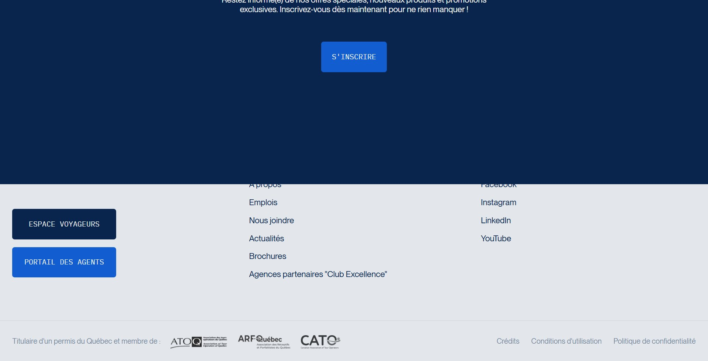
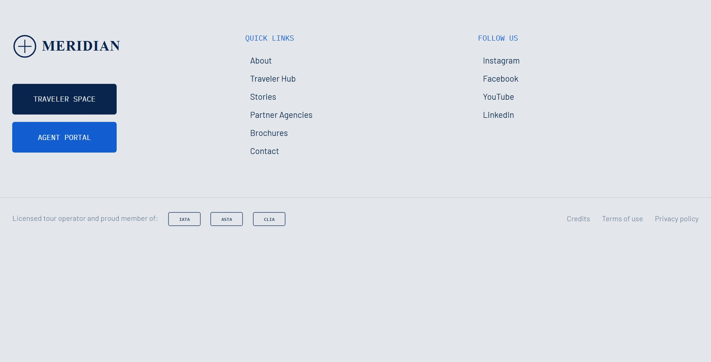
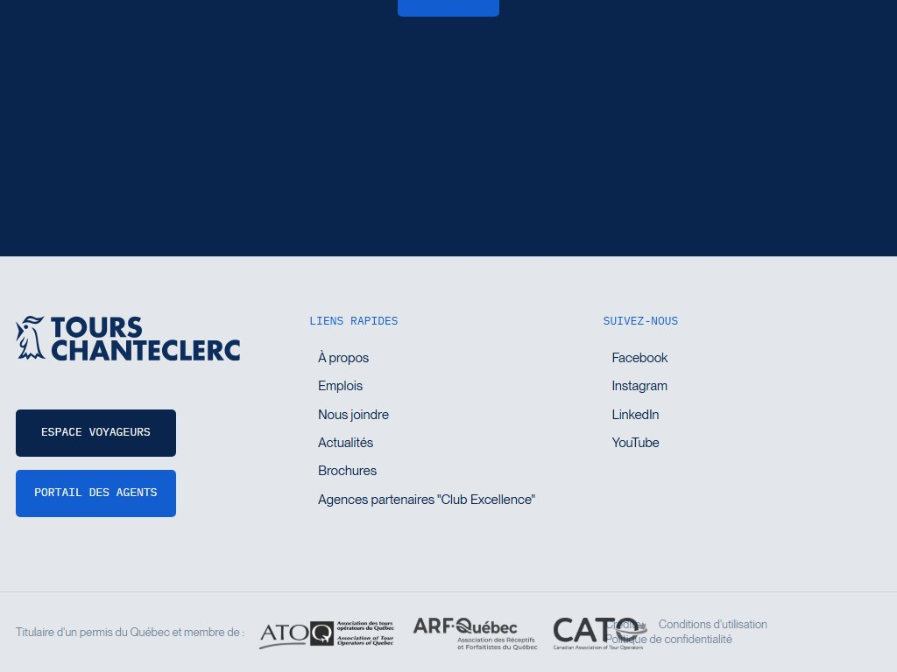
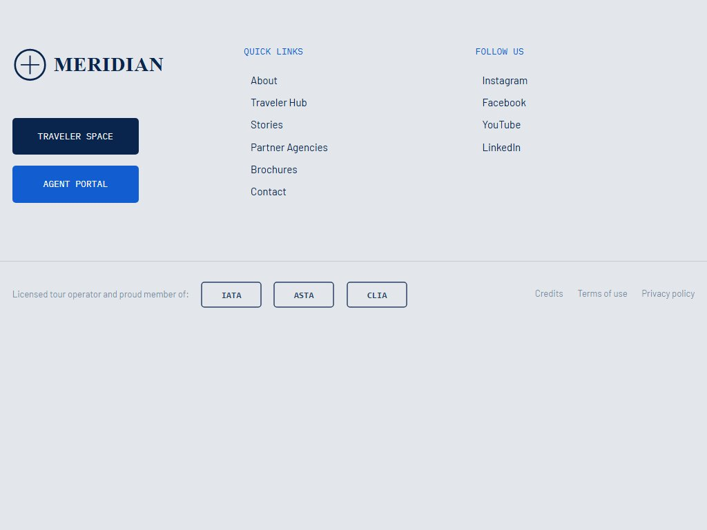

# Fidelity Report: editorial-columns-footer

Sumber: `travel-services/tours-chanteclerc-nextjs` (`.footer` pada `localhost:3001/`)
Ekstrak: `registry/sections/editorial-columns-footer` (`http://localhost:3005/preview/section/editorial-columns-footer?style=azure-editorial`)
Keadaan: footer 4 kolom dengan emblem merek, 2 tombol CTA stacked, 2 daftar tautan bertipe roll-hover, baris akreditasi mitra, dan bar legal bawah.

## Hasil `npm run fidelity:all`

- 1920x980: 7 elemen (`footer`, `top`, `logo`, `primaryCta`, `secondaryCta`, `quickLinksCol`, `bottomBar`), **0 FAIL**, 21 WARN
- 1024x768: 7 elemen (`footer`, `top`, `logo`, `primaryCta`, `secondaryCta`, `quickLinksCol`, `bottomBar`), **0 FAIL**, 21 WARN

## Screenshot berdampingan

| Viewport | Asli | Ekstrak |
| --- | --- | --- |
| 1920x980 |  |  |
| 1024x768 |  |  |

## Beda yang disengaja (WARN)

- **Font body**: `PP Neue Montreal` dipetakan ke `--rk-font-body` (`Barlow`).
- **Brand, lencana asosiasi, & tautan legal**: logo Tours Chanteclerc dan lencana ACTA/OPC diganti emblem generik `MERIDIAN` serta chip akreditasi netral (`IATA`, `ASTA`, `CLIA`), dengan tautan menu netral berbahasa Inggris.
- **Composes UI**: dua CTA footer kiri atas memanggil atom `rolling-cta-button`.
