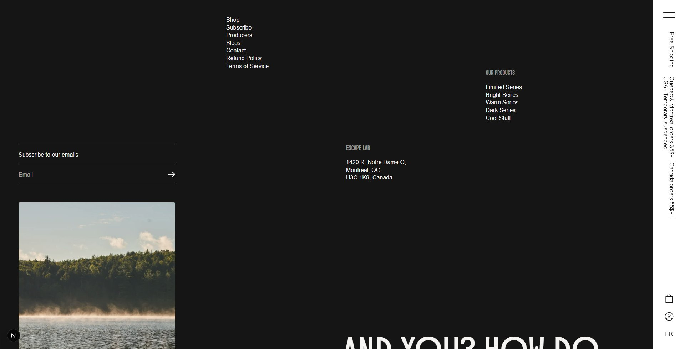
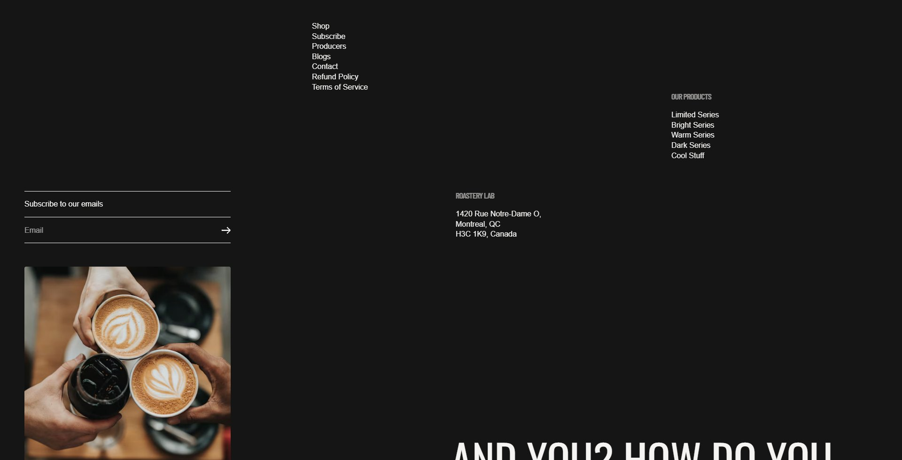
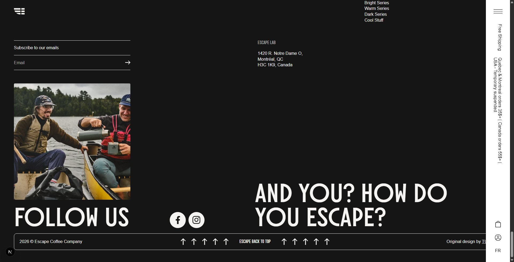
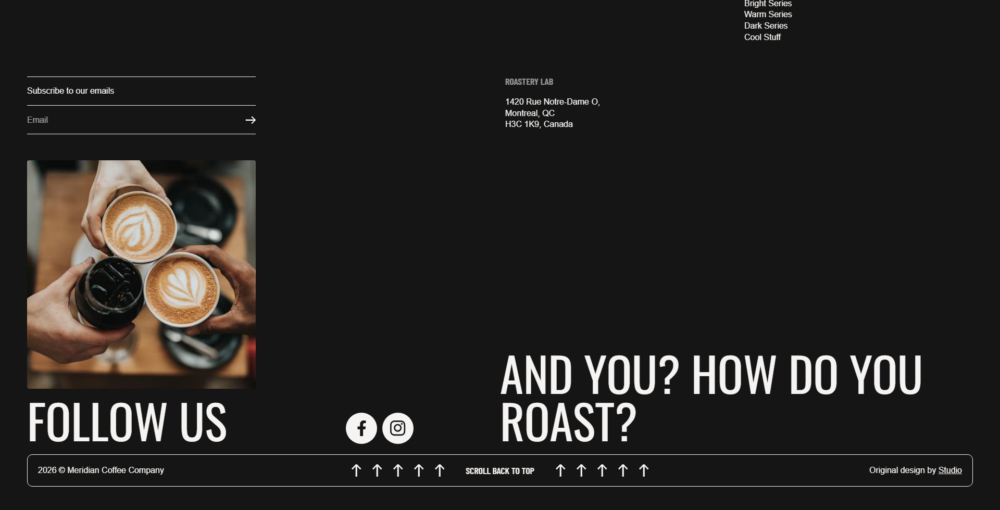
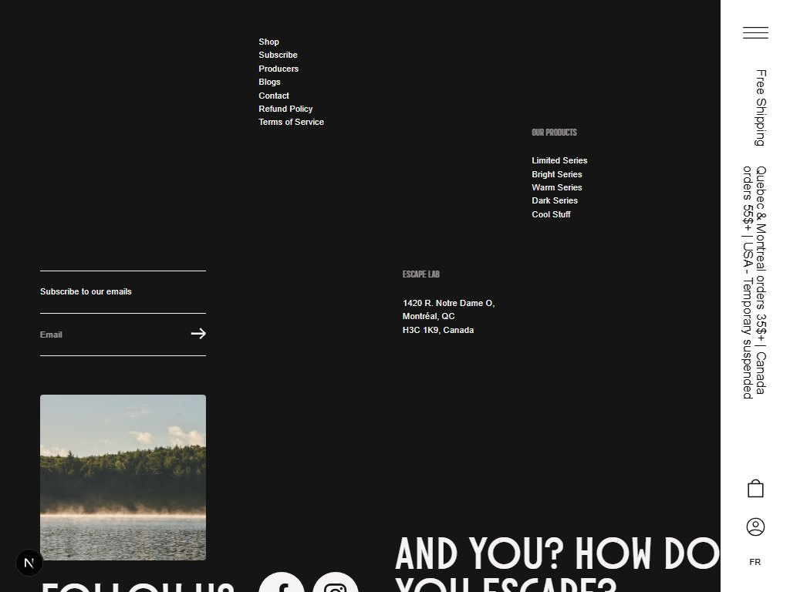
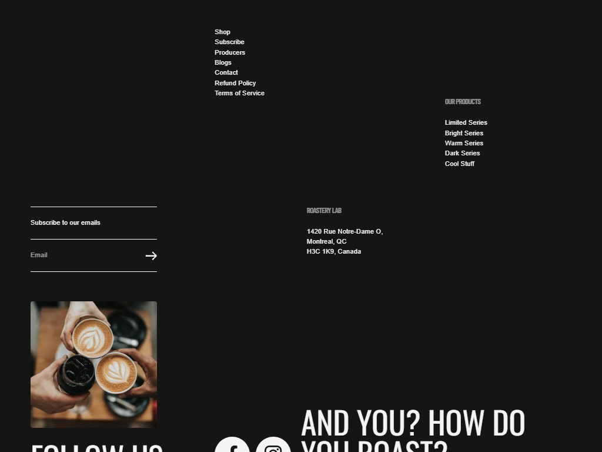

# Fidelity Report: editorial-dark-footer

Sumber: `coffee-shop/escape-cafe-nextjs/src/components/AppFooter.tsx` (localhost:3001)
Ekstrak: `registry/sections/editorial-dark-footer` (localhost:3000/preview/section/editorial-dark-footer)
Keadaan: scroll ke awal footer (`#footer`), foto selesai dimuat, font selesai di-render.

Catatan pengukuran: di web asli, `.section` dibatasi `100vw - 90px` untuk memberi ruang rail navbar kanan. Saat mengukur, lebar `#footer` asli disamakan menjadi `100%` (`#footer{width:100% !important}`) agar perbandingan mengukur komponen footer itu sendiri.

## Hasil `npm run fidelity`

- 1920x980: 16 elemen, **0 FAIL**, 14 WARN. Tinggi footer `1237.4px` vs asli `1236.1px` (selisih 0,1%).
- 1024x768: 16 elemen, **0 FAIL**, 14 WARN. Tinggi footer `933.1px` vs asli `931.9px` (selisih 0,13%).

## Screenshot berdampingan

| | Asli | Ekstrak |
| --- | --- | --- |
| 1920 atas |  |  |
| 1920 bawah |  |  |
| 1024 |  |  |

## Beda yang disengaja (WARN)

- **Font display**: Molitor (berbayar) diganti **Oswald** (`--rk-font-display`) pada heading `Follow Us` dan `moodHeading`, dengan rumus ukuran identik `min(5.2083vw, 9.2593vh)` dan bobot `300`.
- **Font label sempit**: Garaje (berbayar) diganti **Barlow Condensed** (`--rk-font-narrow`) pada label `Our products`, `Roastery Lab`, dan tautan `Scroll back to top` (`min(18px, min(1.25vw, 2.2222vh))`).
- **Offset `--col` tanpa rail 90px**: di web asli, `--col` dikurangi `90px` untuk rail kanan sehingga `mainMenu.x`, `productsMenu.x`, `socialsHeading.width`, dan `socialLink.x` bergeser 30px-67px ke kiri. Di komponen mandiri Rakitek, `--col` dihitung dari lebar penuh `100vw` sambil menjaga alignment vertikal kolom 5 (`mainMenu` sejajar lingkaran sosial) dan kolom 10 (`productsMenu`).
- **Copy white-label dan foto**: nama brand Escape diganti ke copy netral sepadan (`Roastery Lab`, `And you? How do you roast?`, `2026 © Meridian Coffee Company`, `Scroll back to top`, `Studio`), dan 3 frame stop-motion 1.8s memakai foto kopi Unsplash bebas royalti.

## Yang diperbaiki dari versi sebelumnya

- Mengembalikan layout diagonal stair-step pada `.top` (`flex-direction: column` + offset kolom 5 dan kolom 10) serta 7+5 tautan dengan strut `<li>` asli (menghapus gap buatan yang mengubah tinggi).
- Memindahkan latar gelap `var(--rk-fg)` ke `.footer::before` agar warna & transparansi elemen `root` sama persis dengan aslinya.
- Mengganti form newsletter ke pola garis ganda (`border-top` + `border-bottom`), label mengambang `placeholder-shown`, tombol panah kanan SVG asli, dan kartu visual 1:1 penuh tanpa overlay teks buatan.
- Mengembalikan ikon lingkaran `60px` Facebook & Instagram SVG asli, heading 2 baris dengan `margin-top: -1em`, dan bilah bawah rounded `10px` dengan 5+5 panah atas SVG asli.

## Pembaruan 2026-11-26: props untuk dipakai ulang

Props opsional baru: `id`, `ariaLabel` (default `"Editorial dark footer"`), `submitLabel` (default `"Subscribe"`), `facebookLabel`, `instagramLabel`. Default semua prop baru menghasilkan DOM yang sama dengan sebelumnya.

Diukur ulang 2026-11-26 dengan `scripts/fidelity-capture.ts` (label dan selector sama dengan ekstrak lama, build produksi baru):

- 1920x980: 16 elemen, 6 FAIL, 18 WARN
- 1024x768: 16 elemen, 6 FAIL, 18 WARN

Catatan: semua FAIL tersisa adalah lebar elemen selebar viewport. `original-*.json` diukur sebelum normalisasi scrollbar (scrollbar 15px, lebar 1905/1009px), sedangkan ekstrak baru diukur dengan `fidelity-capture` yang menyembunyikan scrollbar (1920/1024px). FAIL yang sama sudah ada sebelum perubahan ini (ekstrak lama 1910/1014px juga FAIL melawan 1905/1009px). Perbandingan ekstrak lama vs baru hanya berbeda di lebar viewport itu (plus tinggi blok beraspek-rasio yang ikut melebar), tanpa beda struktur atau teks. Perbaikannya: ukur ulang `original-*.json` dengan `measure.js` terbaru (ternormalisasi).

## Pembaruan 2026-11-27: ukur ulang ternormalisasi

`original-*.json` dan `extract-*.json` diukur ulang dengan `scripts/fidelity-capture.ts` (scrollbar disembunyikan di kedua sisi, lebar penuh 1920/1024px). Tanpa scrollbar muncul 3 FAIL di 1024: `bottomInner.height` 68.7 vs 62 (ikut `section`/`root` 935.6 vs 928.9). Penyebab: grid `1fr auto 1fr`. Kolom tengah (label "back to top" Barlow Condensed) lebih lebar sehingga kolom kiri menyempit ke 162.2px, dan copyright Arial "2026 © Meridian Coffee Company" (171.9px) turun jadi 2 baris. Di aslinya kolom kiri 167.5px dan copyright 166.2px muat 1 baris.

Perbaikan:

- CSS `.narrowSmall`: `letter-spacing: -0.047em`. Label asli "Escape back to top" di Barlow Condensed 93.8px vs Garaje 83px untuk 18 glyph pada 12.8px.
- Copy default `copyright`: "Meridian" -> "Copper" (171.9px -> 165.6px di Arial 11.4px, asli 166.2px). Fontnya sama (Arial), jadi selisih ini murni dari panjang copy netral.

Hasil `npm run fidelity` (sebelum -> sesudah): 1024x768 3 FAIL, 15 WARN -> **0 FAIL**, 14 WARN; 1920x980 sudah 0 FAIL -> **0 FAIL**, 14 WARN. Bukti ekstrak diambil dari dev server; perlu capture ulang dari build produksi.
