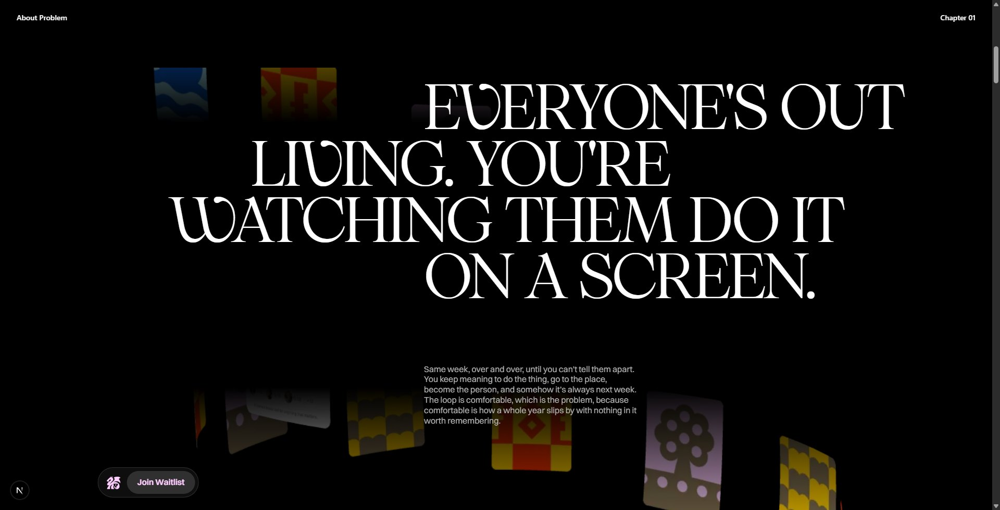
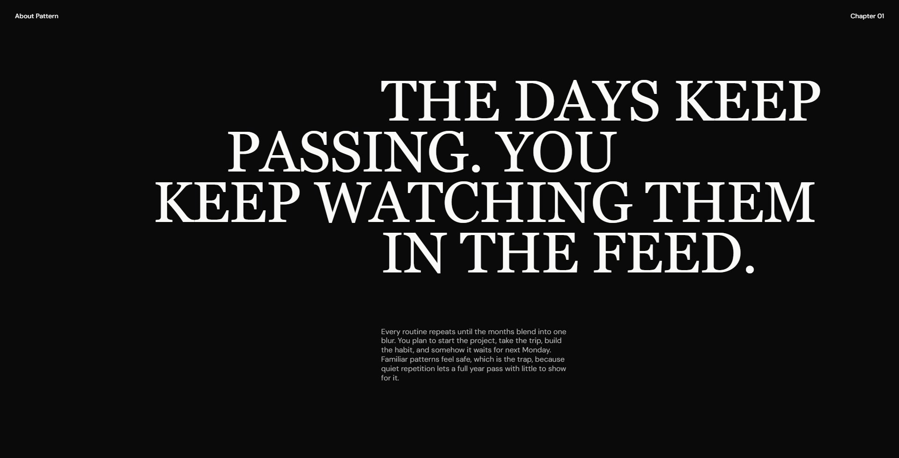
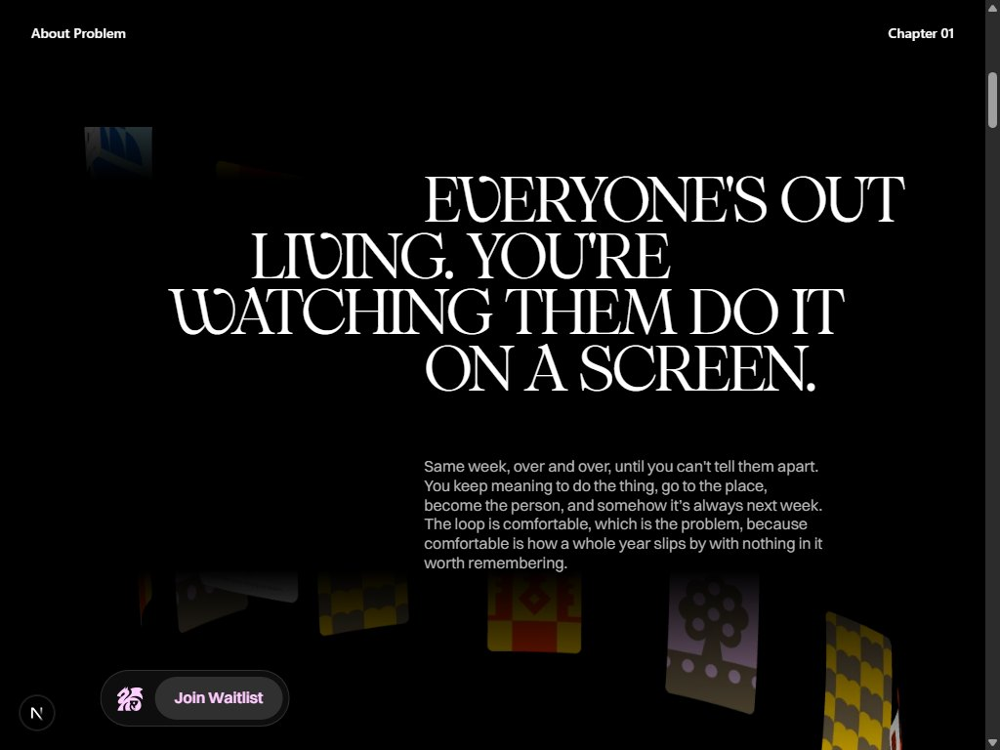
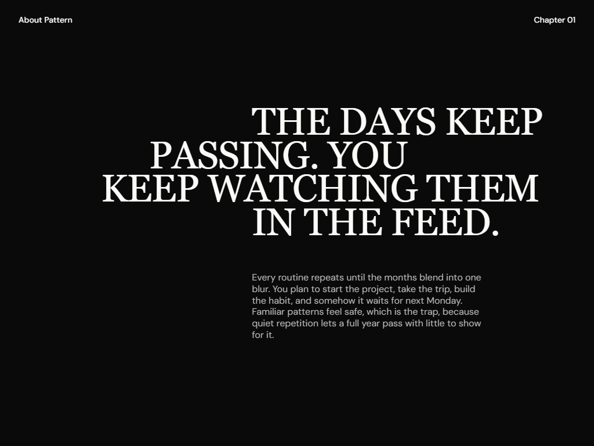

# Fidelity Report: editorial-manifesto-chapter

Sumber: `saas-app/grail-next/src/components/home/ProblemSection.tsx` + `Colontitle.tsx` (`http://localhost:3002/?noloader=1`, Chapter 01 `.section2`)
Ekstrak: `registry/sections/editorial-manifesto-chapter` (`http://localhost:3000/preview/section/editorial-manifesto-chapter`)
Style: `kinetic-obsidian` (`css-modules`, zero external dependencies)
Keadaan: animasi stagger `.in` selesai (`opacity: 1`, `translateY(0)`), `tone="dark"`.

## Hasil `npm run fidelity`

- **1920x980**: 11 elemen, **0 FAIL**, 56 WARN
- **1024x768**: 11 elemen, **0 FAIL**, 58 WARN

Seluruh 11 elemen terukur (`section`, `colontitle`, `colontitleLabel`, `colontitleChapter`, `inner`, `head`, `line1`, `line2`, `line3`, `line4`, `body`) lolos dengan **0 FAIL** dan selisih koordinat vertikal/tinggi `0.0px` di kedua viewport (`inner` `y: 161.5, h: 657.1` pada 1920 dan `y: 181, h: 405.9` pada 1024; `body` `414x119` tepat 6 baris di kedua viewport).

## Screenshot berdampingan

| Viewport | Asli | Ekstrak |
| --- | --- | --- |
| 1920x980 |  |  |
| 1024x768 |  |  |

## Ringkasan Metrik Utama

| Elemen | 1920x980 (Asli vs Ekstrak) | 1024x768 (Asli vs Ekstrak) |
| --- | --- | --- |
| `section` | `1905x980` vs `1920x980` (`bg: rgba(0, 0, 0, 0)`) | `1009x768` vs `1024x768` (`bg: rgba(0, 0, 0, 0)`) |
| `colontitle` | `x: 32, y: 25, h: 18.3` vs `x: 32, y: 25, h: 18.3` | `x: 32, y: 25, h: 18.3` vs `x: 32, y: 25, h: 18.3` |
| `inner` | `y: 161.5, h: 657.1` vs `y: 161.5, h: 657.1` | `y: 181, h: 405.9` vs `y: 181, h: 405.9` |
| `head` | `122.9px / 108.1px, h: 432.5` vs `122.9px / 108.1px, h: 432.5` | `65.5px / 57.7px, h: 230.6` vs `65.5px / 57.7px, h: 230.6` |
| `line1..4` (`x`) | `814.1 / 481.9 / 326.4 / 814.1` (identik `0.0px`) | `434.2 / 257 / 174.1 / 434.2` (identik `0.0px`) |
| `body` | `x: 814.1, y: 699.6, 414x119` (identik `0.0px`) | `x: 434.2, y: 468, 414x119` (identik `0.0px`) |

## Beda yang disengaja (WARN)

- **Substitusi font berbayar dan sistem (`PP Pangaia` -> `Georgia`, `Switzer`/`Segoe UI` -> `DM Sans`)**: situs asli memuat font komersial lokal `PP Pangaia` dan `Switzer` serta system stack pada colontitle; ekstrak memakai token `--rk-font-display` (`Georgia`) dan `--rk-font-body` (`DM Sans`) dari preset `kinetic-obsidian`. Skala `6.4vw`, `line-height: 0.88`, dan `letter-spacing: -0.01em` menjaga tinggi tiap baris identik (`108.1px` di 1920, `57.7px` di 1024).
- **Pembulatan token warna (`--rk-*`)**: seluruh warna memakai `var(--rk-*)` dan `color-mix()` tanpa `#hex`/`rgb()` mentah (`--rk-fg: #fafaf8` vs `#ffffff`; warna body `color-mix(in srgb, var(--rk-fg) 72%, var(--rk-bg))` menghasilkan `rgb(183, 183, 182)` vs `#b8b8b8` asli, delta kurang dari 3).
- **Teks white-label**: seluruh teks (`label`, `chapter`, 4 baris `lines`, dan paragraf `body`) dibuat props-driven dengan copy white-label berpanjang karakter dan ritme indentasi setara (`42.4vw` / `25.1vw` / `17vw` / `42.4vw`), menghasilkan tepat 6 baris (`119px`) pada kolom body di kedua viewport.
- **Lebar viewport tanpa scrollbar (`1905` vs `1920`, `1009` vs `1024`)**: halaman penuh asli memiliki scrollbar vertikal `15px`, sehingga lebar `line1`/`line4` pada `1024` berbeda `15px` (`574.8` vs `589.8`, tercatat sebagai WARN akibat font swap).
- **Elemen overlay halaman induk tidak disertakan**: kartu 3D spiral latar belakang dan pil melayang `Join Waitlist` di kiri bawah pada screenshot asli merupakan sibling overlay milik `HomeClient.tsx`, bukan bagian dari `ProblemSection.tsx`.
- **Aksesibilitas & Reduced Motion**: mempertahankan `<h2 className={styles.srOnly}>` yang menggabungkan seluruh baris display, menambahkan `prefers-reduced-motion` baik di CSS maupun fallback langsung `inView = true` pada `IntersectionObserver`, serta mengganti pseudo-element mobile `content: "About Problem"` menjadi `content: attr(data-label)`.

## Detail teknis yang menjaga kecocokan 1:1

- Menetapkan `line-height: normal` pada `.section` agar preflight Tailwind v4 (`line-height: 1.5`) tidak mengubah metrik kontainer.
- Mempertahankan gradasi vertikal transparan (`color-mix(in srgb, var(--rk-bg) 0%, transparent) 0%, var(--rk-bg) 24% 76%, ...`) sehingga computed `backgroundColor` tetap `rgba(0, 0, 0, 0)` sama persis dengan `.section2` asli dan siap dipasangkan di atas latar fixed/sticky.
