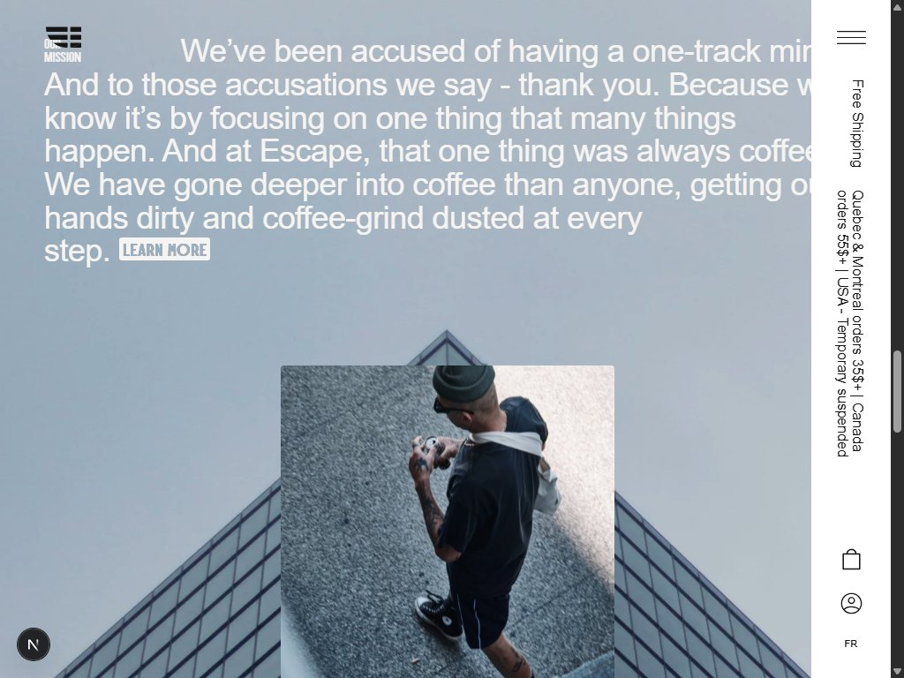
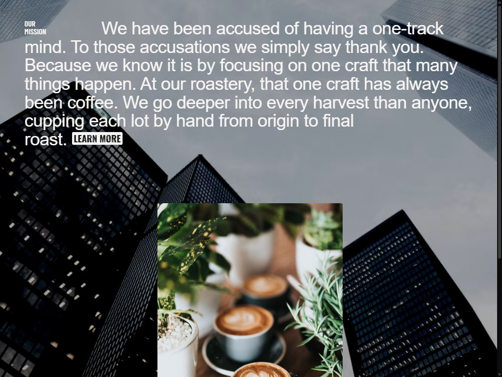

# Fidelity Report: editorial-mission-split

Sumber: `coffee-shop/escape-cafe-nextjs/src/components/HomeMission.tsx` (localhost:3001)
Ekstrak: `registry/sections/editorial-mission-split` (localhost:3000/preview/section/editorial-mission-split)
Keadaan: scroll ke bagian atas section, animasi reveal GSAP selesai.

Catatan pengukuran: di web asli, `.section` dibatasi `100vw - 90px` untuk rail navbar kanan, jadi saat mengukur lebar `#mission` asli disamakan menjadi `100%`.

## Hasil `npm run fidelity`

- 1920x980: 11 elemen, **0 FAIL**, 20 WARN. Tinggi section `1872.1px` sama persis dengan aslinya (`1872.1px`), `manifest` `384.8px` vs `384.8px`, `frontImg` `710.4 x 887px` vs `710.4 x 887px`.
- 1024x768: 11 elemen, **0 FAIL**, 21 WARN. Tinggi section `1109px` sama persis dengan aslinya (`1109px`), `manifest` `263.8px` vs `263.8px`, `frontImg` `378.9 x 473.1px` vs `378.9 x 473.1px`.

## Screenshot berdampingan

| Viewport | Asli | Ekstrak |
| --- | --- | --- |
| 1920x980 |  |  |
| 1024x768 |  |  |

## Beda yang disengaja (WARN)

- **Font tombol**: Molitor (berbayar) diganti **Oswald** (`--rk-font-display`).
- **Font label sempit** (`tagline`, `topCaption`, `bottomCaption`, `coordinates`): Garaje (berbayar) diganti **Barlow Condensed** (`--rk-font-narrow`), sehingga lebar teks berbeda beberapa piksel sementara tinggi dan perataan tetap identik.
- **Teks & foto white-label**: copy dan koordinat diganti ke teks netral roastery dengan jumlah baris identik (6 baris di 1920, 7 baris di 1024), dan foto brand diganti foto Unsplash arsitektur slate-gelap + foto specialty coffee.
- **Hitam tombol**: `#000` asli -> token `--rk-fg` (`#151515`).
