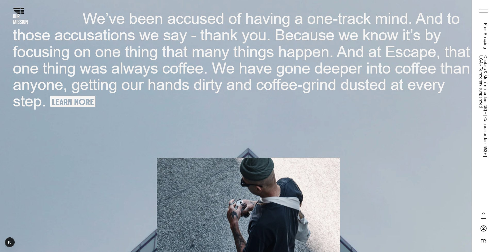
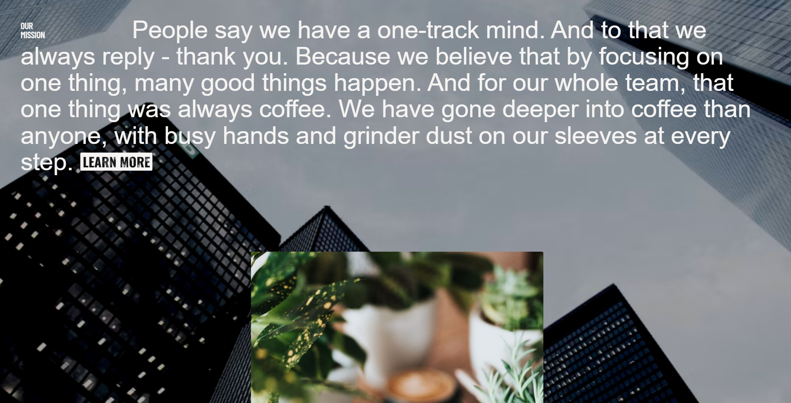

# Fidelity Report: editorial-mission-split

Sumber: `coffee-shop/escape-cafe-nextjs/src/components/HomeMission.tsx` (localhost:3001)
Ekstrak: `registry/sections/editorial-mission-split` (localhost:3000/preview/section/editorial-mission-split)
Keadaan: scroll ke bagian atas section, animasi reveal GSAP selesai.

Catatan pengukuran: di web asli, `.section` dibatasi `100vw - 90px` untuk rail navbar kanan, jadi saat mengukur lebar `#mission` asli disamakan menjadi `100%`.

## Hasil `npm run fidelity`

- 1920x980: 11 elemen, **0 FAIL**, 20 WARN. Tinggi section `1872.1px` sama persis dengan aslinya (`1872.1px`), `manifest` `384.8px` vs `384.8px`, `frontImg` `710.4 x 887px` vs `710.4 x 887px`.
- 1024x768: 11 elemen, **0 FAIL**, 21 WARN. Tinggi section `1109px` sama persis dengan aslinya (`1109px`), `manifest` `263.8px` vs `263.8px`, `frontImg` `378.9 x 473.1px` vs `378.9 x 473.1px`.

## Screenshot berdampingan

| Viewport | Asli | Ekstrak |
| --- | --- | --- |
| 1920x980 |  |  |
| 1024x768 |  |  |

## Beda yang disengaja (WARN)

- **Font tombol**: Molitor (berbayar) diganti **Oswald** (`--rk-font-display`).
- **Font label sempit** (`tagline`, `topCaption`, `bottomCaption`, `coordinates`): Garaje (berbayar) diganti **Barlow Condensed** (`--rk-font-narrow`), sehingga lebar teks berbeda beberapa piksel sementara tinggi dan perataan tetap identik.
- **Teks & foto white-label**: copy dan koordinat diganti ke teks netral roastery dengan jumlah baris identik (6 baris di 1920, 7 baris di 1024), dan foto brand diganti foto Unsplash arsitektur slate-gelap + foto specialty coffee.
- **Hitam tombol**: `#000` asli -> token `--rk-fg` (`#151515`).

## Pembaruan 2026-11-26: props untuk dipakai ulang

Props opsional baru: `id` dan `ariaLabel` (default `"Editorial mission split"`) pada `<section>`. CTA kini hanya `preventDefault()` jika pemanggil memberi `onCtaClick` sendiri (tanpa handler, link `#anchor` bernavigasi normal). Default semua prop baru menghasilkan DOM yang sama dengan sebelumnya.

Diukur ulang 2026-11-26 dengan `scripts/fidelity-capture.ts` (label dan selector sama dengan ekstrak lama, build produksi baru):

- 1920x980: 11 elemen, 5 FAIL, 26 WARN
- 1024x768: 11 elemen, 5 FAIL, 27 WARN

Catatan: semua FAIL tersisa adalah lebar elemen selebar viewport. `original-*.json` diukur sebelum normalisasi scrollbar (scrollbar 15px, lebar 1905/1009px), sedangkan ekstrak baru diukur dengan `fidelity-capture` yang menyembunyikan scrollbar (1920/1024px). FAIL yang sama sudah ada sebelum perubahan ini (ekstrak lama 1910/1014px juga FAIL melawan 1905/1009px). Perbandingan ekstrak lama vs baru hanya berbeda di lebar viewport itu (plus tinggi blok beraspek-rasio yang ikut melebar), tanpa beda struktur atau teks. Perbaikannya: ukur ulang `original-*.json` dengan `measure.js` terbaru (ternormalisasi).

Pengecualian: `text.width` (1920: 1773.3 vs 1746.6, 1024: 906.3 vs 913.2) juga FAIL di ekstrak lama dengan angka yang sama persis, jadi bukan akibat perubahan ini.

## Pembaruan 2026-11-27: ukur ulang ternormalisasi

`original-*.json` dan `extract-*.json` diukur ulang dengan `scripts/fidelity-capture.ts` (scrollbar disembunyikan di kedua sisi, lebar penuh 1920/1024px). Tanpa scrollbar muncul FAIL: 1920 `text.width` 1746.6 vs 1773.3 (1 FAIL); 1024 `text` 7 baris vs 6 (266.1 vs 228.4), ikut `manifest`/`section`/`root` (5 FAIL).

Penyebab: font `text` sama di kedua sisi (Arial, karena TWK Lausanne tidak dimuat), jadi selisihnya dari copy white-label dan lebar `tagline`. `text` adalah inline: baris pertamanya mulai setelah `tagline` (inline-block + 11vw), dan `text.width` = ujung baris terpanjang, jadi bergantung pada titik putus baris copy.

Perbaikan:

- CSS `.tagline`: `letter-spacing: -0.021em` (Barlow Condensed "Mission" 62.2 vs 59px di 22px dan 44.2 vs 41.9px di 15.6px). Lebar tagline kini 59/41.9px seperti aslinya, jadi baris pertama mulai di x yang sama.
- CSS `.topCaption`/`.bottomCaption`: `letter-spacing: -0.033em` (kotak caption 161.5 vs 147.4px dan 153.3 vs 140.4px untuk 19/18 glyph). Hanya mengurangi WARN lebar, tidak memengaruhi tata letak.
- Copy default `statement` (component + preview): copy netral lama (7 baris di 1024) diganti parafrase netral baru yang ditulis ulang, bukan kalimat asli brand ("People say we have a one-track mind. ... with busy hands and grinder dust on our sleeves at every step."). Kalimatnya dipilih dari 108 variasi yang diukur di browser: hanya yang patah barisnya sama dengan aslinya di 1024 (6 baris, lebar 919.1) dan 1920 (6 baris, lebar 1773.3) yang dipakai.

Hasil `npm run fidelity` (sebelum -> sesudah): 1920x980 1 FAIL, 21 WARN -> **0 FAIL**, 15 WARN; 1024x768 5 FAIL, 28 WARN -> **0 FAIL**, 16 WARN. Bukti ekstrak diambil dari dev server; perlu capture ulang dari build produksi.

Capture akhir dari build produksi setelah copy parafrase netral: 1920x980 11 elemen, **0 FAIL**, 19 WARN; 1024x768 11 elemen, **0 FAIL**, 23 WARN.
