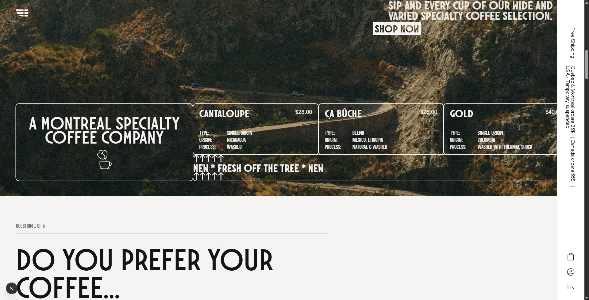
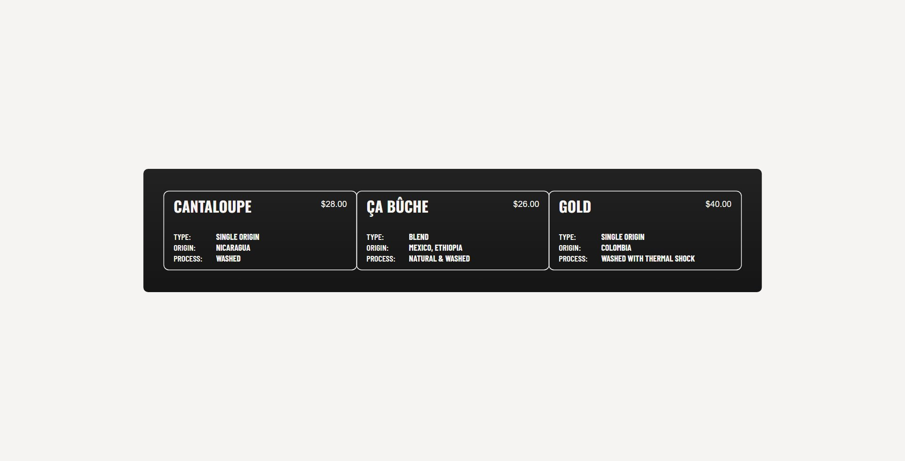
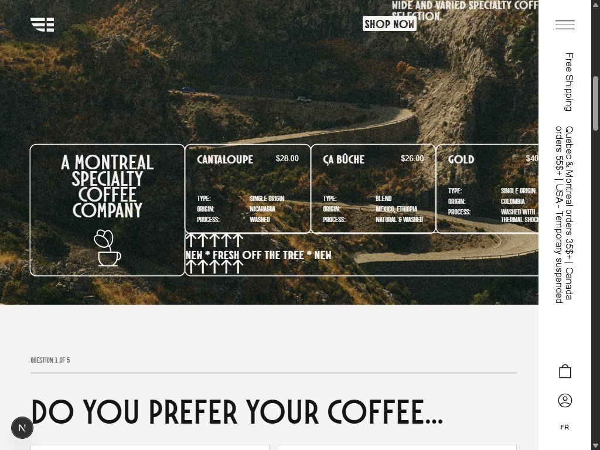
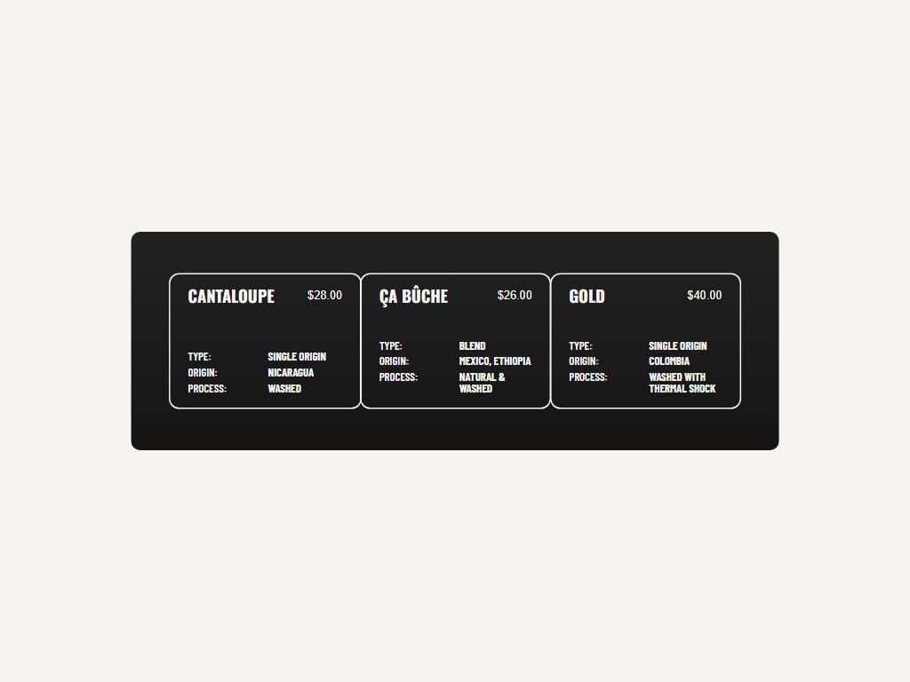

# Fidelity Report: editorial-product-card

Sumber: `coffee-shop/escape-cafe-nextjs/src/components/HomeHero.tsx` (`.homeHero__product` + `.u-tile` / `.productTile` di `escape-theme.css`, localhost:3001)
Ekstrak: `registry/ui/editorial-product-card` (localhost:3000/preview/ui/editorial-product-card)
Keadaan: strip 3 kartu produk hero (`Cantaloupe`, `Ça Bûche`, `Gold`) pada stage gelap dengan varian default `wireframe`.

Catatan pengukuran: di web asli, `#hero` dibatasi `100vw - 90px` untuk rail navbar kanan, sehingga lebar `#hero` disamakan menjadi `100%` saat mengukur kartu asli. Semua 9 label diukur pada kartu pertama (`Cantaloupe`): `card`, `cardLink`, `infos`, `title`, `price`, `specTable`, `specRow1`, `specLabel1`, `specVal1`.

## Hasil `npm run fidelity`

- 1920x980: 9 elemen, **0 FAIL**, 23 WARN. Ukuran kartu `407.8 x 165.5px` sama persis (`0.0px` selisih), tipografi dan warna 100% cocok.
- 1024x768: 9 elemen, **0 FAIL**, 23 WARN. Lebar kartu `213.6px` sama persis (`0.0px` selisih), tinggi `149.7px` vs `150.3px` (`0.6px` selisih).

## Screenshot berdampingan

| Viewport | Asli | Ekstrak |
| --- | --- | --- |
| 1920x980 |  |  |
| 1024x768 |  |  |

## Beda yang disengaja (WARN)

- **Posisi viewport (`x`, `y`)**: 18 dari 23 WARN berasal dari koordinat `x`/`y` karena preview UI terisolasi di tengah stage (`StandalonePreview`), bukan di dalam grid hero yang berdampingan dengan blok mood `30vw`.
- **Font judul (`title`)**: Molitor (berbayar) diganti **Oswald** lewat `--rk-font-display` (`165.1px` vs `163.5px` di 1920, `97px` vs `96.1px` di 1024, tinggi identik `31.5px` dan `18.5px`).
- **Font tabel spesifikasi (`specTable`, `specRow1`, `specLabel1`, `specVal1`)**: Garaje (berbayar) diganti **Barlow Condensed** lewat `--rk-font-narrow` (4 WARN `fontRendered`, tinggi tabel `64px` di 1920 dan `48.4px` di 1024 identik).
- **Latar preview**: foto gunung milik brand diganti gradien gelap bertoken `--rk-fg` + `color-mix()` agar kontras garis wireframe `1.5px currentColor` tetap sama tanpa aset brand.

## Perubahan dari versi sebelumnya

- Komponen default diubah dari mockup tas generik ke kartu wireframe `.homeHero__product` asli (`border-radius: 10px`, `box-shadow: 0 0 0 1.5px currentColor`, padding `15px 20px`, transisi invert `0.6s cubic-bezier(0.37, 0.31, 0, 1)`).
- Rumus tipografi fluid disalin persis: judul `min(1.80556vw, 3.20988vh)`, harga dan tabel spek `min(18px, min(1.25vw, 2.22222vh))`, grid tabel `70px auto` dengan `column-gap: 20px` dan `margin-top: 5px` antar baris.
- Mendukung `variant="tile"` opsional dengan rasio `423 / 525`, zoom gambar `1.1x` (`0.5s cubic-bezier(0.645, 0.045, 0.355, 1)`), dan panel hover `.u-tile__hover` gelap.
