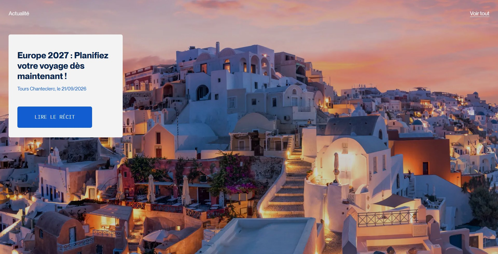
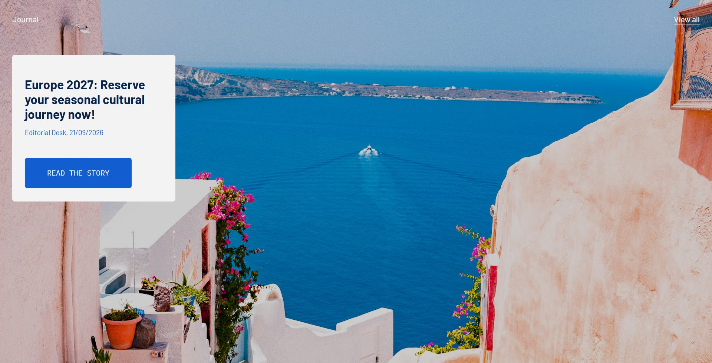
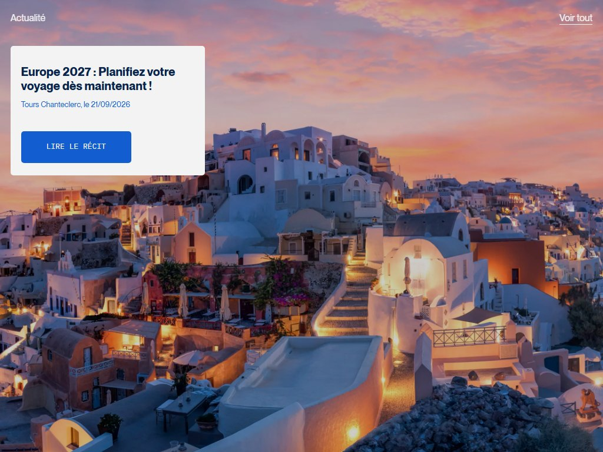
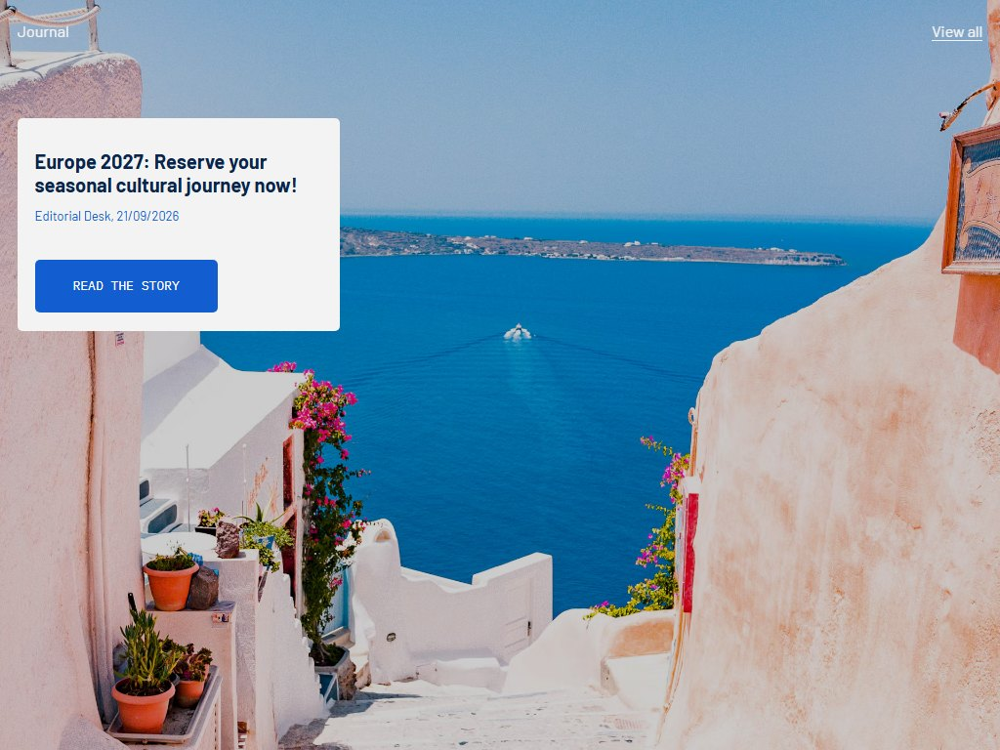

# Fidelity Report: editorial-spotlight-banner

Sumber: `travel-services/tours-chanteclerc-nextjs` (`article.article` full-viewport spotlight pada `localhost:3001/`)
Ekstrak: `registry/sections/editorial-spotlight-banner` (`http://localhost:3005/preview/section/editorial-spotlight-banner?style=azure-editorial`)
Keadaan: banner editorial penuh `1920x980` dan `1024x768` dengan label kategori, tautan kanan atas, dan kartu info mengambang di kiri.

## Hasil `npm run fidelity:all`

- 1920x980: 7 elemen (`banner`, `category`, `viewAll`, `card`, `title`, `author`, `cta`), **0 FAIL**, 22 WARN
- 1024x768: 7 elemen (`banner`, `category`, `viewAll`, `card`, `title`, `author`, `cta`), **0 FAIL**, 22 WARN

## Screenshot berdampingan

| Viewport | Asli | Ekstrak |
| --- | --- | --- |
| 1920x980 |  |  |
| 1024x768 |  |  |

## Beda yang disengaja (WARN)

- **Font body**: `PP Neue Montreal` dipetakan ke `Barlow` (`--rk-font-body`).
- **Copy & latar belakang**: artikel unggulan ("Actualite / Europe 2027") diganti salinan netral berbahasa Inggris ("Journal / Europe 2027: Reserve your seasonal cultural journey now!") dan fotografi Santorini berlisensi terbuka.
- **Composes UI**: tombol sekunder memakai atom `rolling-cta-button`.
