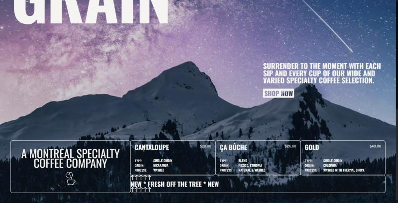

# Fidelity Report: editorial-storefront-hero

Sumber: `coffee-shop/escape-cafe-nextjs/src/components/HomeHero.tsx` (localhost:3001)
Ekstrak: `registry/sections/editorial-storefront-hero` (localhost:3005/preview/section/editorial-storefront-hero)
Keadaan: scroll paling atas, 3,5 detik setelah load (animasi masuk selesai).

Catatan pengukuran: di web asli, `.section` dibatasi `100vw - 90px` untuk memberi ruang rail navbar kanan. Itu aturan layout halaman, bukan aturan hero, jadi saat mengukur lebar section asli disamakan menjadi 100% (`#hero{width:100%}`).

## Hasil `npm run fidelity`

- 1920x980: 20 elemen, **0 FAIL**, 14 WARN. Tinggi hero 2120.3px, sama persis dengan aslinya.
- 1024x768: 20 elemen, **1 FAIL**, 28 WARN. Tinggi hero 1449.2px, sama persis dengan aslinya.

Satu-satunya FAIL: blok mood di 1024 lebih sempit 7px (262.7 vs 255.3, selisih 2,8%). Blok mood memakai `width: 30vw` yang ikut menyusut mengikuti ruang minimum kartu produk di sebelahnya. Ruang minimum itu bergantung pada lebar huruf font, dan Barlow Condensed tidak sama persis dengan Garaje. Ini hanya bisa hilang dengan font asli (berbayar).

## Screenshot berdampingan

| | Asli | Ekstrak |
| --- | --- | --- |
| 1920 atas |  |  |
| 1920 bawah |  |  |
| 1024 atas |  |  |

## Beda yang disengaja (WARN)

- **Font display**: Molitor (berbayar) diganti **Oswald**, font gratis yang lebarnya paling mendekati (CANTALOUPE 97 vs 96.1px). Bentuk hurufnya tetap berbeda karena Molitor bergaya art-deco.
- **Font label sempit** (tabel spesifikasi): Garaje diganti Barlow Condensed lewat token baru `--rk-font-narrow`.
- **Foto latar**: foto gunung milik brand diganti foto Unsplash (gunung malam) supaya tidak memakai aset brand. Komposisinya beda, tapi gelapnya mirip sehingga teks putih tetap terbaca.
- **Posisi X tombol Shop Now**: dihitung dari lebar hero (rata dengan kolom 9, sejajar deskripsi). Di aslinya dihitung dari `100vw - 90px`.
- **Hitam tombol**: `#000` asli → token `--rk-fg` `#151515`.

## Yang diperbaiki dari versi Gemini

- Ukuran judul memakai rumus asli `min(17.36vw, 31.48vh)` (sebelumnya `min(13.5vw, 22vh)`), jadi tinggi hero sama.
- Struktur kartu produk, tabel spesifikasi (grid 70px + auto), ticker panah, dan ikon mug dibuat persis seperti aslinya.
- Animasi asli dikembalikan: huruf judul masuk acak dari kiri/kanan/atas/bawah, foto mengecil dari 1.2 dan parallax, tombol di-pin lalu mengecil dari 1.3, deskripsi muncul saat di-scroll.
- Gemini menambahkan "(+1)" ke judul produk saat diklik. Ini tidak ada di aslinya, jadi diganti callback `onProductClick`.
- **Re-verifikasi 25 Nov (`letter-spacing: var(--rk-display-tracking)` pada `.desc`):** Menambahkan `-0.02em` pada `.desc` agar metrik font substitusi `Oswald` tidak menambah 1 baris ekstra saat hero dipasang pada lebar `1830px` (`calc(100vw - 90px)` di dalam template). Pengukuran ulang standalone mengonfirmasi `wrapper.height` (`2120.3px` @ 1920, `1449.2px` @ 1024) dan `desc.height` (`104px` @ 1920, `73.9px` @ 1024) tetap identik `0.0px` dengan aslinya (selisih lebar `1905` vs `1910` pada capture standalone murni berasal dari lebar scrollbar Chrome Windows `15px` vs `10px`).
