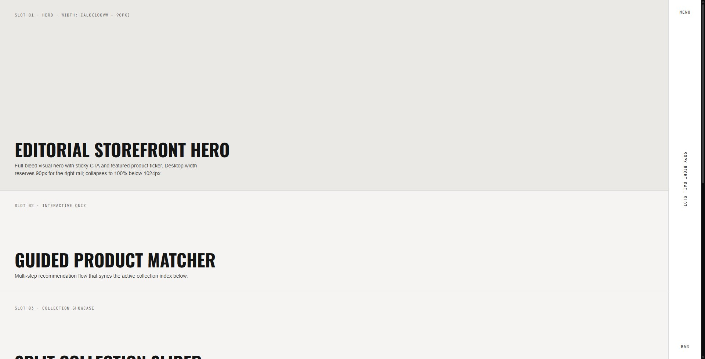
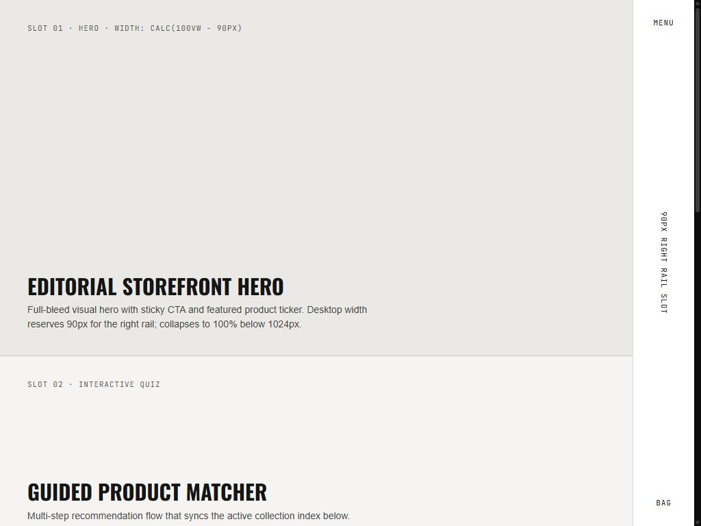
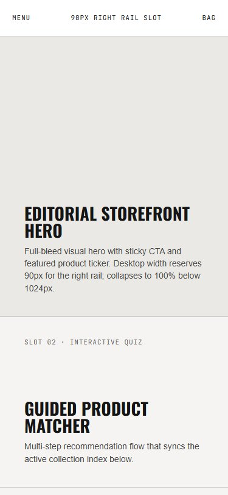

# Fidelity Report: editorial-storefront-template

Sumber: `coffee-shop/escape-cafe-nextjs` (aturan layout shell rail 90px pada `src/styles/escape-theme.css`: `width: calc(100% - 90px - (0px - (100vw - 100%)))` yang identik dengan `width: calc(100vw - 90px)`)
Ekstrak: `registry/templates/editorial-storefront-template` (`http://localhost:3000/preview/template/editorial-storefront-template`)
Style: `editorial-roastery` (`css-modules`, 100% token `--rk-*`, zero hardcoded `#hex`/`rgb()`)

## Verifikasi Geometri Shell (25 Nov, setelah perbaikan `calc(100vw - 90px)`)

| Viewport | `shell.width` | `rail` (`width x height`, `x`) | `content` (`calc(100vw - 90px)`) | Overlap / Overflow | Status |
| --- | :---: | :---: | :---: | :---: | :---: |
| `1920x980` | `1910px` | `90 x 980px` (`x: 1820`) | `1830px` (`x: 0`, `hero` & `footer` `1830px`) | `0` horizontal overflow (`overflow-x: clip`) | **PASS** |
| `1024x768` | `1014px` | `90 x 768px` (`x: 924`) | `934px` (`x: 0`, `hero` & `footer` `934px`) | `0` horizontal overflow (`overflow-x: clip`) | **PASS** |
| `375x812` | `375px` | `375 x 60px` (`x: 0`, top bar) | `375px` (`100%` collapse mobile) | `0` overlap / `0` overflow | **PASS** |

## Screenshot Shell Template

| Desktop `1920x980` | Laptop `1024x768` | Mobile `375x812` |
| --- | --- | --- |
|  |  |  |

## Catatan Arsitektur
- Aturan lebar konten desktop `width: calc(100vw - 90px)` (`@media (min-width: 1024px)`) berada di `.contentColumn` milik template, bukan di hero/section individual. Sebelumnya pemakaian `calc(100% - 90px)` mengurangi lebar konten 10px akibat lebar scrollbar (`1820px` vs asli `1830px`); setelah diperbaiki ke `calc(100vw - 90px)`, lebar konten tepat `1830px` (1920) dan `934px` (1024) persis seperti web asli.
- Menggunakan `overflow-x: clip` agar `position: sticky` di dalam slot hero/showcase tetap bekerja tanpa menimbulkan horizontal scrollbar.
