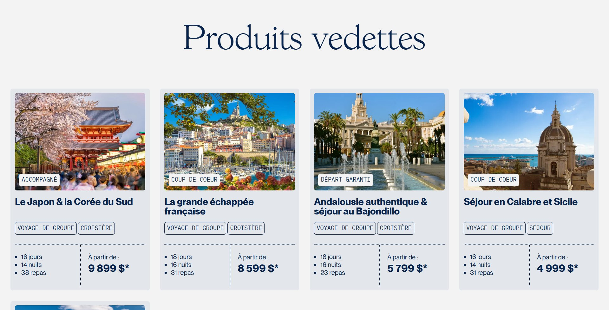
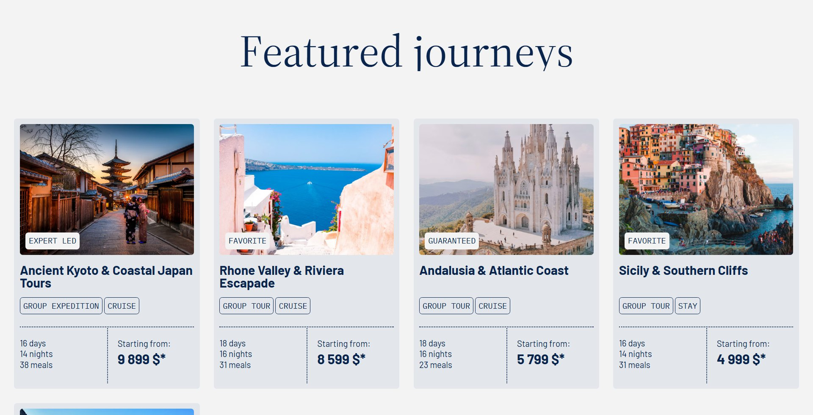
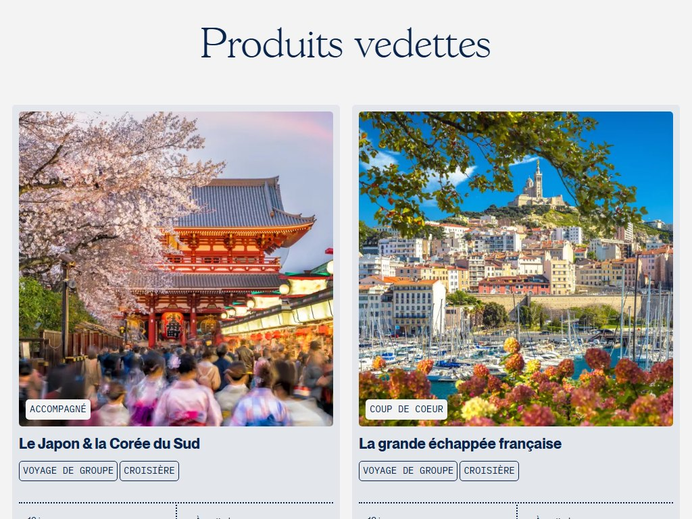
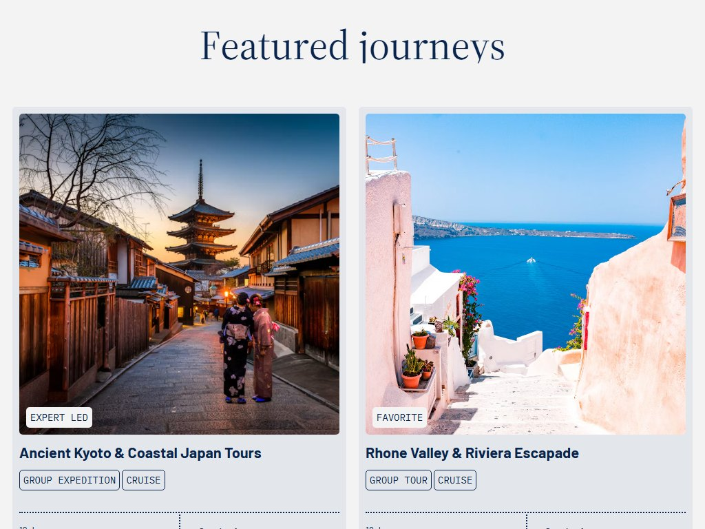

# Fidelity Report: featured-packages-grid

Sumber: `travel-services/tours-chanteclerc-nextjs` (`.productsList__inner` grid 4 kolom pada `localhost:3001/`)
Ekstrak: `registry/sections/featured-packages-grid` (`http://localhost:3005/preview/section/featured-packages-grid?style=azure-editorial`)
Keadaan: section grid produk unggulan 2 baris x 4 kolom pada `1920x980` dan `1024x768`.

## Hasil `npm run fidelity:all`

- 1920x980: 4 elemen (`section`, `heading`, `grid`, `firstCard`), **0 FAIL**, 8 WARN
- 1024x768: 4 elemen (`section`, `heading`, `grid`, `firstCard`), **0 FAIL**, 8 WARN

## Screenshot berdampingan

| Viewport | Asli | Ekstrak |
| --- | --- | --- |
| 1920x980 |  |  |
| 1024x768 |  |  |

## Beda yang disengaja (WARN)

- **Font display & body**: `Gascogne` -> `Source Serif 4` (`--rk-font-display`), `PP Neue Montreal` -> `Barlow` (`--rk-font-body`).
- **Sample grid items**: 8 kartu produk Prancis diganti 8 paket perjalanan putih-label berbasis komponen `voyage-package-card`.
