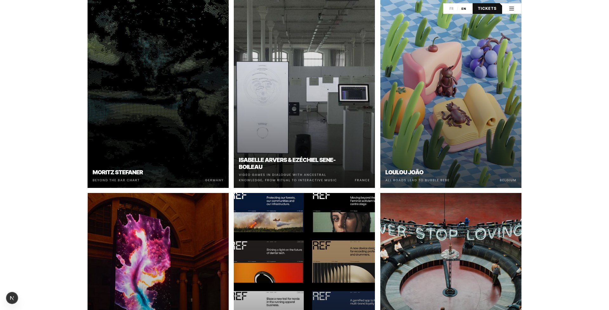
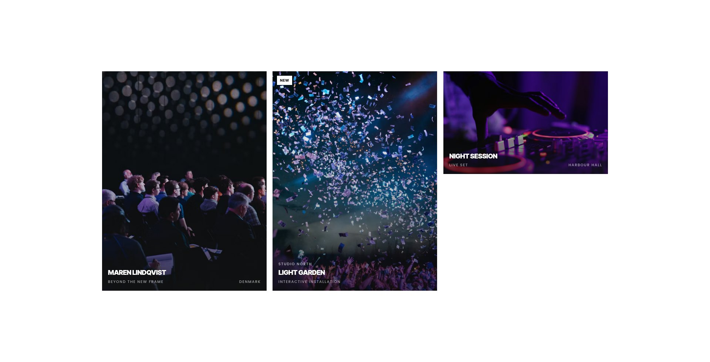
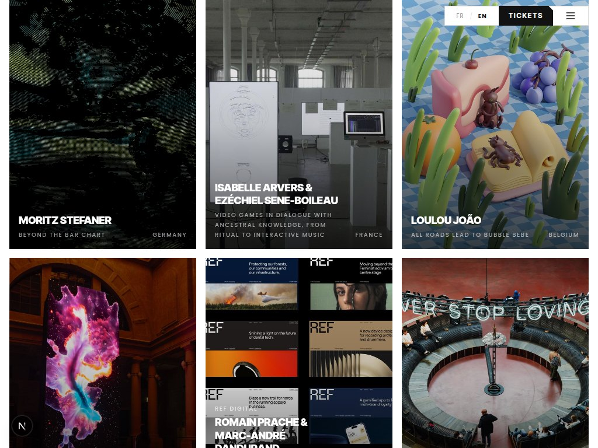
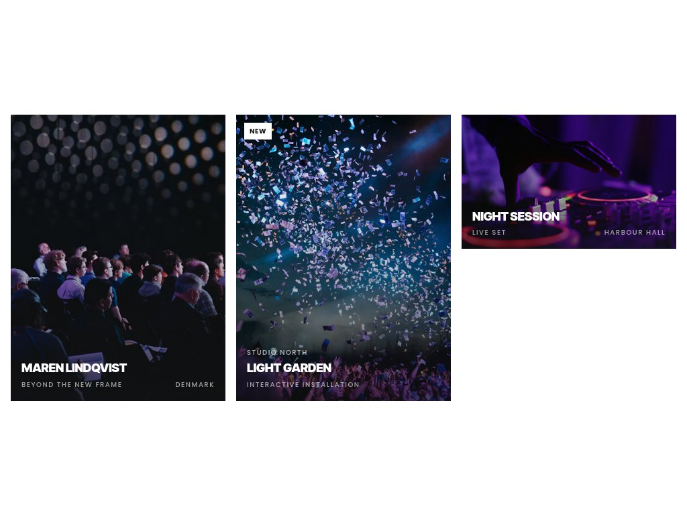

# Fidelity Report: `festival-card`

- **Kind / Level:** `ui` / `molecule`
- **Source:** `education-event/kikkfestival-be-nextjs` (`src/components/ui/FestivalCard.tsx`, `http://127.0.0.1:3011/`)
- **Extract:** `registry/ui/festival-card` (`http://127.0.0.1:3015/preview/ui/festival-card`)
- **Style:** `neon-brutalist` (`css-modules`, 100% `--rk-*` tokens)

## Results (`npm run fidelity`)

- `1920x980`: 7 elements (`card`, `link`, `media`, `caption`, `title`, `subtitle`, `location`), **0 FAIL**, 29 WARN.
- `1024x768`: 7 elements, **0 FAIL**, 29 WARN.

Note: `StandalonePreview`'s `max-w-5xl` and outer padding were unwrapped during extract capture so the 3-column grid matches the `1400px` (`1920`) / `1024px` (`1024`) container width (`445.3 x 593.8px` and `320 x 426.7px` cards).

## Side-by-Side Screenshots

| Viewport | Original (`127.0.0.1:3011/`) | Extract (`127.0.0.1:3015/preview/ui/festival-card`) |
| --- | --- | --- |
| `1920x980` |  |  |
| `1024x768` |  |  |

## Intentional Differences (WARN)

- **White-label sample copy & Unsplash photography:** Speaker/artist names, subtitles, locations, and photos are neutral white-label data (`Maren Lindqvist`, `Light garden`, `Night session`), while preserving exact card aspect ratio (`3:4` visual, `16:10` wide), notch hover, and 3D tilt.
- **Viewport `y` offset & sRGB `color-mix()`:** Preview vertically centers the 3-card row; `color-mix(in srgb, ...)` produces equivalent `color(srgb ...)` strings for caption subtitle/location opacity.
