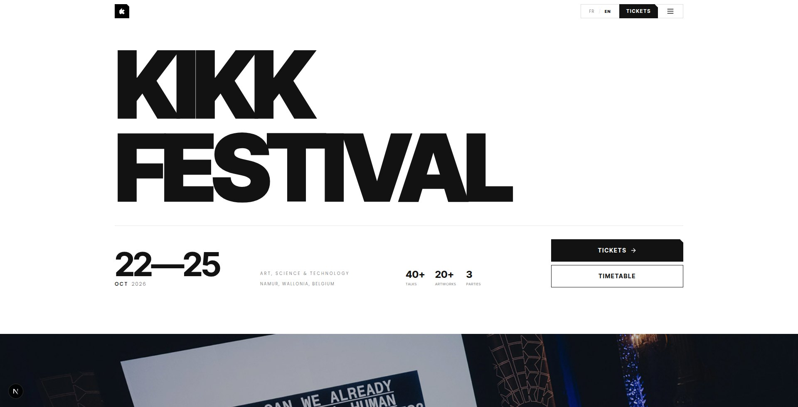
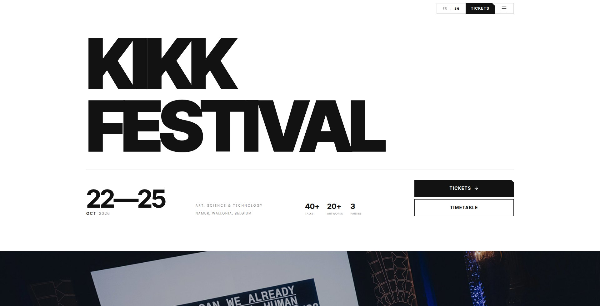
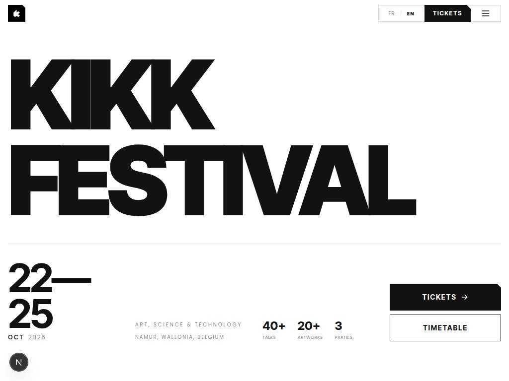
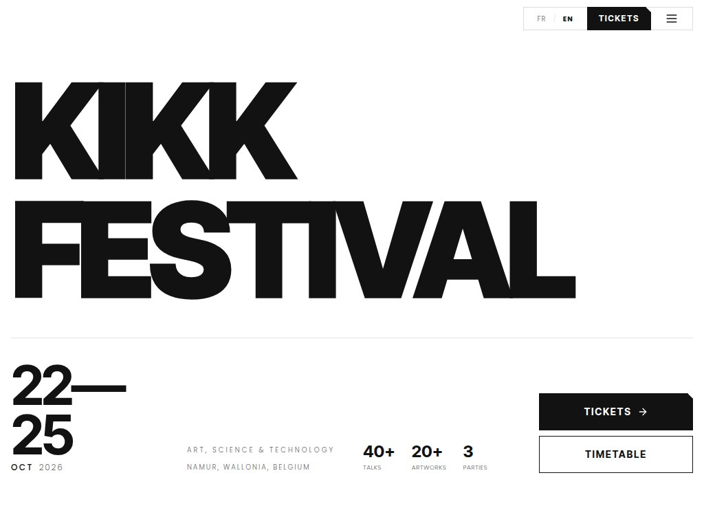
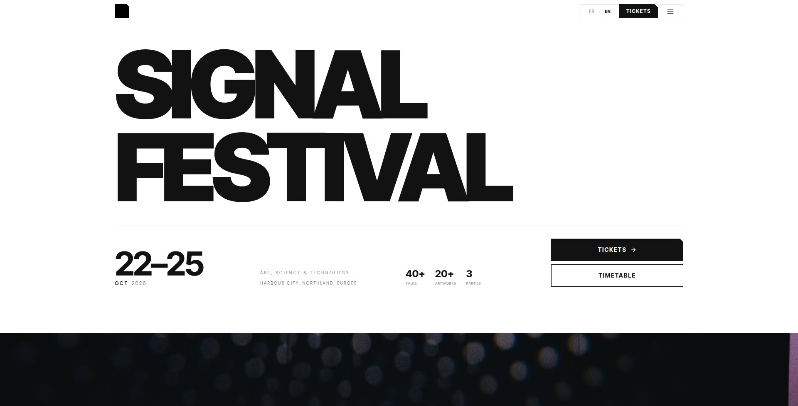
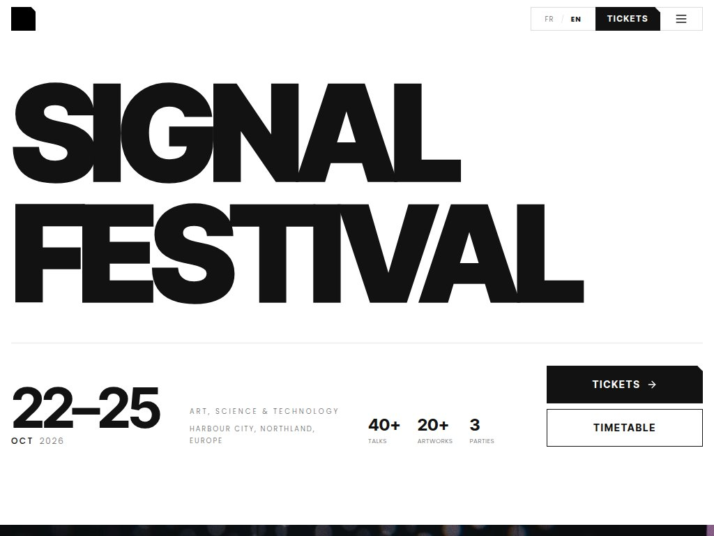

# Fidelity Report: `festival-event-demo-page`

- **Kind / Level:** `page` / `page`
- **Composes:** `templates/fixed-backdrop-reveal-template`, `sections/fixed-video-backdrop`, `sections/festival-header`, `sections/festival-hero-manifesto`, `sections/cinematic-media-banner`, `sections/program-tile-grid`, `sections/festival-lineup-section`, `sections/numbers-practical-info`, `sections/ticket-marquee-bar`, `sections/festival-footer`, `ui/festival-section-divider`
- **Reference Source (Step 1 Assembly Proof):** `education-event/kikkfestival-be-nextjs` (`http://127.0.0.1:3011/`)
- **Live Extract Preview:** `http://127.0.0.1:3015/preview/page/festival-event-demo-page`

## Step 1: Assembly Fidelity Proof (vs Full Original Homepage)

`demo-data.ts` and `demo-cards.ts` were temporarily populated with the reference homepage copy and measured across all 18 structural regions (`header`, `reveal`, `hero`, `featureBanner`, `program`, `divider1`, `talks`, `divider2`, `trail`, `midBanner`, `playground`, `divider3`, `parties`, `divider4`, `numbers`, `marquee`, `closingBanner`, `footer`).

| Viewport | Elements Checked | Hero `y` / `height` | Footer `y` / `height` | FAIL | WARN | Result |
| --- | ---: | :---: | :---: | ---: | ---: | --- |
| `1920x980` | 18 | `0px` / `868.5px` | `11473.1px` / `881px` | **0** | 34 | **PASS** |
| `1024x768` | 18 | `0px` / `799.9px` | `8828.2px` / `907px` | **0** | 34 | **PASS** |

### Side-by-Side Visual Proof (Step 1 Assembly)

| Viewport | Original (`127.0.0.1:3011/`) | Extract (`127.0.0.1:3015/preview/page/festival-event-demo-page`) |
| --- | --- | --- |
| `1920x980` |  |  |
| `1024x768` |  |  |

### Documented Intentional WARNs (Step 1)
- **Zero-width border colors (`borderTop` / `borderBottom`):** `0px` borders inherit `rgb(18, 18, 18)` in CSS Modules vs Tailwind global `* { border-color }` (`rgba(18, 18, 18, 0.15)`).
- **`trail.text` stat order:** Neutral demo dataset lists `20+ Artworks` before `€10 Trail access`.

## Step 2: Neutral Sample Data Swap & Visual Check

After locking in Step 1 (`0 FAIL` across all 18 sections with `0.0px` height/position drift), `demo-data.ts` and `demo-cards.ts` were restored to neutral white-label `Signal Festival` sample copy and Unsplash media, rebuilt, and verified visually and geometrically:

| Viewport | Hero `y` | Footer Bottom `y` | Overlap / Clipping / Overflow |
| --- | ---: | ---: | --- |
| `1920x980` | `0px` | `12360.7px` | **0 overlap, 0 clipping, 0 horizontal overflow** |
| `1024x768` | `0px` | `9745px` | **0 overlap, 0 clipping, 0 horizontal overflow** |

### Neutral Sample Data Screenshots

| `1920x980` (Neutral) | `1024x768` (Neutral) |
| --- | --- |
|  |  |
