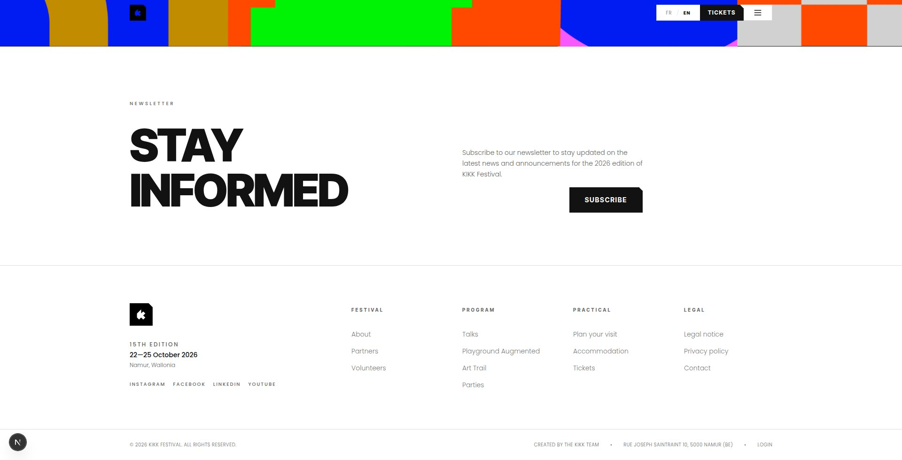
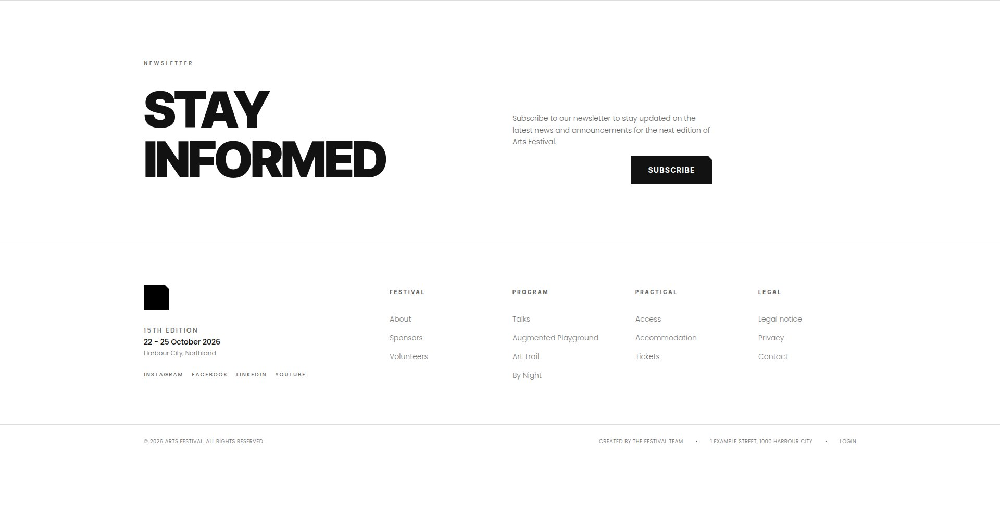
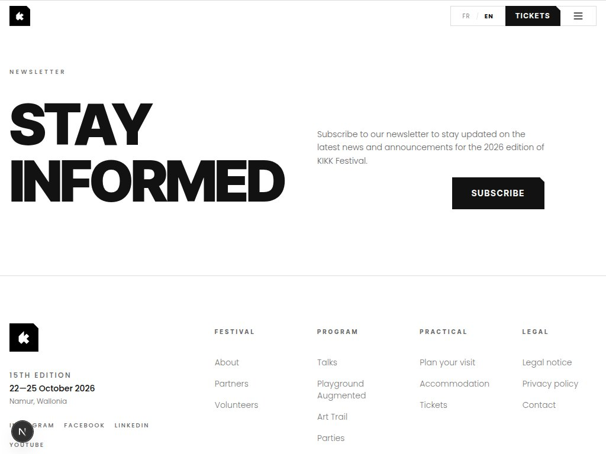
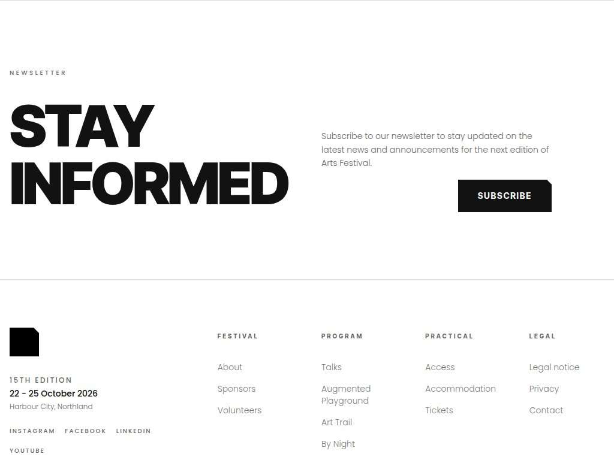
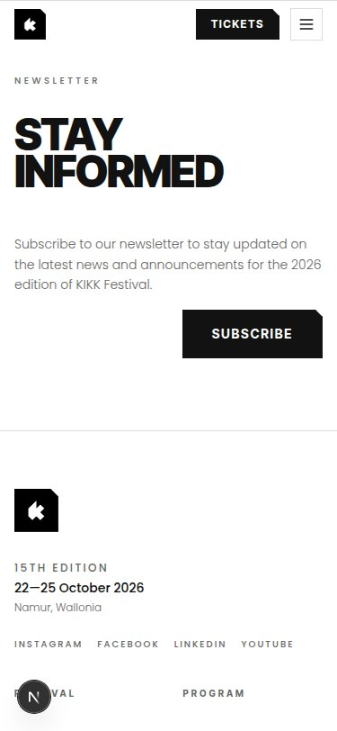
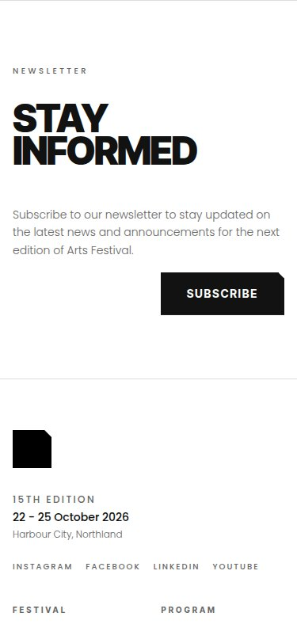

# Fidelity Report: `festival-footer`

- **Kind / Level:** `section` / `organism`
- **Source:** `education-event/kikkfestival-be-nextjs` (`src/components/layout/Footer.tsx`, `http://127.0.0.1:3011/`)
- **Extract:** `registry/sections/festival-footer` (`http://127.0.0.1:3015/preview/section/festival-footer`)
- **Style:** `neon-brutalist` (`css-modules`, 100% `--rk-*` tokens)

## Results (`npm run fidelity`)

- `1920x980`: 16 elements (`footer`, `newsBlock`, `newsEyebrow`, `newsTitle`, `newsText`, `newsButton`, `main`, `mainGrid`, `logo`, `edition`, `date`, `place`, `colHeading`, `colLink`, `bottom`, `copyright`), **0 FAIL**, 49 WARN.
- `1024x768`: 16 elements, **0 FAIL**, 33 WARN.
- `375x812`: 16 elements, **0 FAIL**, 34 WARN.

## Side-by-Side Screenshots

| Viewport | Original (`127.0.0.1:3011/`) | Extract (`127.0.0.1:3015/preview/section/festival-footer`) |
| --- | --- | --- |
| `1920x980` |  |  |
| `1024x768` |  |  |
| `375x812` |  |  |

## Intentional Differences (WARN)

- **White-label copy & SVG mark:** Branded logo PNG, city/address (`Namur, Wallonia`), and `KIKK` copyright replaced with neutral `Arts Festival` / `Harbour City, Northland` copy and geometric SVG mark (`49.5 x 48px`).
- **sRGB `color-mix()` & `0px` border colors:** Link hover color `color-mix(in srgb, var(--rk-fg) 60%, transparent)` and `0px` inherited borders differ only in serialized string format.
