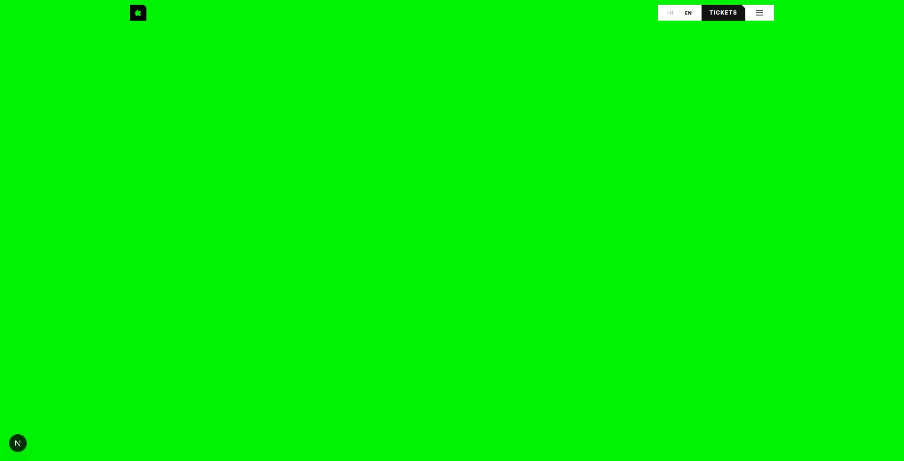
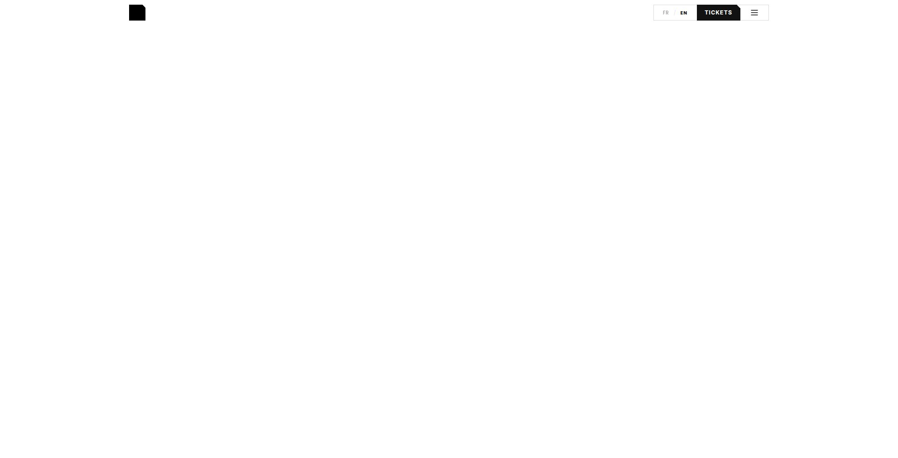
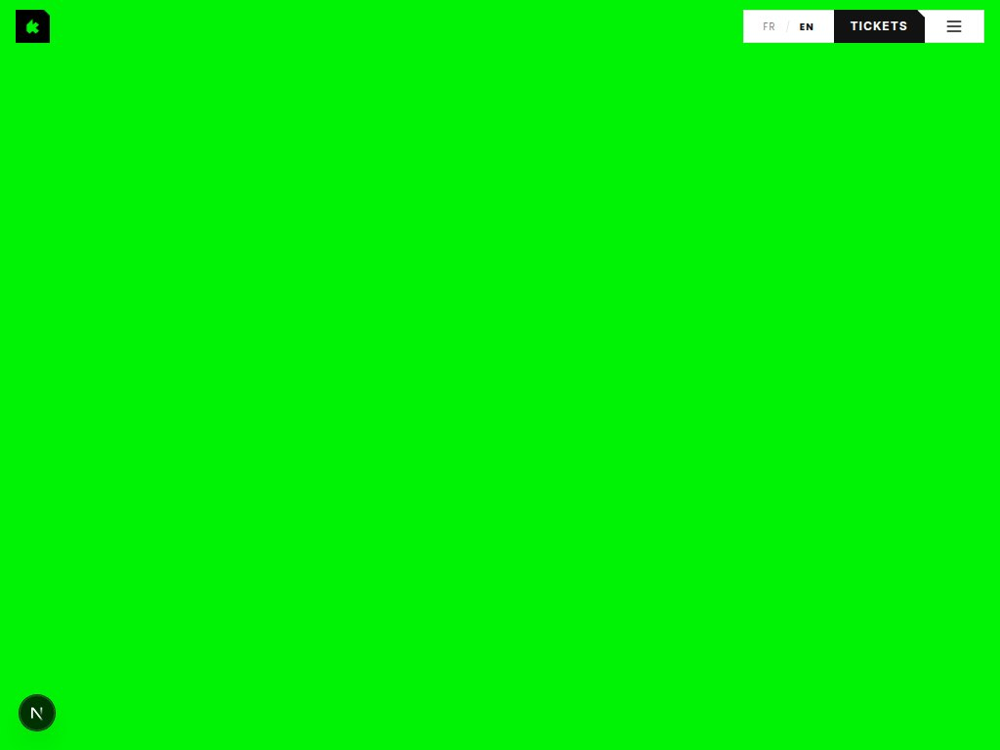
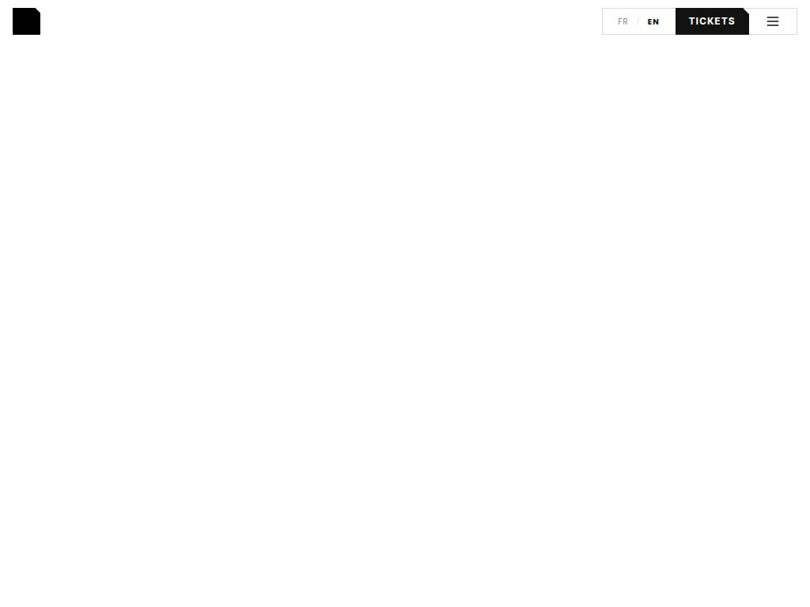
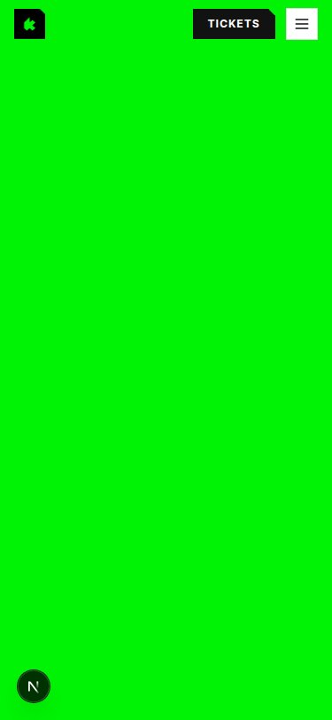
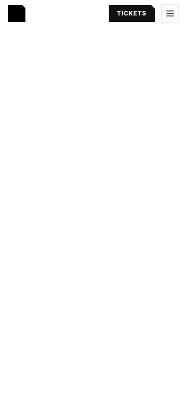

# Fidelity Report: `festival-header`

- **Kind / Level:** `section` / `organism`
- **Source:** `education-event/kikkfestival-be-nextjs` (`src/components/layout/Header.tsx` & `MenuDrawer.tsx`, `http://127.0.0.1:3011/`)
- **Extract:** `registry/sections/festival-header` (`http://127.0.0.1:3015/preview/section/festival-header`)
- **Style:** `neon-brutalist` (`css-modules`, 100% `--rk-*` tokens)

## Results (`npm run fidelity`)

- `1920x980`: 8 elements (`header`, `container`, `logoLink`, `logo`, `tools`, `langActive`, `cta`, `toggle`), **0 FAIL**, 12 WARN.
- `1024x768`: 8 elements, **0 FAIL**, 12 WARN.
- `375x812`: 8 elements, **0 FAIL**, 14 WARN.

## Side-by-Side Screenshots

| Viewport | Original (`127.0.0.1:3011/`) | Extract (`127.0.0.1:3015/preview/section/festival-header`) |
| --- | --- | --- |
| `1920x980` |  |  |
| `1024x768` |  |  |
| `375x812` |  |  |

## Intentional Differences (WARN)

- **White-label SVG logo mark:** Branded PNG replaced with a neutral geometric SVG data URI mark (`35 x 34px` identical dimensions) and `brandName` fallback support.
- **Zero-width border colors:** `0px` borders inherit element text color vs Tailwind global `* { border-color }` (`rgba(18, 18, 18, 0.15)`), while visible borders on `.tools` and `.toggleBox` match `1px rgba(18, 18, 18, 0.15)`.
