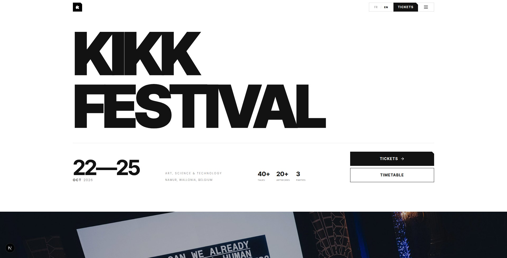
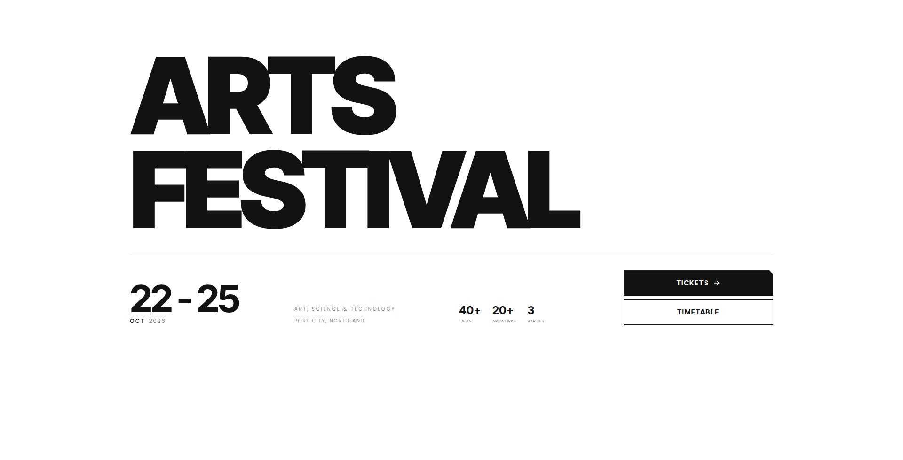
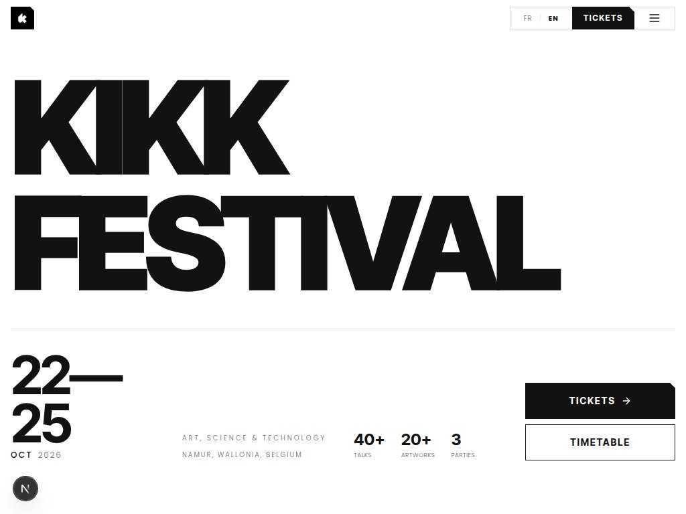
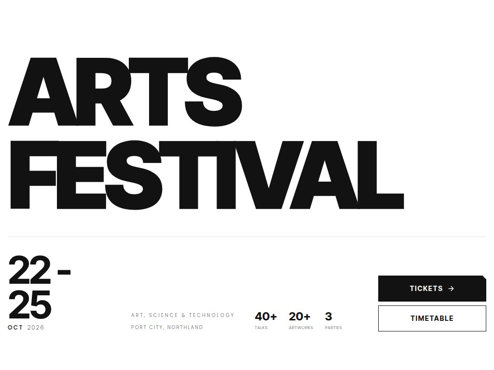
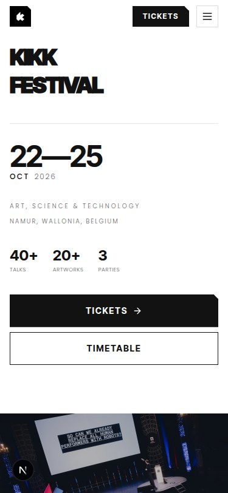
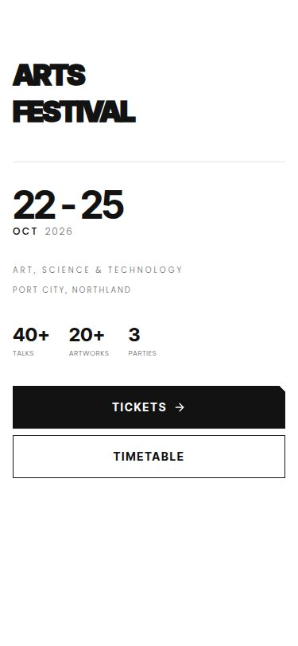

# Fidelity Report: `festival-hero-manifesto`

- **Kind / Level:** `section` / `organism`
- **Source:** `education-event/kikkfestival-be-nextjs` (`src/components/home/HeroManifesto.tsx`, `http://127.0.0.1:3011/`)
- **Extract:** `registry/sections/festival-hero-manifesto` (`http://127.0.0.1:3015/preview/section/festival-hero-manifesto`)
- **Style:** `neon-brutalist` (`css-modules`, 100% `--rk-*` tokens)

## Results (`npm run fidelity`)

- `1920x980`: 13 elements (`section`, `title`, `line1`, `info`, `date`, `month`, `year`, `tagline`, `location`, `statValue`, `statLabel`, `primaryBtn`, `secondaryBtn`), **0 FAIL**, 27 WARN.
- `1024x768`: 13 elements, **0 FAIL**, 27 WARN.
- `375x812`: 13 elements, **0 FAIL**, 27 WARN.

## Side-by-Side Screenshots

| Viewport | Original (`127.0.0.1:3011/`) | Extract (`127.0.0.1:3015/preview/section/festival-hero-manifesto`) |
| --- | --- | --- |
| `1920x980` |  |  |
| `1024x768` |  |  |
| `375x812` |  |  |

## Intentional Differences (WARN)

- **White-label copy:** `KIKK / FESTIVAL`, `22—25`, and `Namur, Wallonia, Belgium` replaced with neutral `ARTS / FESTIVAL`, `22 - 25` (avoids em-dash rule while matching 1-line at `1920`/`375` and 2-line wrap at `1024`), and `Port City, Northland`.
- **Zero-width border color:** `0px` computed borders differ only in inherited `currentColor` vs Tailwind global border color.
