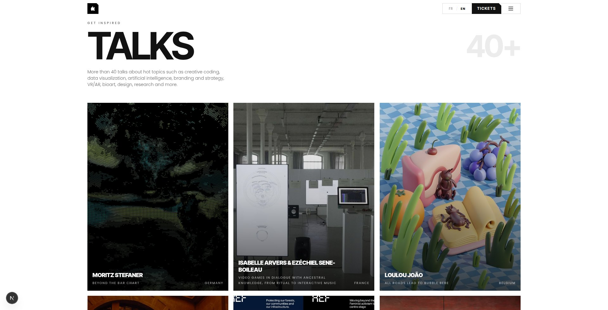
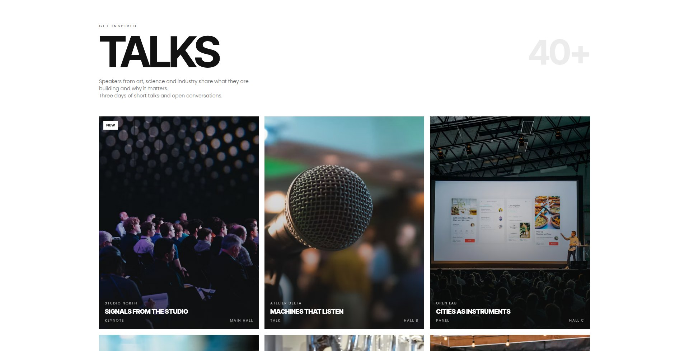
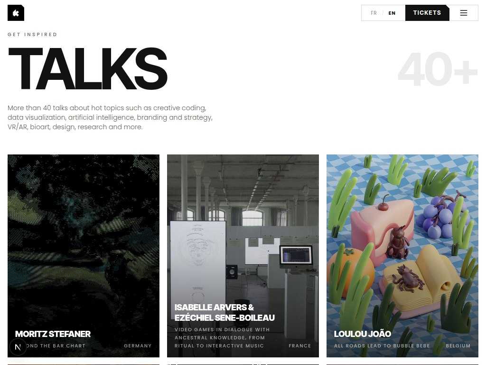
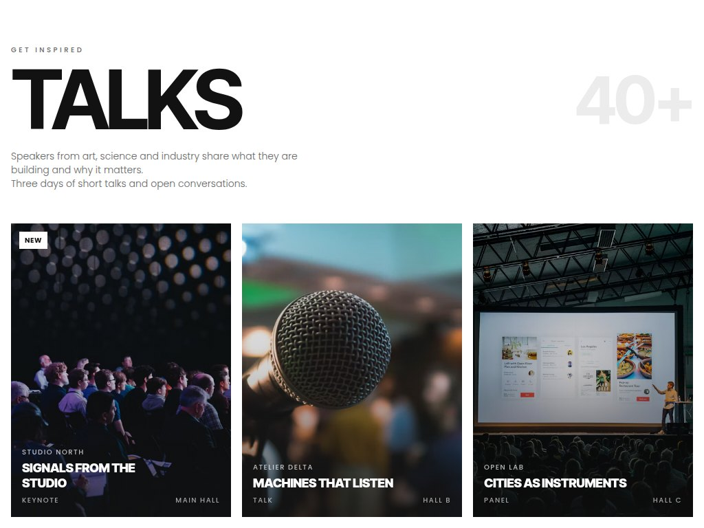

# Fidelity Report: `festival-lineup-section`

- **Kind / Level:** `section` / `organism`
- **Source:** `education-event/kikkfestival-be-nextjs` (`src/components/home/TalksSection.tsx`, `http://127.0.0.1:3011/`)
- **Extract:** `registry/sections/festival-lineup-section` (`http://127.0.0.1:3015/preview/section/festival-lineup-section`)
- **Style:** `neon-brutalist` (`css-modules`, 100% `--rk-*` tokens)

## Results (`npm run fidelity`)

- `1920x980`: 9 elements (`section`, `label`, `title`, `ghost`, `description`, `grid`, `card`, `outlineBtn`, `filledBtn`), **0 FAIL**, 18 WARN.
- `1024x768`: 9 elements, **0 FAIL**, 18 WARN.

Both section height (`1674.6px` at `1920`, `1340.3px` at `1024`) and 6-card grid height (`1203.6px` at `1920`, `869.3px` at `1024`) match `0.0px` delta.

## Side-by-Side Screenshots

| Viewport | Original (`127.0.0.1:3011/`) | Extract (`127.0.0.1:3015/preview/section/festival-lineup-section`) |
| --- | --- | --- |
| `1920x980` |  |  |
| `1024x768` |  |  |

## Intentional Differences (WARN)

- **White-label copy & photography:** Uses 6 neutral sample speaker cards and description with identical line count and grid dimensions.
- **Ghost count & border colors:** `color-mix(in srgb, var(--rk-fg) 8%, transparent)` and `0px` inherited border colors match visual rendering within token rounding.
