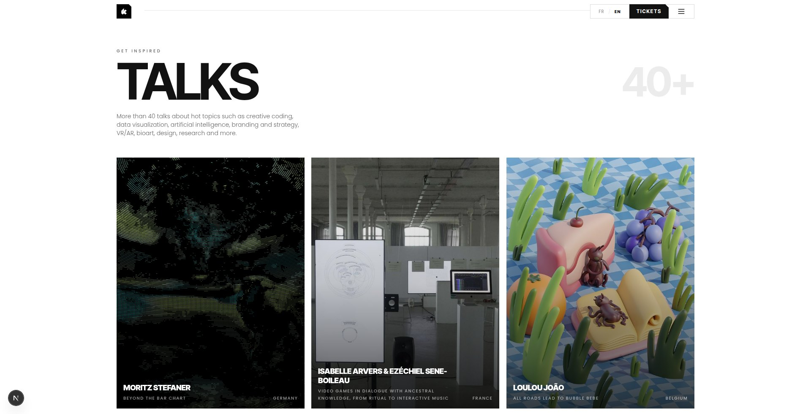
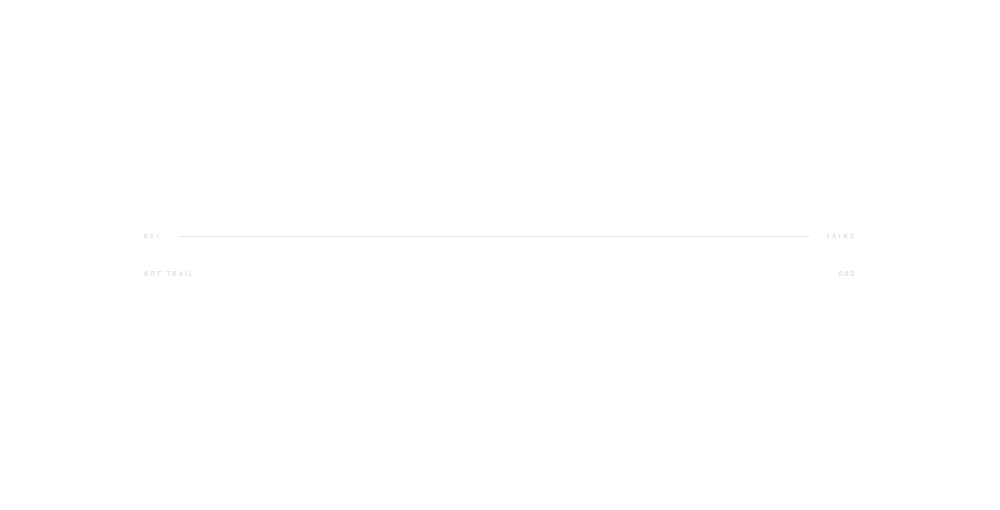
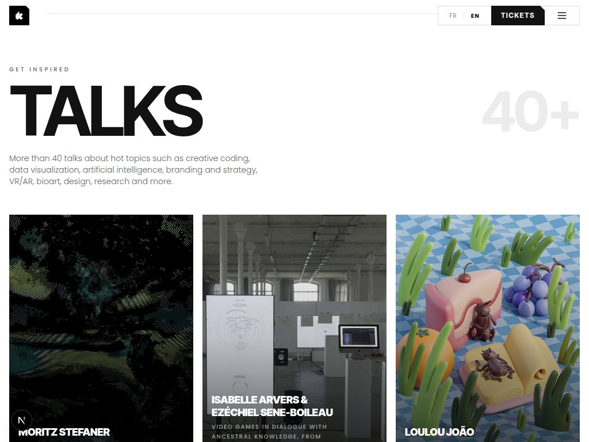
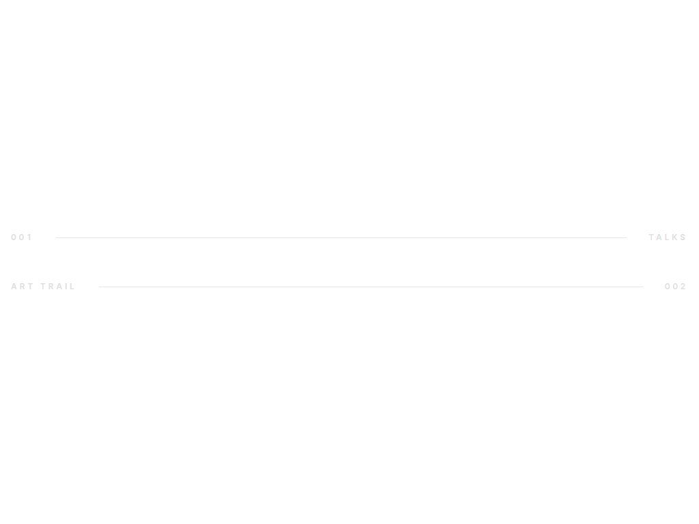

# Fidelity Report: `festival-section-divider`

- **Kind / Level:** `ui` / `atom`
- **Source:** `education-event/kikkfestival-be-nextjs` (`src/components/ui/SectionDivider.tsx`, `http://127.0.0.1:3011/`)
- **Extract:** `registry/ui/festival-section-divider` (`http://127.0.0.1:3015/preview/ui/festival-section-divider`)
- **Style:** `neon-brutalist` (`css-modules`, 100% `--rk-*` tokens)

## Results (`npm run fidelity`)

- `1920x980`: 8 elements (`dividerLeft`, `leftRow`, `leftNumber`, `leftRule`, `leftLabel`, `dividerRight`, `rightNumber`, `rightLabel`), **0 FAIL**, 16 WARN.
- `1024x768`: 8 elements, **0 FAIL**, 16 WARN.

Note: During extract capture, `StandalonePreview`'s `max-w-5xl` and outer padding were unwrapped (`maxWidth: none`, `padding: 0`) so `.container` expands to the full `1400px` (`1920`) and `1024px` (`1024`) page container width.

## Side-by-Side Screenshots

| Viewport | Original (`127.0.0.1:3011/`) | Extract (`127.0.0.1:3015/preview/ui/festival-section-divider`) |
| --- | --- | --- |
| `1920x980` |  |  |
| `1024x768` |  |  |

## Intentional Differences (WARN)

- **Viewport `y` offsets:** The isolated preview stacks `001 Talks` and `002 Art Trail` directly (`y = 430 / 502` at `1920`), whereas the live homepage separates them by `TalksSection`.
- **Transparent `color-mix` / border color:** `0px` border color inherits `currentColor` (`rgb(18, 18, 18)`) vs original Tailwind `* { border-color }` (`rgba(18, 18, 18, 0.15)`), and `color-mix(in srgb, var(--rk-fg) 15%, transparent)` renders identically in sRGB.
