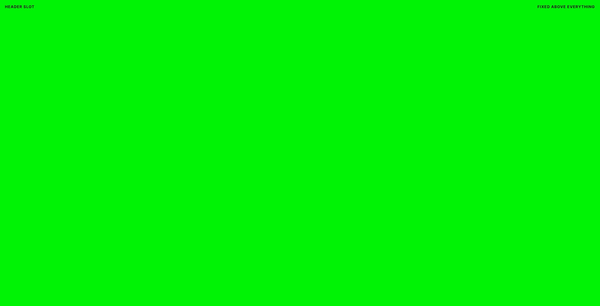
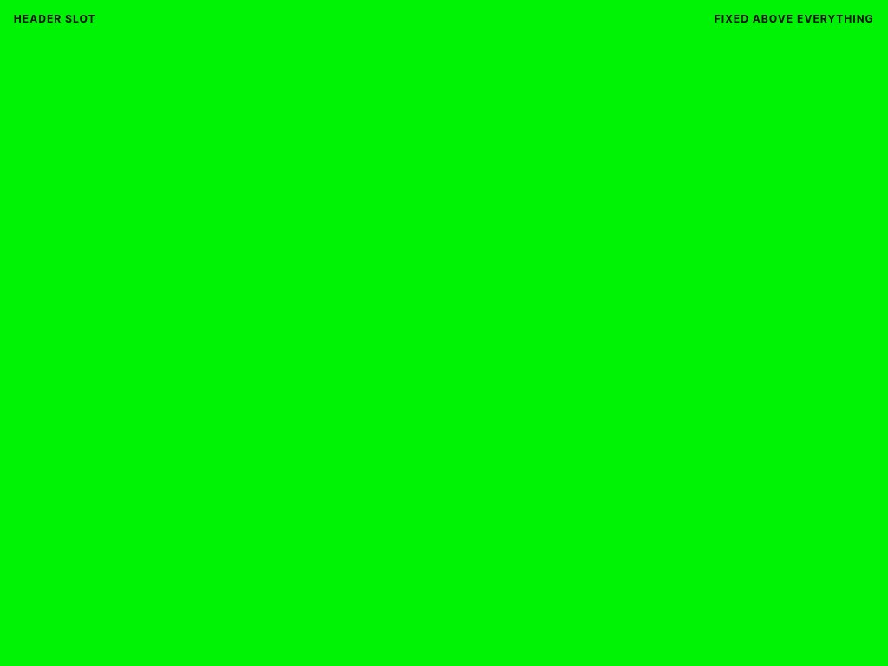
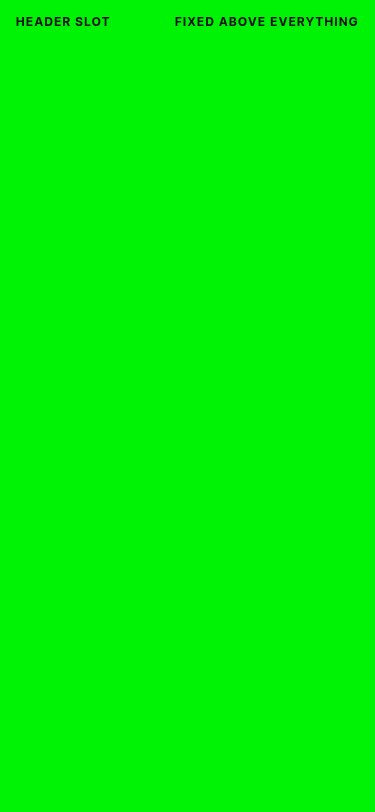

# Fidelity Report: `fixed-backdrop-reveal-template`

- **Kind / Level:** `template` / `template`
- **Source:** `education-event/kikkfestival-be-nextjs` (`src/app/page.tsx` page-level fixed backdrop reveal shell)
- **Extract:** `registry/templates/fixed-backdrop-reveal-template` (`http://127.0.0.1:3015/preview/template/fixed-backdrop-reveal-template`)
- **Style:** `neon-brutalist` (`css-modules`, 100% `--rk-*` tokens)

## Shell Geometry Verification

| Viewport | `shell` | `backdrop` (`fixed`, `100vh`) | `reveal` spacer | `content` layer | Overlap / Overflow | Status |
| --- | --- | --- | --- | --- | --- | --- |
| `1920x980` | `1920 x 1534.5px` | `1920 x 980px` (`y=0`) | `1920 x 980px` (`y=0`) | `1920 x 554.5px` (`y=980`) | `0` overlap / `0` horizontal overflow | **PASS** |
| `1024x768` | `1024 x 1322.5px` | `1024 x 768px` (`y=0`) | `1024 x 768px` (`y=0`) | `1024 x 554.5px` (`y=768`) | `0` overlap / `0` horizontal overflow | **PASS** |
| `375x812` | `375 x 1462.5px` | `375 x 812px` (`y=0`) | `375 x 812px` (`y=0`) | `375 x 650.5px` (`y=812`) | `0` overlap / `0` horizontal overflow | **PASS** |

## Template Shell Screenshots

| Desktop `1920x980` | Laptop `1024x768` | Mobile `375x812` |
| --- | --- | --- |
|  |  |  |

## Architecture Notes

- The first `100vh` `.reveal` spacer (`z-index: 10`) keeps the `z-index: 0` fixed backdrop visible above the fold while the fixed `header` (`z-index: 50`) stays pinned at `y = 0`.
- `.content` uses `display: flow-root` with `background-color: var(--rk-bg)` so child block margins cannot collapse through `.content` and leave a backdrop gap between `.reveal` and `.content` (`content.y === reveal.height` at all viewports).
