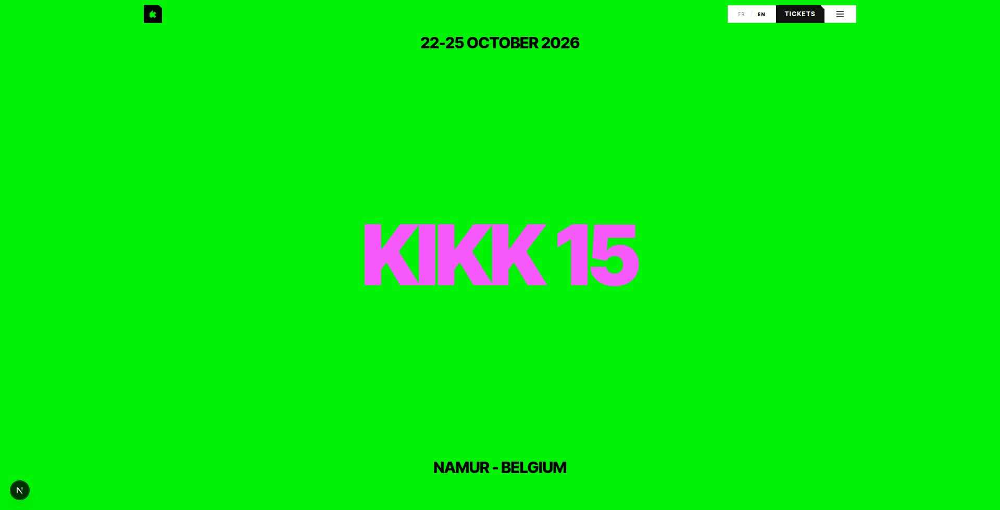
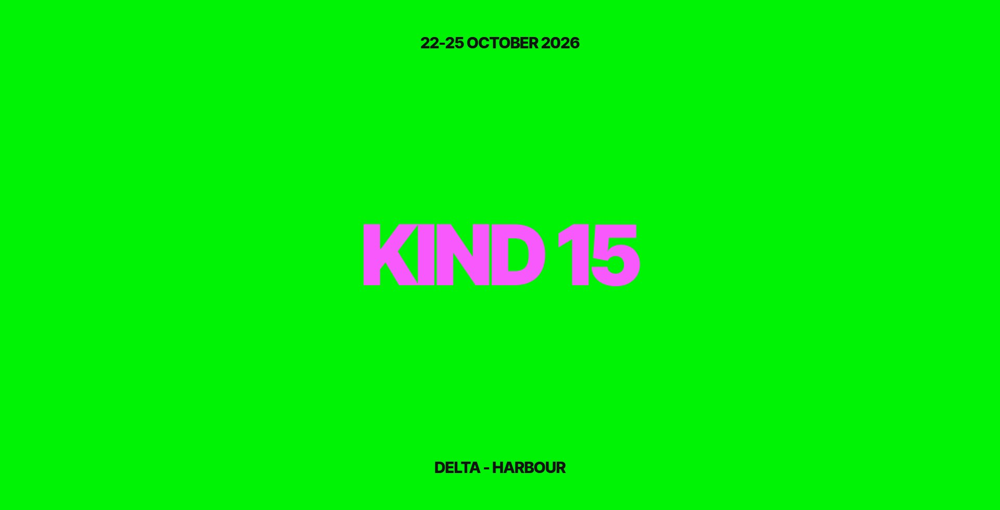
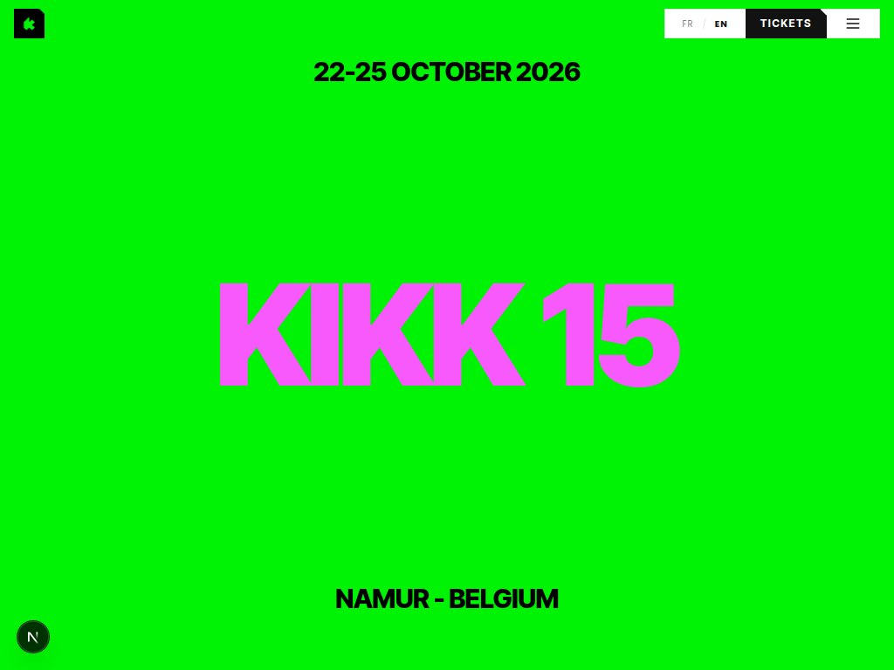
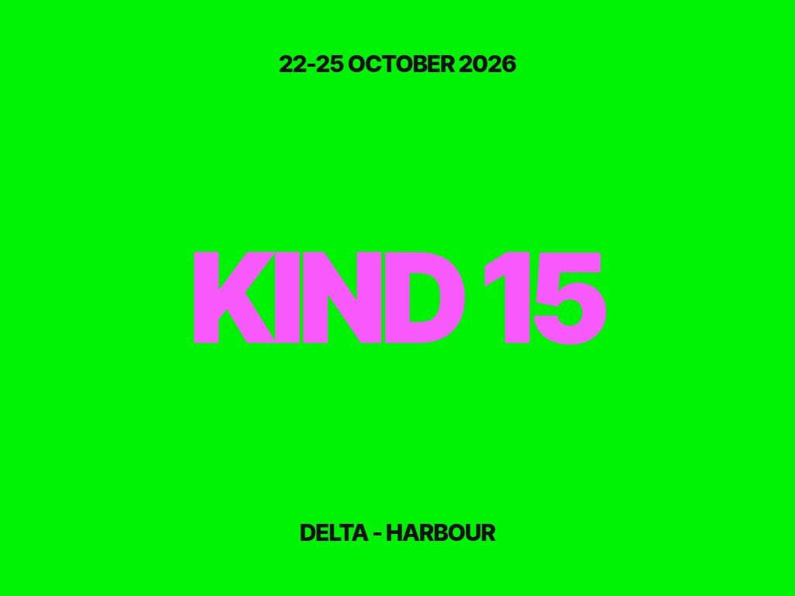

# Fidelity Report: `fixed-video-backdrop`

- **Kind / Level:** `section` / `organism`
- **Source:** `education-event/kikkfestival-be-nextjs` (`src/components/home/HeroBackground.tsx`, `http://127.0.0.1:3011/`)
- **Extract:** `registry/sections/fixed-video-backdrop` (`http://127.0.0.1:3015/preview/section/fixed-video-backdrop`)
- **Style:** `neon-brutalist` (`css-modules`, 100% `--rk-*` tokens)

## Results (`npm run fidelity`)

- `1920x980`: 5 elements (`backdrop`, `fallback`, `edgeTop`, `center`, `edgeBottom`), **0 FAIL**, 18 WARN.
- `1024x768`: 5 elements, **0 FAIL**, 18 WARN.

Measured in poster-fallback state (`waitMs: 5600` on original so its 5s Vimeo fallback displays identically to extract preview with `videoSrc=""`).

## Side-by-Side Screenshots

| Viewport | Original (`127.0.0.1:3011/`) | Extract (`127.0.0.1:3015/preview/section/fixed-video-backdrop`) |
| --- | --- | --- |
| `1920x980` |  |  |
| `1024x768` |  |  |

## Intentional Differences (WARN)

- **White-label fallback text & token colors:** Branded `KIKK 15` / `NAMUR - BELGIUM` replaced with neutral `KIND 15` / `DELTA - HARBOUR`; `#000` mapped to `--rk-accent-fg` (`rgb(18, 18, 18)`), `--rk-accent` (`#00f305`), `--rk-accent-2` (`#f859fc`).
- **Root fontWeight:** Backdrop container uses `400` default weight on `.backdrop` (child `.edge` and `.center` explicitly set `800` and `900`).
