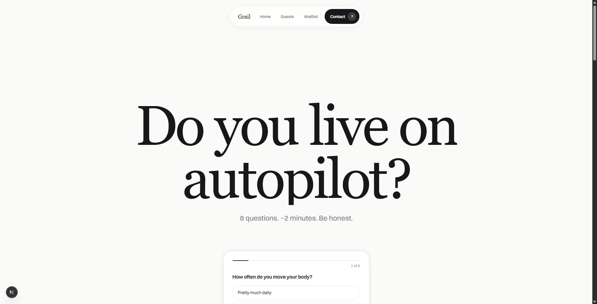
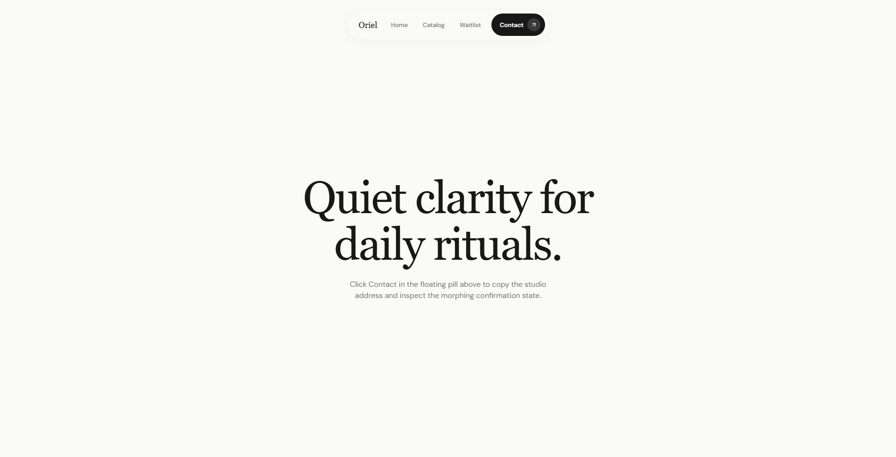
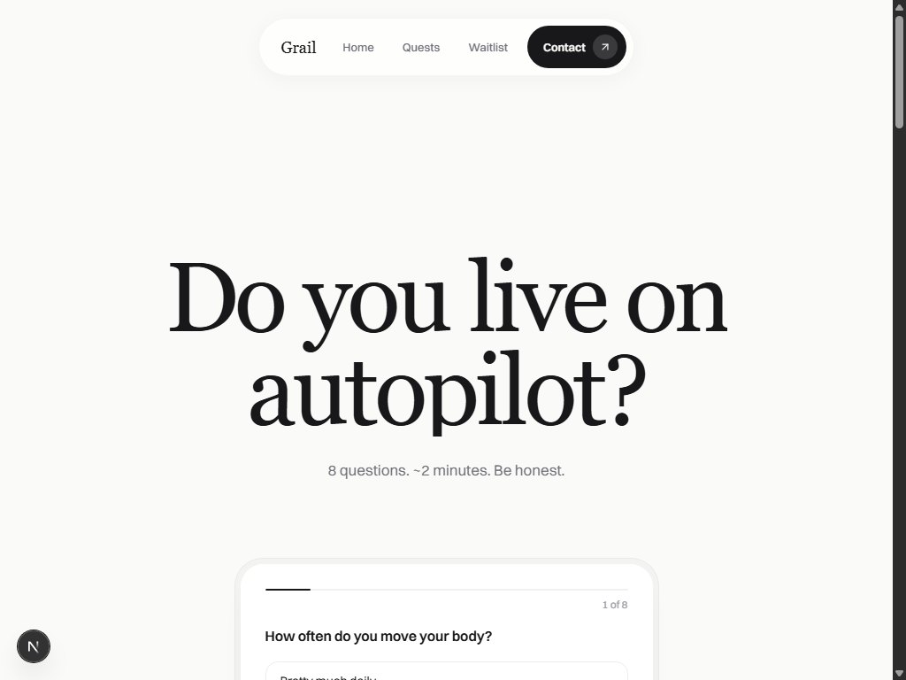
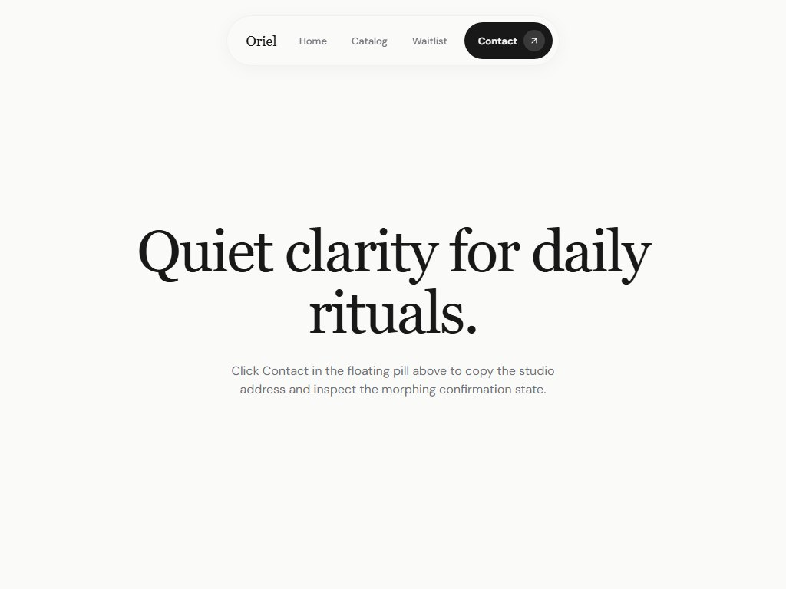

# Fidelity Report: floating-pill-navbar

Sumber: `saas-app/grail-next/src/components/landing/LandingNav.tsx` (`http://localhost:3002/v1`)
Ekstrak: `registry/sections/floating-pill-navbar` (`http://localhost:3000/preview/section/floating-pill-navbar`)
Style: `kinetic-obsidian` (`css-modules` + `motion`)
Keadaan: animasi blur-drop masuk selesai (`opacity: 1`, `y: 0`, `filter: blur(0px)`), tombol `Contact` dalam state awal (belum diklik).

## Hasil `npm run fidelity`

- **1920x980**: 8 elemen, **0 FAIL**, 29 WARN
- **1024x768**: 8 elemen, **0 FAIL**, 29 WARN

Seluruh 8 elemen terukur (`nav`, `logo`, `links`, `link1`, `contactBtn`, `contactLabel`, `contactIcon`, `contactSvg`) lolos dengan **0 FAIL** ukuran, padding, tinggi baris, warna, display, maupun visibilitas di kedua viewport.

## Screenshot berdampingan

| Viewport | Asli | Ekstrak |
| --- | --- | --- |
| 1920x980 |  |  |
| 1024x768 |  |  |

## Beda yang disengaja (WARN)

- **Font body (`Switzer` -> `DM Sans`)**: aslinya memuat file lokal `Switzer-Variable.woff2`; ekstrak memakai token `--rk-font-body` (`DM Sans`) milik `kinetic-obsidian`. Karena lebar glif `DM Sans` sedikit lebih lebar dari `Switzer`, lebar horizontal elemen teks sans-serif (`nav`, `links`, `contactBtn`, `contactLabel`) selisih 3-10px (dicatat sebagai WARN oleh comparator). Font display (`Georgia`) pada `logo` sama persis.
- **Pembulatan token warna (`--rk-*`)**: seluruh warna memakai `var(--rk-*)` dan `color-mix()` tanpa `#hex` atau `rgb()` mentah:
  - Tinta gelap (`#18181b` / `rgb(24, 24, 27)`): `color-mix(in srgb, var(--rk-bg) 94%, var(--rk-fg))` (delta RGB ~1.8).
  - Tautan sekunder (`#71717a` / `rgb(113, 113, 122)`): `color-mix(in srgb, var(--rk-fg-muted) 69%, var(--rk-bg))` (delta RGB ~1.3).
  - Permukaan kaca pill (`#ffffffb8` / `rgba(255, 255, 255, 0.72)`): `color-mix(in srgb, var(--rk-fg) 72%, transparent)` (delta RGB 7).
  - Badge ikon (`#ffffff26` / `rgba(255, 255, 255, 0.15)`): `color-mix(in srgb, var(--rk-fg) 15%, transparent)` (delta RGB 7).
  - Border dan shadow pill (`#18181b0a`): `color-mix(in srgb, var(--pill-ink) 4%, transparent)`.
  - State `Copied` memakai pasangan token `--rk-accent` / `--rk-accent-fg` agar selalu kontras WCAG AA tanpa warna mentah.
- **Teks white-label**: merek `"Grail"` diganti menjadi `"Oriel"` (5 huruf, lebar identik `47.9 x 21px` pada Georgia 18px) dan tautan `"Quests"` menjadi `"Catalog"` (`Home`, `Catalog`, `Waitlist`).
- **Aksesibilitas & Reduced Motion**: ditambahkan `type="button"` pada tombol, `aria-label="Primary navigation"`, `aria-live="polite"` dan `aria-label` deskriptif pada tombol `Contact`, `aria-hidden="true"` pada SVG dekoratif, cleanup timer pada unmount, ring `:focus-visible`, serta dukungan penuh `prefers-reduced-motion` (`useReducedMotion()`).

## Detail teknis yang menjaga kecocokan 1:1

- Menetapkan `line-height: normal` secara eksplisit pada `.nav`, `.logo`, `.links`, `.link`, `.contact`, dan `.contactLabel` agar preflight Tailwind v4 (`line-height: 1.5`) tidak mengubah tinggi elemen (`nav: 66px`, `logo: 21px`, `link1: 33px`, `contactBtn: 48px`, `contactLabel: 17px`).
- Menyertakan `backdrop-filter: blur(24px)` sekaligus `-webkit-backdrop-filter: blur(24px)` dan `box-sizing: border-box` dengan padding eksak `8px 8px 8px 24px`.
