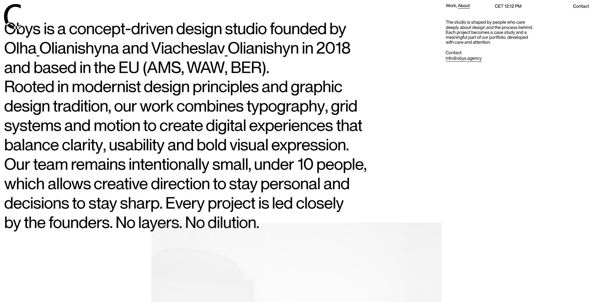
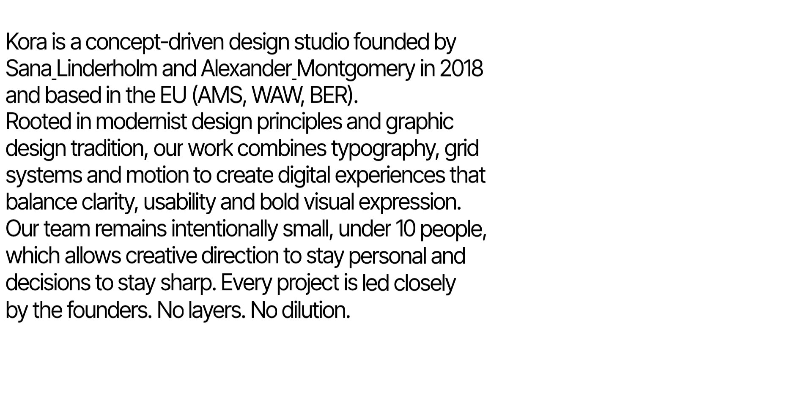
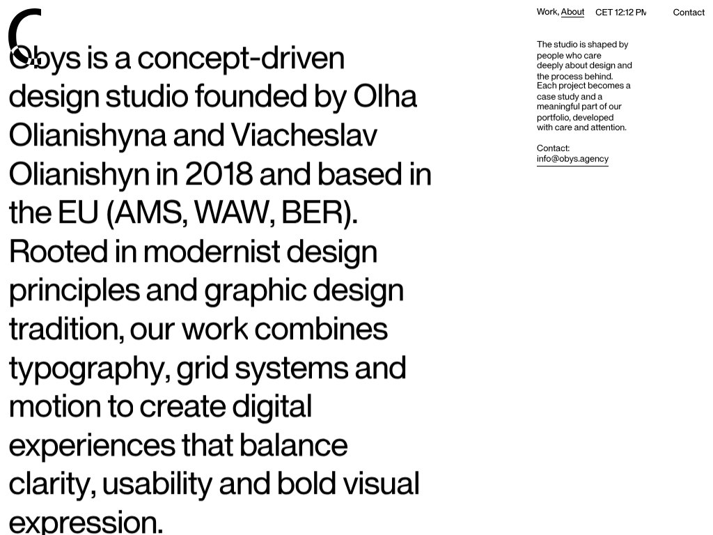
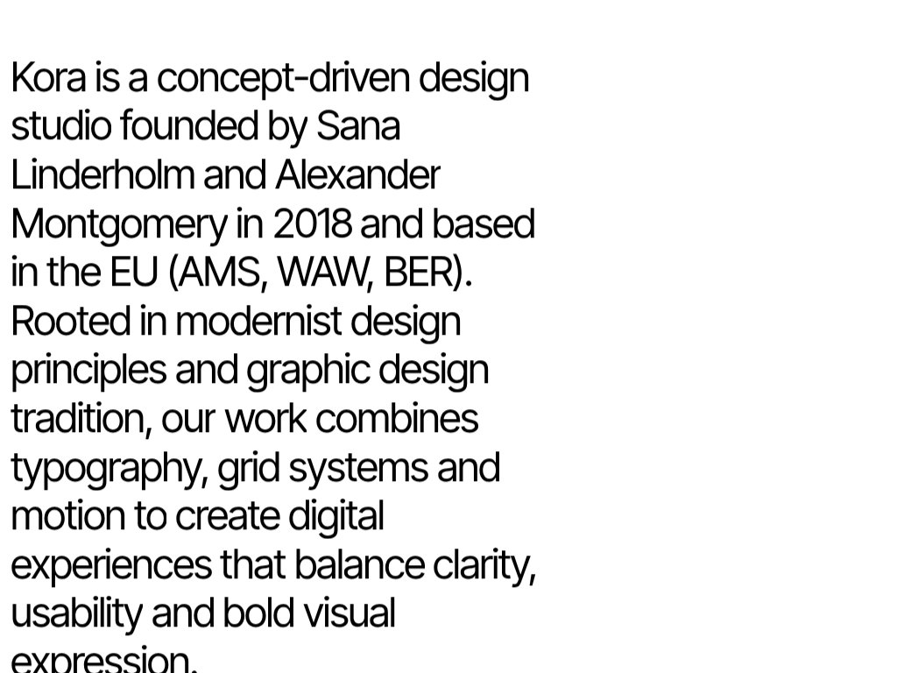
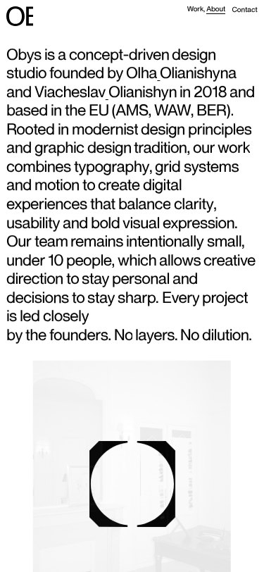
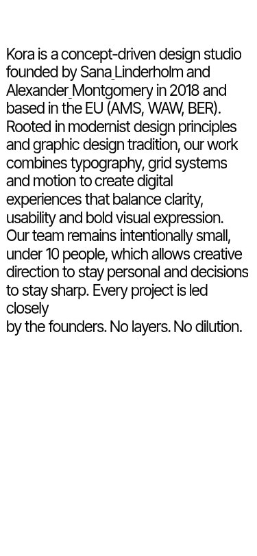

# Fidelity Report: founder-hover-manifesto

- **Sumber:** `agency-portfolio/obys-agency-nextjs` (`src/components/about/AboutPageView.tsx` + `FounderPortraits.tsx`, `#ab-co-ma` & `#ab-fo-hover`, `http://localhost:3021/about`)
- **Ekstrak:** `registry/sections/founder-hover-manifesto` (`http://localhost:3025/preview/section/founder-hover-manifesto`)
- **Style:** `swiss-mono` (`css-modules`, 100% token `--rk-*`)

## Hasil `npm run fidelity`

- `1920x980`: 7 elemen (`manifesto`, `column`, `p1`, `p2`, `p3`, `p4`, `portraits`), **0 FAIL**, 11 WARN
- `1024x768`: 7 elemen (`manifesto`, `column`, `p1`, `p2`, `p3`, `p4`, `portraits`), **0 FAIL**, 11 WARN
- `375x812`: 7 elemen (`manifesto`, `column`, `p1`, `p2`, `p3`, `p4`, `portraits`), **0 FAIL**, 11 WARN

## Screenshot Berdampingan

| Viewport | Asli | Ekstrak |
| --- | --- | --- |
| `1920x980` |  |  |
| `1024x768` |  |  |
| `375x812` |  |  |

## Temuan yang Diperbaiki

- Menambahkan `font-size: calc(var(--rk-u) * 1.1); line-height: 1.2; letter-spacing: -0.01em;` pada `.root` agar `.portraits` mewarisi ukuran caption asli (`14.7px / 17.6px` di `1920`, `13px / 15.5px` di `1024`, `10.3px / 12.4px` di `375`) alih-alih `16px / 24px` default shell.

## Beda yang Disengaja (WARN)

- **Font proprietary (`Obys` -> `Inter Tight`):** seluruh 7 elemen melaporkan WARN `fontRendered`, dengan jumlah baris dan tinggi setiap paragraf identik (`0 FAIL`).
- **Teks & foto white-label:** nama studio (`Kora`), pendiri (`Sana Linderholm`, `Alexander Montgomery`), dan potret Unsplash menggantikan merek/foto asli.
