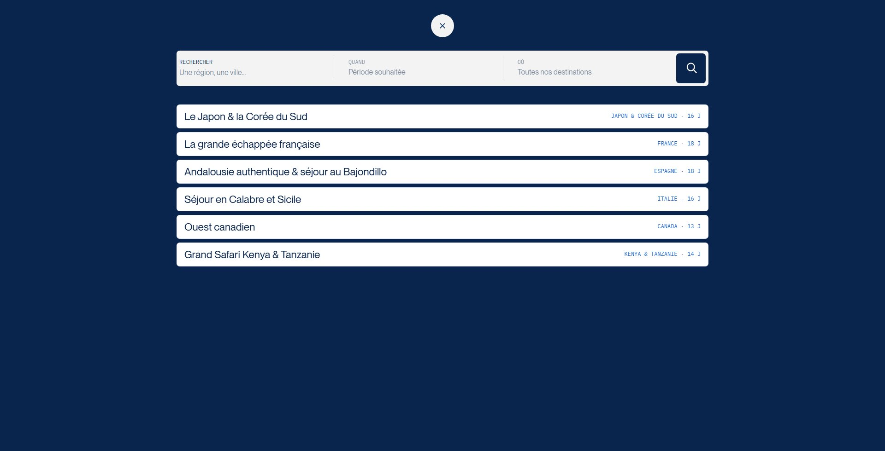
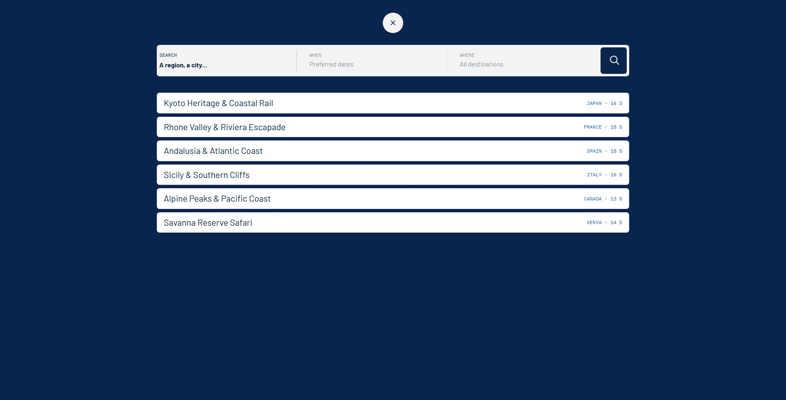
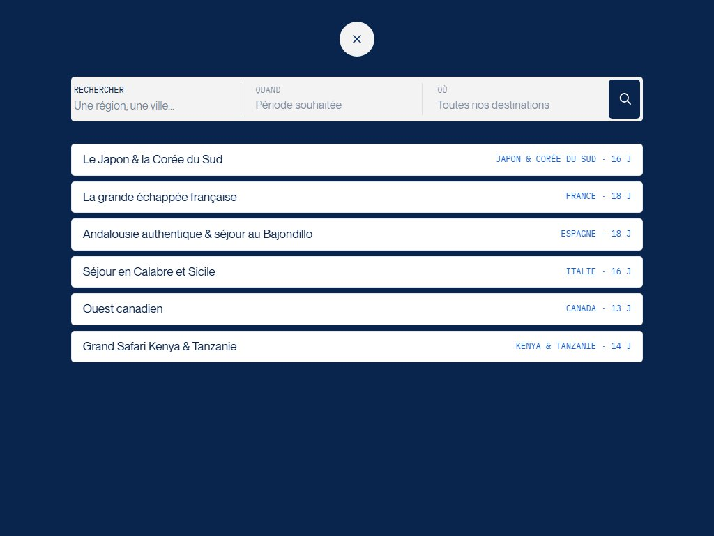
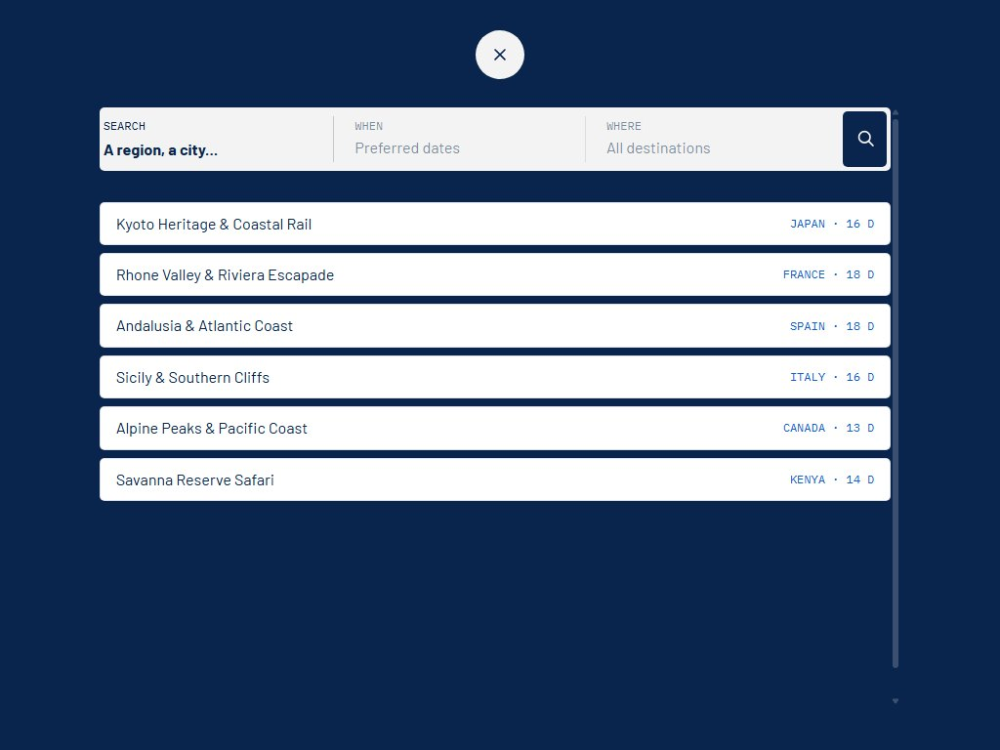

# Fidelity Report: fullscreen-search-overlay

Sumber: `travel-services/tours-chanteclerc-nextjs` (`search.search` dalam keadaan terbuka di `#search` via klik search toggle pada `localhost:3001/`)
Ekstrak: `registry/ui/fullscreen-search-overlay` (`http://localhost:3005/preview/ui/fullscreen-search-overlay?style=azure-editorial`)
Keadaan: overlay terbuka fullscreen (`1920x980` dan `1024x768`), step `results` aktif, 2,2 detik setelah load (`document.fonts.ready`).

## Hasil `npm run fidelity:all`

- 1920x980: 5 elemen (`overlay`, `inner`, `searchBar`, `closeBtn`, `stepResults`), **0 FAIL**, 8 WARN
- 1024x768: 5 elemen (`overlay`, `inner`, `searchBar`, `closeBtn`, `stepResults`), **0 FAIL**, 10 WARN

## Screenshot berdampingan

| Viewport | Asli | Ekstrak |
| --- | --- | --- |
| 1920x980 |  |  |
| 1024x768 |  |  |

## Beda yang disengaja (WARN)

- **Font body**: `PP Neue Montreal` dipetakan ke `--rk-font-body` (`Barlow`).
- **Daftar paket & destinasi sample**: katalog hasil pencarian, filter durasi, dan grid destinasi menggunakan data fiktif netral berbahasa Inggris.
- **Composes UI**: overlay mengimpor atom `rolling-cta-button` dan molekul `trip-search-bar` serta memisahkan subkomponen `date-range-calendar.tsx` agar modular di bawah 260 baris.
