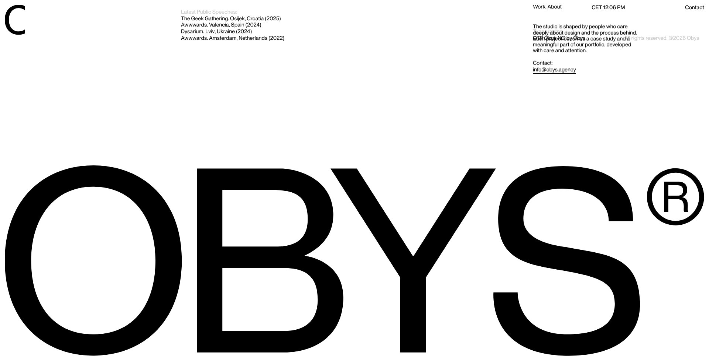
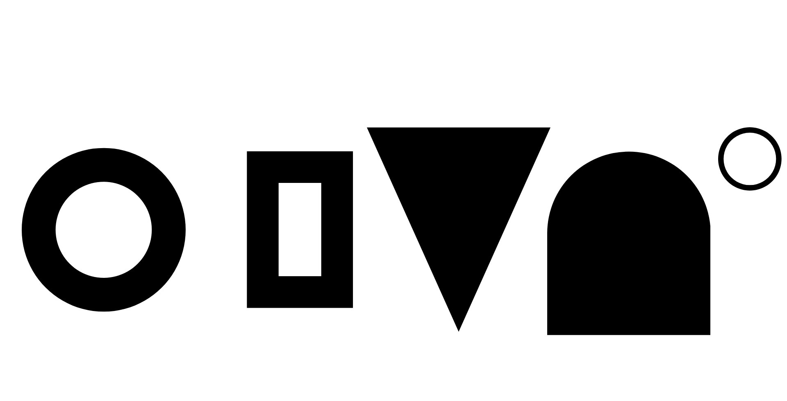
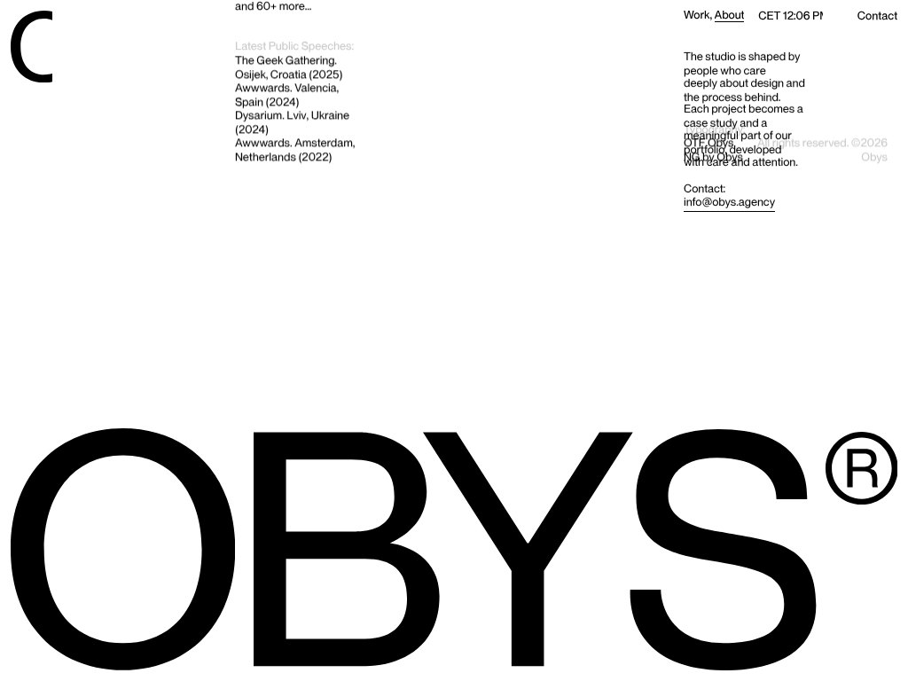
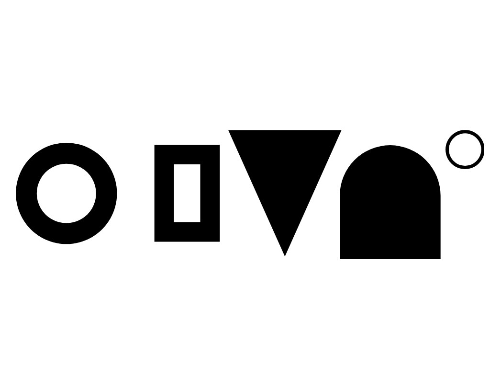
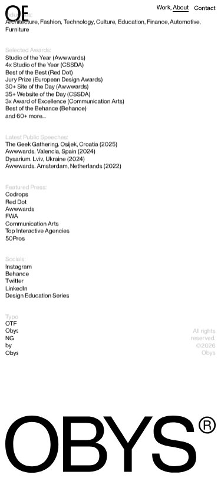
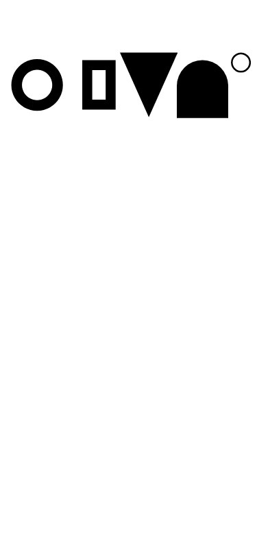

# Fidelity Report: giant-wordmark-footer

- **Sumber:** `agency-portfolio/obys-agency-nextjs` (`src/components/about/AboutFooterLogo.tsx`, `#ab-fo`, `http://localhost:3021/about`)
- **Ekstrak:** `registry/sections/giant-wordmark-footer` (`http://localhost:3025/preview/section/giant-wordmark-footer`)
- **Style:** `swiss-mono` (`css-modules`, 100% token `--rk-*`)

## Hasil `npm run fidelity`

- `1920x980`: 4 elemen (`root`, `row`, `glyphFirst`, `glyphLast`), **0 FAIL**, 8 WARN
- `1024x768`: 4 elemen (`root`, `row`, `glyphFirst`, `glyphLast`), **0 FAIL**, 8 WARN
- `375x812`: 4 elemen (`root`, `row`, `glyphFirst`, `glyphLast`), **0 FAIL**, 8 WARN

## Screenshot Berdampingan

| Viewport | Asli | Ekstrak |
| --- | --- | --- |
| `1920x980` |  |  |
| `1024x768` |  |  |
| `375x812` |  |  |

## Temuan yang Diperbaiki

- Menambahkan tipografi dasar (`font-family`, `font-size: calc(var(--rk-u) * 1.1)`, `line-height: 1.2`, `letter-spacing: -0.01em`) pada `.root` agar identik dengan `#ab-fo`.
- Memindahkan `background: var(--rk-bg)` ke `.root::before` (`z-index: -1`) dengan `isolation: isolate; background: transparent;` agar `backgroundColor` terukur `rgba(0, 0, 0, 0)` seperti aslinya.

## Beda yang Disengaja (WARN)

- **Wordmark geometris netral:** `preview.tsx` dan default `glyphs` memakai 5 glyph SVG geometris netral dengan persentase flex dan tinggi/rasio kontainer yang sama persis (`25.35%`, `20.99%`, `23.66%`, `21.06%`, `8.17%`).
- **Koordinat `y` capture:** pada web asli `#ab-fo` berada di bagian bawah halaman saat di-scroll, sedangkan preview section dimulai di `y: 0`.
