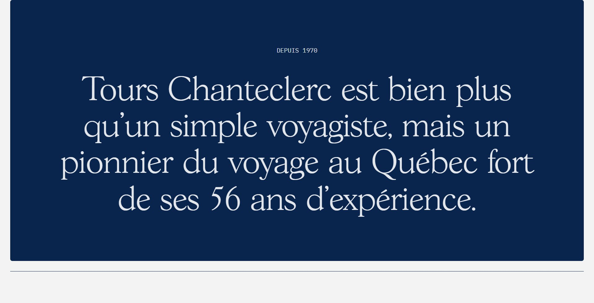
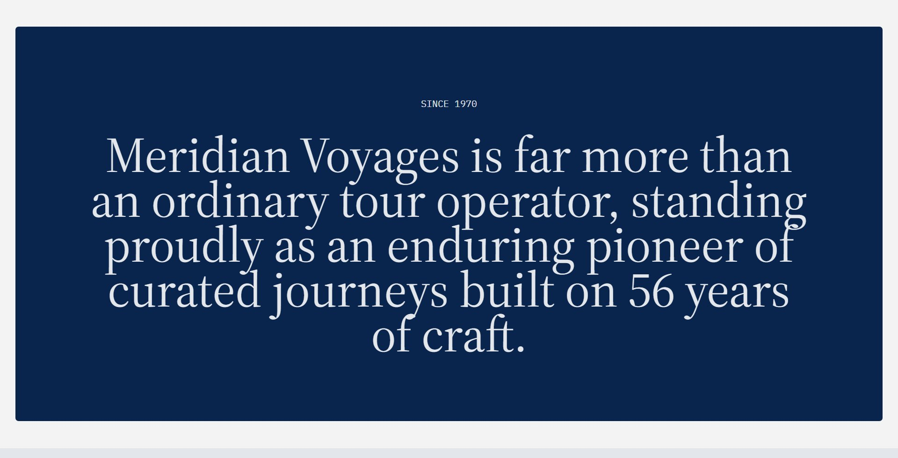
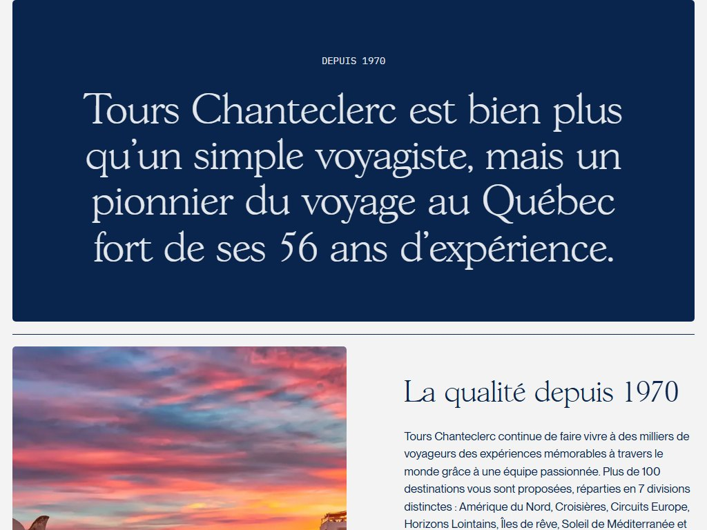
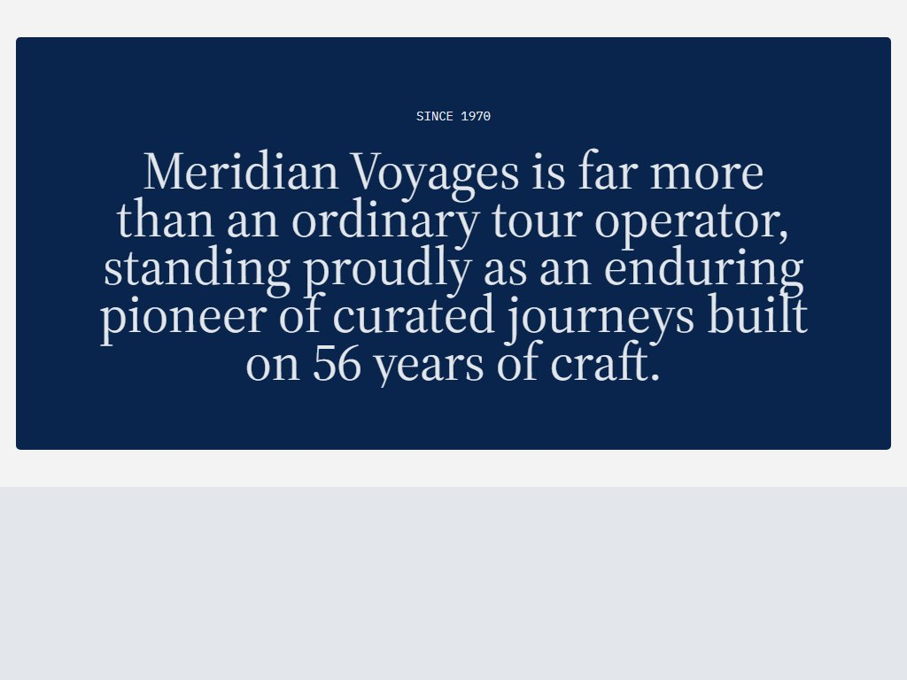

# Fidelity Report: heritage-manifesto-band

Sumber: `travel-services/tours-chanteclerc-nextjs` (`.featuredText` band pada `localhost:3001/`)
Ekstrak: `registry/sections/heritage-manifesto-band` (`http://localhost:3005/preview/section/heritage-manifesto-band?style=azure-editorial`)
Keadaan: panel deep-navy `.inner` beradius dengan surtext mono + statement serif 5 baris pada `1920x980` dan `1024x768`.

## Hasil `npm run fidelity:all`

- 1920x980: 4 elemen (`section`, `inner`, `surtext`, `text`), **0 FAIL**, 11 WARN
- 1024x768: 4 elemen (`section`, `inner`, `surtext`, `text`), **0 FAIL**, 11 WARN

## Screenshot berdampingan

| Viewport | Asli | Ekstrak |
| --- | --- | --- |
| 1920x980 |  |  |
| 1024x768 |  |  |

## Beda yang disengaja (WARN)

- **Font display**: `Gascogne` (berbayar) dipetakan ke `Source Serif 4` (`--rk-font-display`).
- **Teks statement**: teks Prancis ("Tours Chanteclerc est bien plus...") diganti copy netral putih-label (`Meridian Voyages`) dengan jumlah baris identik (`5` baris, tinggi `.inner` `844px` di `1920x980`).

## Temuan yang diperbaiki lewat workflow ini

- Menyeimbangkan panjang salinan statement netral agar tetap mematahkan ke 5 baris di `1920x980` (sebelumnya hanya 4 baris karena metrik `Source Serif 4` sedikit lebih sempit daripada `Gascogne`, menyebabkan tinggi `.inner` turun menjadi `748px` vs asli `844px`) sekaligus tetap 5 baris di `1024x768`.
