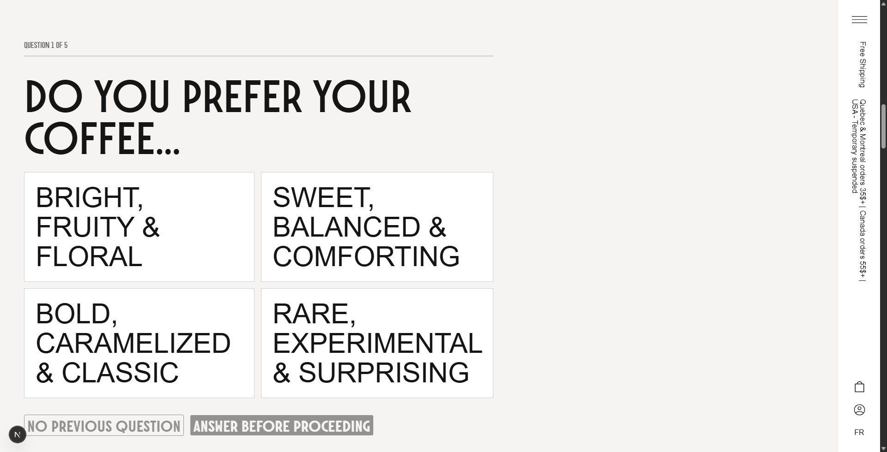
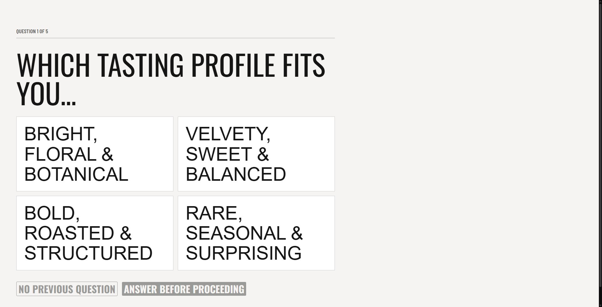
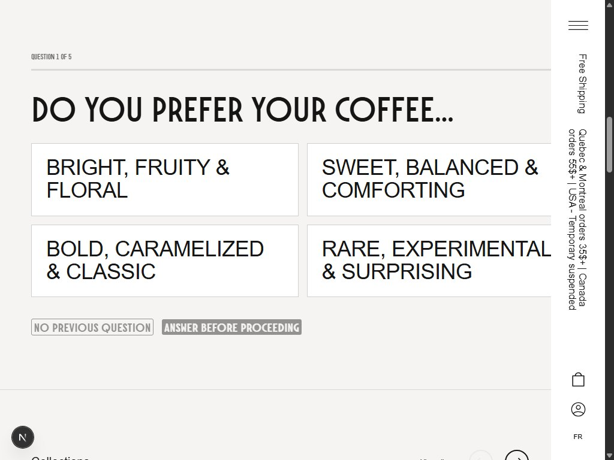
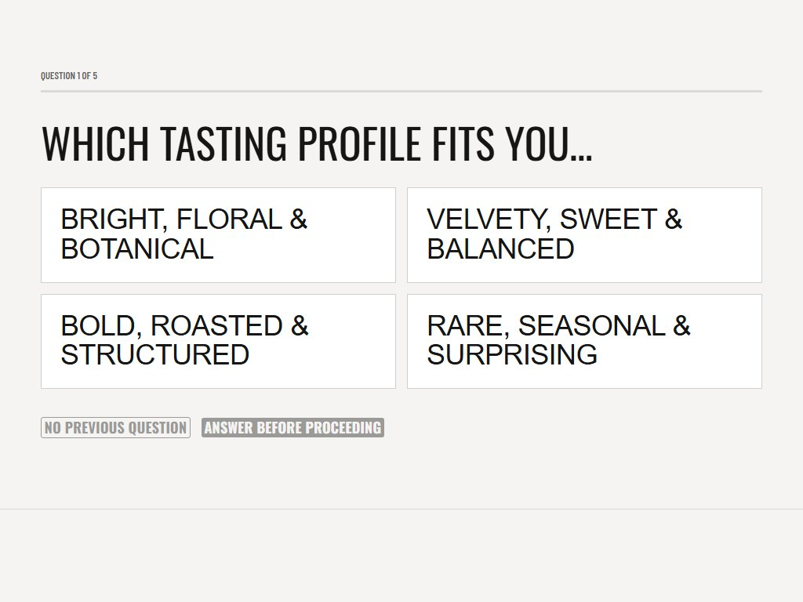

# Fidelity Report: interactive-quiz

Sumber: `coffee-shop/escape-cafe-nextjs/src/components/CoffeeQuiz.tsx` (localhost:3001)
Ekstrak: `registry/sections/interactive-quiz` (localhost:3000/preview/section/interactive-quiz)
Keadaan: pertanyaan 1 dari 5, belum ada opsi dipilih (tombol navigasi nonaktif pada `opacity: 0.4`).

Catatan pengukuran: di web asli, `.section` dibatasi `100vw - 90px` untuk memberi ruang rail navbar kanan. Saat mengukur web asli, lebar `#quiz` disamakan menjadi `100%` (`#quiz { width: 100% !important }`) supaya yang dibandingkan adalah komponennya, bukan layout halamannya.

## Hasil `npm run fidelity`

- 1920x980: 14 elemen, **0 FAIL**, 17 WARN. Tinggi section **1035.8px** (asli 1035.8px, selisih 0.0px), kontainer **854.8px** (asli 854.8px).
- 1024x768: 14 elemen, **0 FAIL**, 19 WARN. Tinggi section **650.5px** (asli 650.5px, selisih 0.0px), kontainer **469.5px** (asli 469.5px).

## Screenshot berdampingan

| Viewport | Asli | Ekstrak |
| --- | --- | --- |
| 1920x980 |  |  |
| 1024x768 |  |  |

## Beda yang disengaja (WARN)

- **Font display & tombol**: Molitor (berbayar) diganti **Oswald** (`--rk-font-display`), sehingga lebar tombol `prevBtn` sedikit lebih sempit (346.4px vs 322.9px di 1920; 204.3px vs 190.6px di 1024) dan posisi X `nextBtn` ikut bergeser, tetapi tinggi tombol (45.5px / 43.5px di 1920; 27.6px / 25.6px di 1024) dan jumlah baris judul (2 baris di 1920, 1 baris di 1024) sama persis.
- **Font eyebrow**: Garaje (berbayar) diganti **Barlow Condensed** (`--rk-font-narrow`), dengan ukuran responsif identik (18px di 1920, 12.8px di 1024).
- **Hitam tombol navigasi**: `#000` asli memakai token `--rk-fg` (`#151515`), dalam batas token rounding.
- **Teks preview netral**: pertanyaan dan opsi memakai copy white-label netral tanpa referensi brand, dengan panjang karakter setara sehingga jumlah baris per kartu opsi identik (3 baris di 1920, 2 baris di 1024).
- **Isian progress bar**: di web asli, `.escape-quiz__progress-bar` disembunyikan oleh aturan `div:empty { display: none }` dari tema Dawn (`visible: false`). Di ekstrak, `progressFill` default `false` untuk kesamaan visual 1:1 dan dapat diaktifkan lewat prop `progressFill={true}`.

## Temuan yang diperbaiki lewat workflow ini

- Kontainer `.escape-quiz__container` di aslinya rata kiri (`max-width: 1120px` tanpa `margin: 0 auto`) dengan `padding: 0 52px` di desktop (`0 20px` di mobile) dan `padding: 90px 0` pada section.
- Opsi kuis di aslinya memakai `.t-h5` besar dalam font `Arial` (`min(3.4722222222vw, 6.1728395062vh)`, `line-height: 1.06`, `letter-spacing: -0.01em`, uppercase) di atas latar putih `--rk-surface-elevated` yang berbalik ke `--rk-fg` saat hover/terpilih.
- Tombol navigasi memakai ukuran & padding responsif `.btn.t-h4` (`min(1.8055555556vw, 3.2098765432vh)`, padding `min(0.3472222222vw, 0.6172839506vh)`, `border-radius: 3px`) dan varian ghost/dark sesuai aslinya.
- Layar hasil akhir lengkap dipertahankan (grid `1.3fr 0.7fr`, deskripsi `58ch`, CTA utama/sekunder, tombol `Retake quiz`, serta slot media/placeholder).
