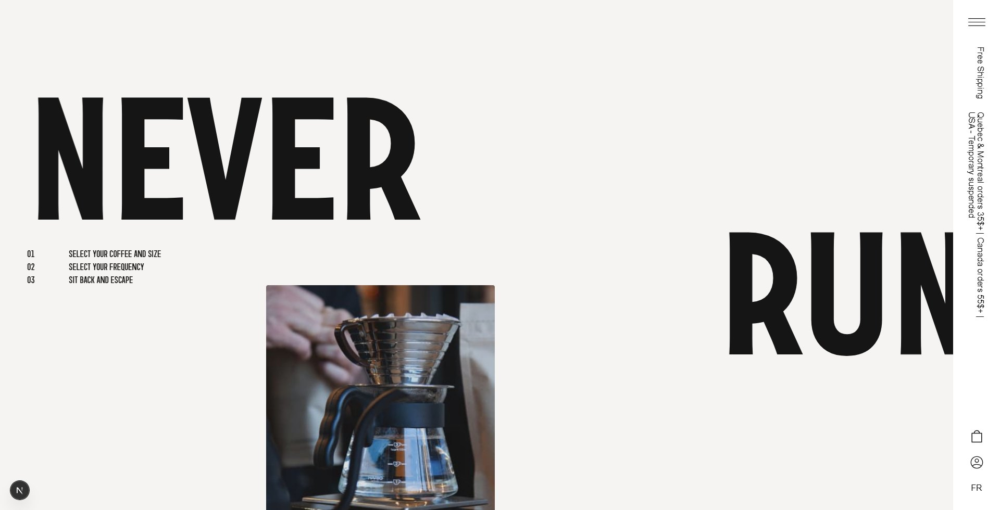
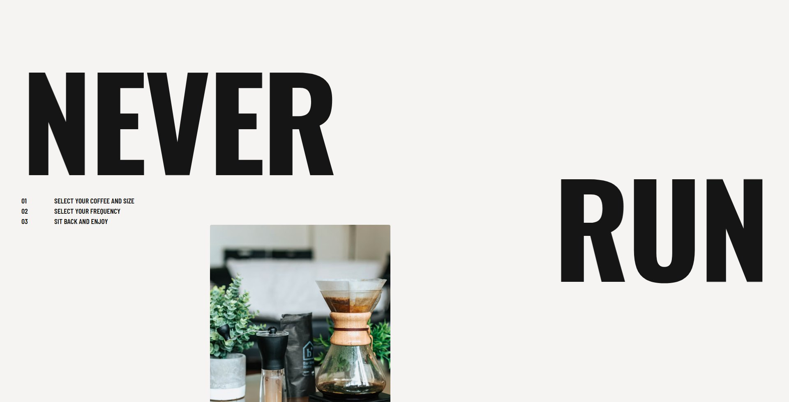
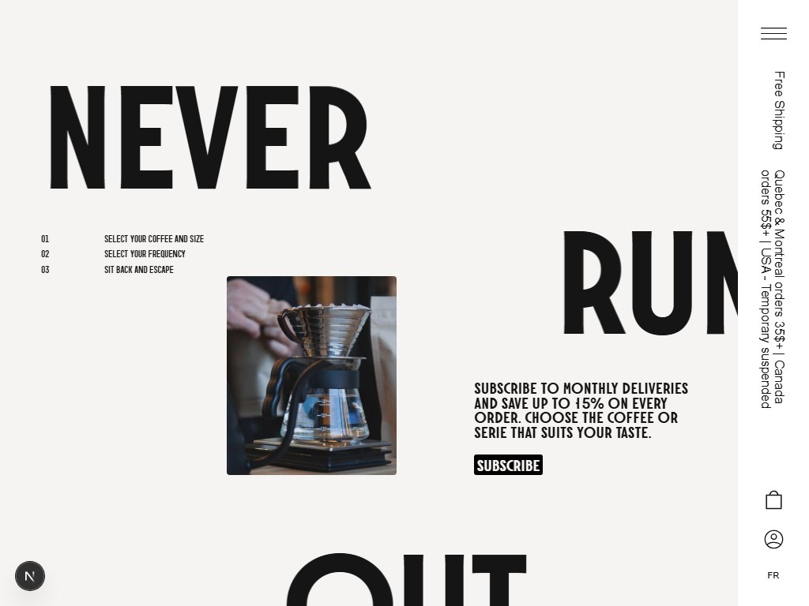
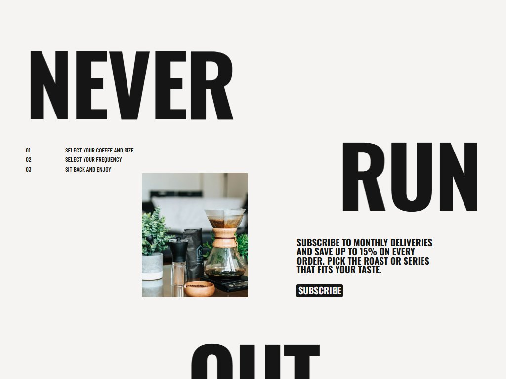

# Fidelity Report: kinetic-manifesto-steps

Sumber: `coffee-shop/escape-cafe-nextjs/src/components/HomeManifest.tsx` (`http://localhost:3001/#manifest`)
Ekstrak: `registry/sections/kinetic-manifesto-steps` (`http://localhost:3000/preview/section/kinetic-manifesto-steps`)
Keadaan: bagian `#manifest` digulir ke atas viewport setelah seluruh animasi GSAP split-char dan fade-in (`once: true`) selesai.

Catatan pengukuran: di web asli, `.section` dibatasi `100vw - 90px` untuk memberi ruang rail navbar kanan. Aturan itu milik layout halaman, bukan komponen manifesto, sehingga saat mengukur lebar `#manifest` asli disamakan menjadi `100%` (`#manifest { width: 100% !important }`).

## Hasil `npm run fidelity`

- 1920x980: 11 elemen, **0 FAIL**, 10 WARN. Tinggi total section 1621.6px vs 1623.1px (selisih 0.09% karena scrollbar 10px vs 15px).
- 1024x768: 11 elemen, **0 FAIL**, 12 WARN. Tinggi total section 920.0px vs 921.4px (selisih 0.15%).

Seluruh metrik geometri, padding, line-height, tinggi deskripsi (3 baris 94.4px di 1920 dan 4 baris 73.9px di 1024), tinggi tombol CTA (43.5px di 1920 dan 25.6px di 1024), dan grid 12 kolom lolos tanpa FAIL.

## Screenshot berdampingan

| Viewport | Asli | Ekstrak |
| --- | --- | --- |
| 1920x980 |  |  |
| 1024x768 |  |  |

## Beda yang disengaja (WARN)

- **Font display**: Molitor (berbayar) diganti **Oswald** (`--rk-font-display`), yang lebarnya paling dekat. Lebar `RUN` (488.7px vs 521.1px di 1920; 270.3px vs 288.3px di 1024), `run.x`, dan lebar tombol `SUBSCRIBE` (147.4px vs 160px di 1920; 86.6px vs 94px di 1024) mengikuti metrik Oswald.
- **Font daftar langkah**: Garaje (berbayar) diganti **Barlow Condensed** (`--rk-font-narrow`), mempertahankan `font-weight: 300`, `line-height: 1`, dan grid `80px auto`.
- **Pembulatan float CSS**: `letter-spacing: -0.02em` pada 1024x768 dibulatkan `-3.41333px` vs `-3.41334px` (selisih 0.00001px).
- **Warna tombol CTA**: `#000000` asli dipetakan ke token `--rk-fg` (`#151515`, `rgb(21, 21, 21)`) agar tetap adaptif di semua preset gaya (`editorial-roastery`, `kinetic-obsidian`, dll.).
- **Aset dan salinan bebas merek**: foto pour-over CDN brand diganti foto Unsplash pour-over carafe di atas timbangan digital, dan teks langkah/deskripsi dinetralkan tanpa menyebut nama brand namun mempertahankan jumlah baris identik (3 baris di 1920, 4 baris di 1024).
- **Aksesibilitas**: tombol CTA dilengkapi `:focus-visible` dan seluruh animasi GSAP menghormati `prefers-reduced-motion: reduce`.

## Perbaikan dari versi awal

- Memisahkan wrapper `.section` (`background: var(--rk-bg)`, `padding: 0`) dan `.root` (`padding: min(9.03vw, 16.05vh) 0`, transparan) agar struktur DOM 1:1 dengan `#manifest` > `.homeManifest`.
- Menghapus wrapper `.charMask` dengan `overflow: hidden` dan memakai `.word` + `.char` langsung agar tinggi `.tH1` tidak membesar di luar `line-height: 0.85`.
- Mengganti `.tNarrow` dari `--rk-font-display` (`fw 500`, `ls 0.02em`) ke `--rk-font-narrow` (`fw 300`, `ls normal`).
- Mengembalikan gaya asli `.ctaBtn` (`padding: 5px` / `min(0.35vw, 0.62vh)`, `border: 0`, `border-radius: 3px`, hover ke `--rk-surface-elevated`) dan `.imageBox` (`background: transparent`, overlay `color-mix`, parallax `--yPercent` `scale(1.2)`).
- Memporting penuh 4 pola GSAP dari `useEscapeAnimations.ts`: split-char `expo.out` bergantian `xPercent`/`yPercent`, scrub parallax `--yPercent`, fade-up `power2.out` dengan `clearProps: "transform"`, serta reveal baris mobile.

## Pembaruan 2026-11-26: props untuk dipakai ulang

Props opsional baru: `id` pada `<section>` dan `onCtaClick` baru. CTA tidak lagi `preventDefault()` otomatis pada href `#...`; link bernavigasi normal kecuali `onCtaClick` diberikan. Default semua prop baru menghasilkan DOM yang sama dengan sebelumnya.

Diukur ulang 2026-11-26 dengan `scripts/fidelity-capture.ts` (label dan selector sama dengan ekstrak lama, build produksi baru):

- 1920x980: 11 elemen, 7 FAIL, 18 WARN
- 1024x768: 11 elemen, 7 FAIL, 24 WARN

Catatan: semua FAIL tersisa adalah lebar elemen selebar viewport. `original-*.json` diukur sebelum normalisasi scrollbar (scrollbar 15px, lebar 1905/1009px), sedangkan ekstrak baru diukur dengan `fidelity-capture` yang menyembunyikan scrollbar (1920/1024px). FAIL yang sama sudah ada sebelum perubahan ini (ekstrak lama 1910/1014px juga FAIL melawan 1905/1009px). Perbandingan ekstrak lama vs baru hanya berbeda di lebar viewport itu (plus tinggi blok beraspek-rasio yang ikut melebar), tanpa beda struktur atau teks. Perbaikannya: ukur ulang `original-*.json` dengan `measure.js` terbaru (ternormalisasi).

## Pembaruan 2026-11-27: ukur ulang ternormalisasi

`original-*.json` dan `extract-*.json` diukur ulang dengan `scripts/fidelity-capture.ts` (scrollbar disembunyikan di kedua sisi, lebar penuh 1920/1024px). Hasil `npm run fidelity`: 1920x980 11 elemen, **0 FAIL**, 10 WARN; 1024x768 11 elemen, **0 FAIL**, 13 WARN. FAIL lebar viewport di catatan sebelumnya hilang karena kedua sisi kini sama-sama 1920/1024px. Tidak ada perubahan CSS.
