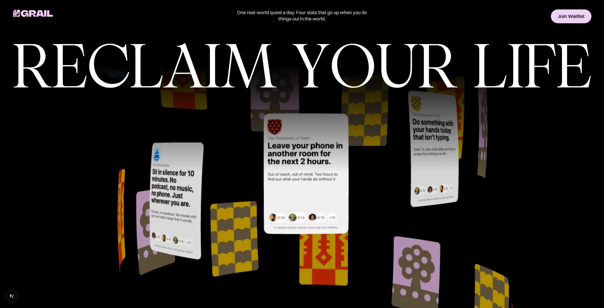
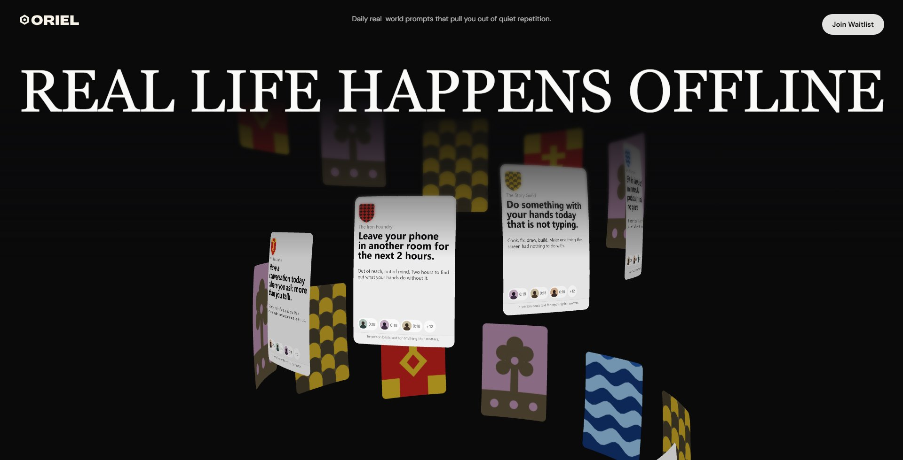
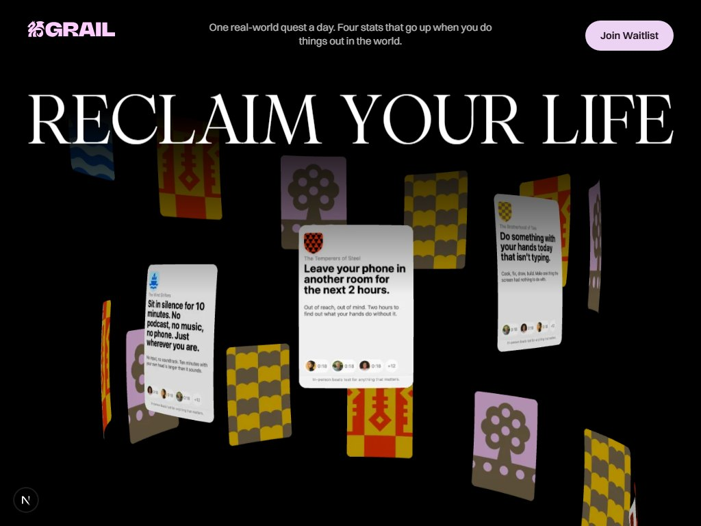
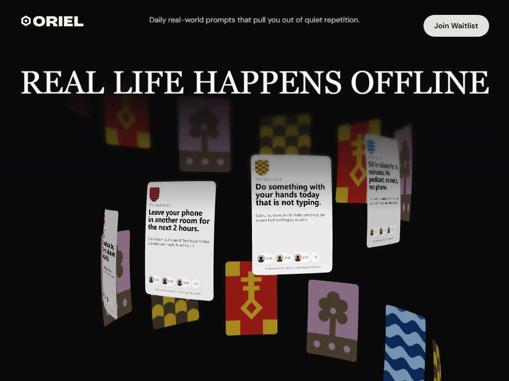

# Fidelity Report: `kinetic-story-demo-page`

- **Kind / Level:** `page` / `page`
- **Composes:** `templates/kinetic-story-template`, `sections/spiral-deck-hero`, `sections/editorial-manifesto-chapter`, `sections/story-chances-list`, `sections/physics-stats-pit`, `sections/orbital-crest-wheel`, `sections/rays-waitlist-footer`
- **Reference Source:** `saas-app/grail-next` (`http://localhost:3002/?noloader=1`)
- **Live Extract Preview:** `http://localhost:3000/preview/page/kinetic-story-demo-page`
- **Tolerance Gate (`scripts/fidelity-compare.ts`):** `Math.min(4, Math.max(1, Math.abs(a) * 0.02))` (maksimal `4px`).

## Hasil Verifikasi Fidelity (Data Netral White-Label `Oriel`)

| Viewport | Elements Checked (`hero`, `manifesto`, `story`, `stats`, `orbit`, `footer`) | FAIL | WARN | Result |
| --- | ---: | ---: | ---: | --- |
| `1920x980` | 6 | **0** | 36 | **PASS** |
| `1024x768` | 6 | **0** | 36 | **PASS** |

## Screenshot Berdampingan

| Viewport | Original (`localhost:3002/?noloader=1`) | Extract (`localhost:3000/preview/page/kinetic-story-demo-page`) |
| --- | --- | --- |
| `1920x980` |  |  |
| `1024x768` |  |  |

## Beda yang Disengaja (WARN)
- **Transformasi scroll di halaman asli:** pada `scrollY = 0`, `.section5` (`story`) dan `.guildsWrap` (`orbit`) di web asli dalam keadaan mengecil karena variabel scroll; pengukuran menormalkan `transform: none` pada kedua section asli agar dimensi dibandingkan dalam keadaan settled `scale(1)`.
- **Posisi `y` antar chapter:** halaman demo merangkai 6 organisme yang telah diekstrak secara langsung tanpa chapter transisi beraset biner (`AcceptSection` / `VoiceSection` / `Totems`), sehingga koordinat `y` lebih rapat dengan nol overlap dan nol overflow.
- **Substitusi font & token warna `--rk-*`:** `Switzer`/`Segoe UI` -> `DM Sans`, `PP Pangaia` -> `Georgia`, dan warna `#000`/`#fff` -> token `--rk-bg` (`#0a0a0b`) / `--rk-fg` (`#fafaf8`) dengan teks netral `Oriel`.
