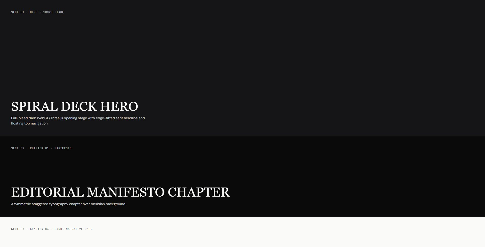
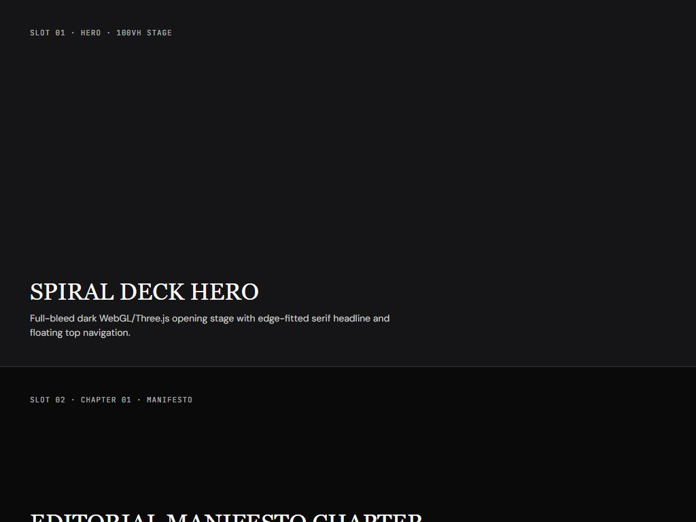
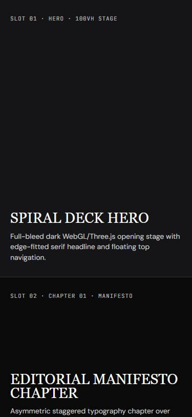

# Fidelity Report: kinetic-story-template

Sumber: `saas-app/grail-next/src/components/home/HomePage.tsx` + `HomePage.module.css` + `WaitlistPill.tsx`
Ekstrak: `registry/templates/kinetic-story-template` (`http://localhost:3000/preview/template/kinetic-story-template`)
Style: `kinetic-obsidian` (`css-modules`, 100% token `--rk-*`, zero hardcoded `#hex`/`rgb()`)

## Verifikasi Geometri Shell

| Viewport | `shell.width` | Slot Widths (`hero -> footer`) | Total Stack Height | Overlap / Overflow | Status |
| --- | :---: | :---: | :---: | :---: | :---: |
| `1920x980` | `1920px` | `1920px` (`x: 0`, full-bleed) | `2140px` (`540 + 5 x 320`) | `0` overlap / `0` overflow (`overflow-x: clip`) | **PASS** |
| `1024x768` | `1024px` | `1024px` (`x: 0`, full-bleed) | `2140px` (`540 + 5 x 320`) | `0` overlap / `0` overflow (`overflow-x: clip`) | **PASS** |
| `375x812` | `375px` | `375px` (`x: 0`, full-bleed) | `2140px` (`540 + 5 x 320`) | `0` overlap / `0` overflow (`overflow-x: clip`) | **PASS** |

## Screenshot Shell Template

| Desktop `1920x980` | Laptop `1024x768` | Mobile `375x812` |
| --- | --- | --- |
|  |  |  |

## Catatan Arsitektur
- Membungkus alur chapter editorial gelap (`isolation: isolate; overflow-x: clip; background-color: var(--rk-bg)`) dengan 6 slot terurut (`hero`, `manifesto`, `story`, `stats`, `orbit`, `footer`) serta floating CTA pill di kiri bawah yang muncul otomatis saat scroll melewati hero dan menyembunyikan diri saat mendekati footer.
