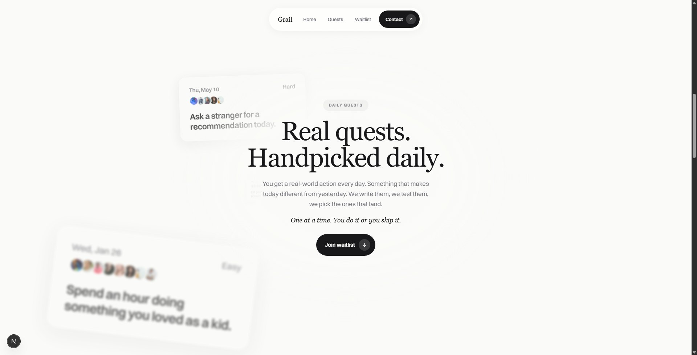
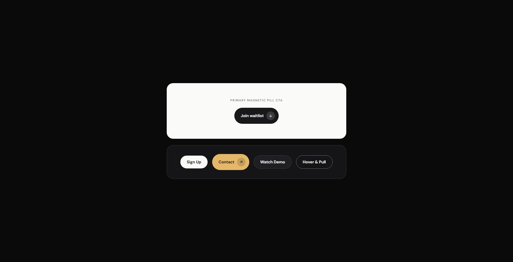
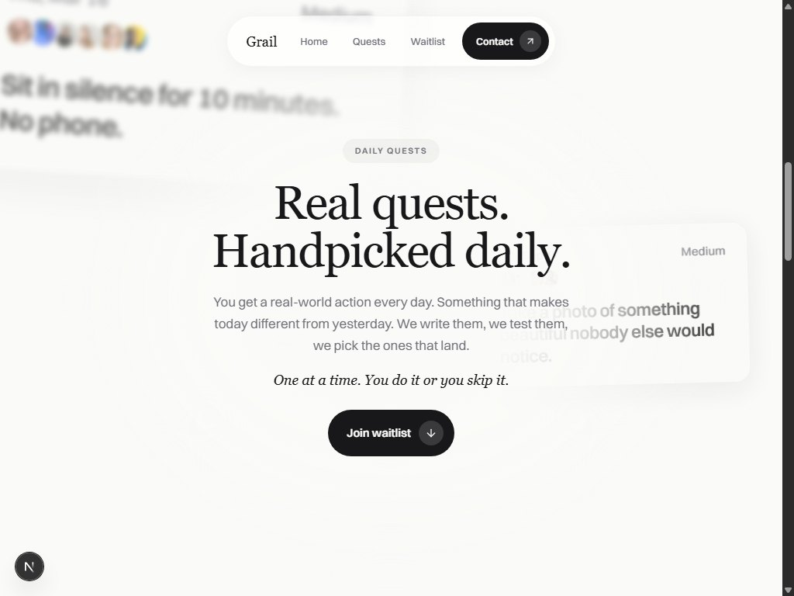
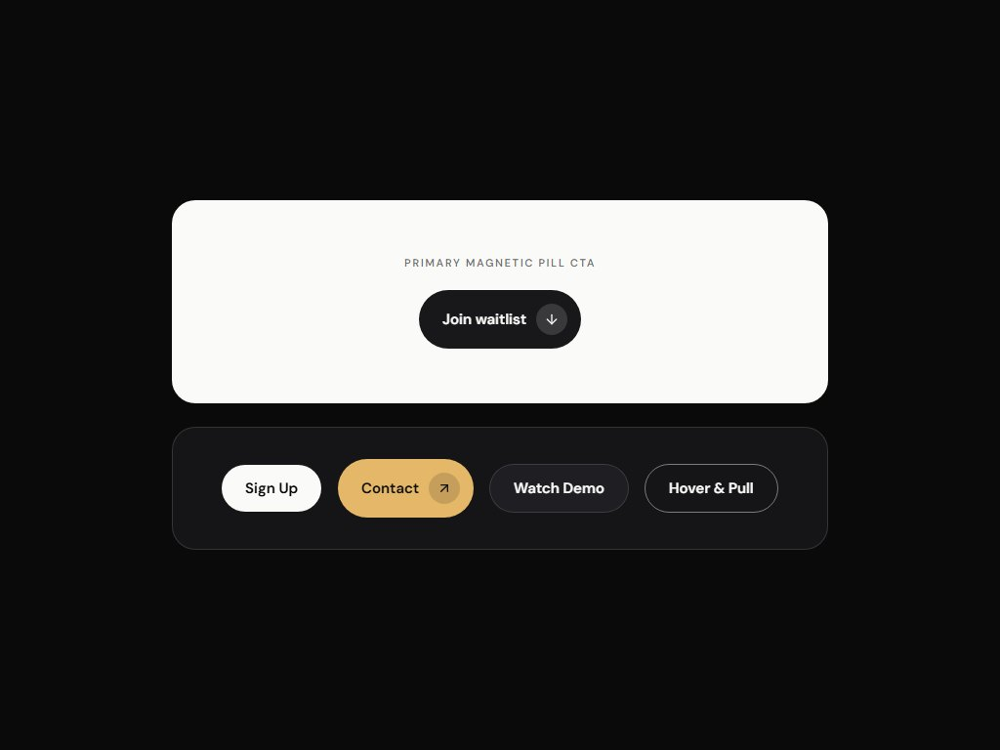

# Fidelity Report: magnetic-button

Sumber: `saas-app/grail-next/src/components/landing/MagneticButton.tsx` + `FlyingQuestsSection.module.css` (`http://localhost:3002/v1`, `#quests button`)
Ekstrak: `registry/ui/magnetic-button` (`http://localhost:3000/preview/ui/magnetic-button`)
Keadaan: tombol CTA pill magnetik utama (`"Join waitlist"` dengan badge ikon panah bawah `32x32px`) dalam posisi diam (`x=0, y=0`) di atas latar terang (`--rk-fg` `#fafaf8` pada preset `kinetic-obsidian`).

## Hasil `npm run fidelity`

- `1920x980`: 4 elemen (`button`, `label`, `icon`, `iconSvg`), **0 FAIL**, 10 WARN.
- `1024x768`: 4 elemen (`button`, `label`, `icon`, `iconSvg`), **0 FAIL**, 10 WARN.

Seluruh metrik geometri dan gaya lolos tanpa FAIL: tinggi tombol `60px`, padding `14px 14px 14px 24px`, `gap: 10px`, `border-radius: 100px`, `display: inline-flex`, ukuran teks `15px` (`font-weight: 600`, `line-height: normal`, tinggi label `20px`), badge ikon `32x32px` (`border-radius: 100px`), SVG panah `16x16px`, warna teks `rgb(250, 250, 248)` (selisih 0), dan warna latar tombol `color-mix(in srgb, var(--rk-surface) 70%, var(--rk-surface-elevated))` (`rgb(24, 24, 27)`, selisih < 1).

## Screenshot berdampingan

| Viewport | Asli | Ekstrak |
| --- | --- | --- |
| 1920x980 |  |  |
| 1024x768 |  |  |

## Beda yang disengaja (WARN)

- **Font body**: font lokal `Switzer` pada sumber asli dipetakan ke token `--rk-font-body` (`DM Sans`) di preset `kinetic-obsidian`. Hal ini memicu 4 WARN `fontRendered` dan 1 WARN lebar label (`82.8px` vs `86px`, +3.2px) di tiap viewport, dengan tinggi label tetap identik (`20px`).
- **Posisi vertikal (`y`)**: di web asli tombol berada di bagian bawah section `#quests` (`y: 645.9` di 1920, `528.3` di 1024), sedangkan di preview standalone tombol ditempatkan di pusat kartu showcase (`y: 403.3` di 1920, `297.3` di 1024). Ini menghasilkan 4 WARN koordinat `y`.
- **Pembulatan warna token badge ikon**: `#ffffff26` (`rgba(255, 255, 255, 0.15)`) asli dipetakan ke `color-mix(in srgb, currentColor 15%, transparent)` (`rgba(250, 250, 248, 0.15)`, delta RGB 7) agar tetap adaptif di semua varian dan preset tema tanpa warna hex atau rgb hardcoded.
- **Aksesibilitas & motion**: fisika pegas `motion/react` (`useMotionValue(0)`, `useSpring(target, { stiffness: 150, damping: 15 })`, `intensity = 0.3`) memantau `useReducedMotion()` dan CSS menonaktifkan transisi/transform saat `prefers-reduced-motion: reduce`, ditambah indikator fokus `:focus-visible`.

## Perbaikan dari versi awal

- Mengganti implementasi Tailwind + React state v1 menjadi `css-modules` + `motion/react` spring 1:1 sesuai `MagneticButton.tsx` dan `FlyingQuestsSection.module.css`.
- Mempertahankan kompatibilitas props (`children`, `icon`, `intensity`, `variant`, `className`, `onClick`, `disabled`, `type`, `style`) dengan varian `primary`, `accent`, `surface`, `outline`, dan `light`.
- Membungkus tombol utama pada `preview.tsx` dalam elemen blok `
` agar tidak ter-blockify oleh parent flex menjadi `display: flex`, sehingga `display: inline-flex` cocok 1:1 dengan aslinya.
