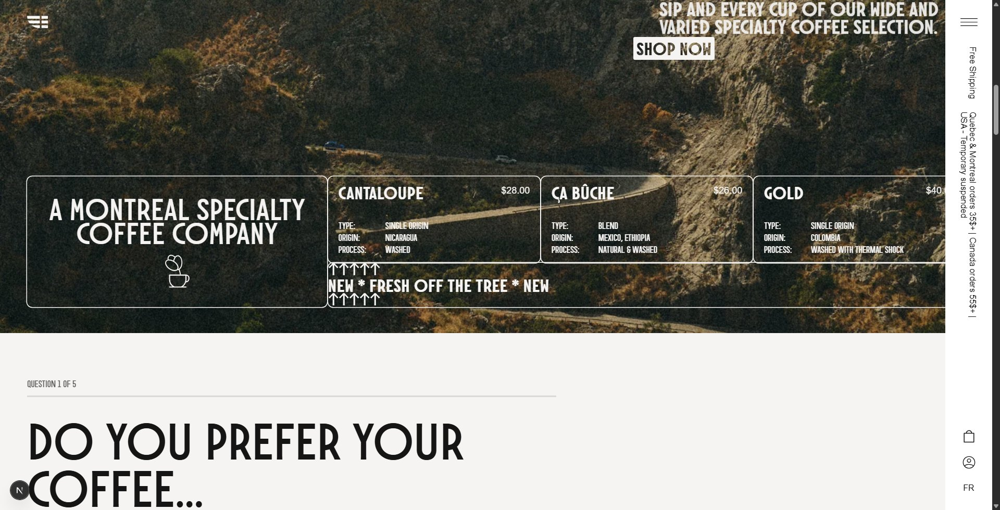
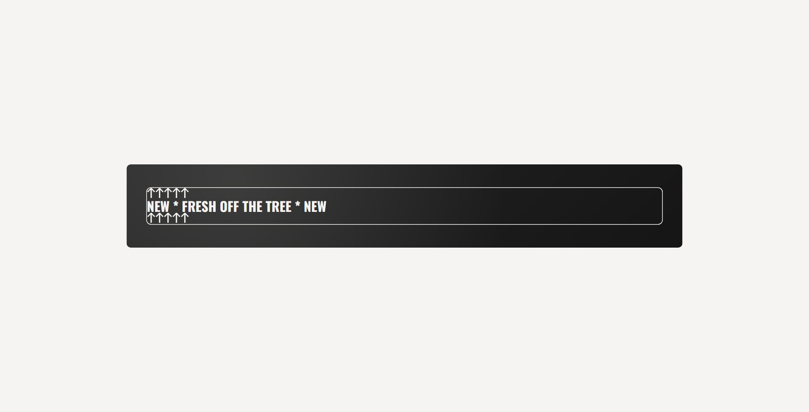
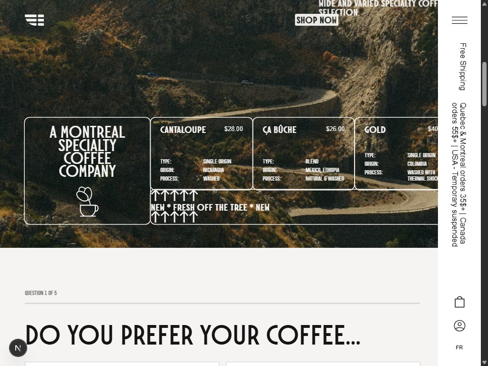
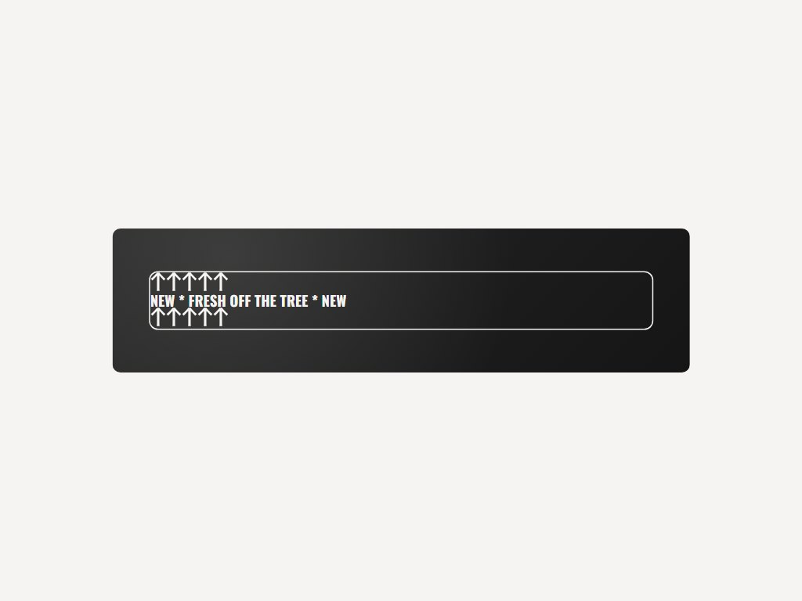

# Fidelity Report: marquee-ticker

Sumber: `coffee-shop/escape-cafe-nextjs/src/components/HomeHero.tsx` (`.homeHero__ticker.block`, `localhost:3001`)
Ekstrak: `registry/ui/marquee-ticker` (`localhost:3000/preview/ui/marquee-ticker`)
Keadaan: mode default `"arrows"`, 5+5 ikon `ArrowUpIcon` (`20x24`), teks `"NEW * FRESH OFF THE TREE * NEW"`, latar editorial gelap dengan lebar slot mengikuti proporsi `.homeHero__products`.

Catatan pengukuran: di web asli, `#hero` dibatasi `width: calc(100% - 90px)` untuk rail navbar kanan, jadi saat mengukur lebar `#hero` disamakan menjadi `100%` (`#hero { width: 100% !important }`) dan `.homeHero__push` di-scroll ke tengah viewport. Di `HomeHero.tsx`, kelas yang dipakai adalah `.homeHero__ticker.block` (bukan `.homeHero__pushTagline`), sehingga di browser asli tata letaknya bertumpuk 3 baris (`display: block`, `padding: 0`, `border-radius: 10px`, `box-shadow: 0 0 0 1.5px currentColor`): 5 panah inline (`27px`), teks `.t-h4` (`31.5px` di 1920 / `18.5px` di 1024), lalu 5 panah inline (`27px`).

## Hasil `npm run fidelity`

- 1920x980: 4 elemen (`ticker`, `inner`, `text`, `arrow`), **0 FAIL**, 9 WARN.
  - `ticker` & `inner`: asli `1223.5 x 85.5`, ekstrak `1223 x 85.5`.
  - `text`: asli `31.5px` (`line-height: 31.5px`), ekstrak `31.5px` (`line-height: 31.5px`).
  - `arrow`: asli `20 x 24` (`display: inline`), ekstrak `20 x 24` (`display: inline`).
- 1024x768: 4 elemen (`ticker`, `inner`, `text`, `arrow`), **0 FAIL**, 9 WARN.
  - `ticker` & `inner`: asli `640.8 x 72.5`, ekstrak `640.6 x 72.5`.
  - `text`: asli `18.5px` (`line-height: 18.5px`), ekstrak `18.5px` (`line-height: 18.5px`).
  - `arrow`: asli `20 x 24` (`display: inline`), ekstrak `20 x 24` (`display: inline`).

## Screenshot berdampingan

| Viewport | Asli | Ekstrak |
| --- | --- | --- |
| 1920x980 |  |  |
| 1024x768 |  |  |

## Beda yang disengaja (WARN)

- **Font display teks (`text.fontRendered`)**: Molitor (berbayar) diganti **Oswald** lewat `--rk-font-display`. Ukuran huruf (`31.5px` / `18.5px`), `line-height: 1`, `font-weight: 700`, `text-transform: uppercase`, dan tinggi baris sama persis.
- **Posisi `x` / `y` di halaman** (8 WARN per viewport): di web asli komponen berada di kanan bawah section `#hero` setelah blok mood `30vw`, sedangkan di preview terisolasi komponen dipusatkan di tengah stage. Seluruh dimensi (`width`, `height`, `fontSize`, `lineHeight`, `padding`), `borderRadius`, `display`, dan warna (`rgb(245, 244, 242)` pada `rgba(0, 0, 0, 0)`) identik 0 FAIL.
- **Aksesibilitas & mode opsional**: ditambahkan `role="region"`, `aria-label`, `:focus-visible`, `prefers-reduced-motion: reduce`, serta prop opsional `mode="scroll"` dengan `@keyframes scrollX` dari tema asli sambil mempertahankan default `mode="arrows"` 1:1.

## Temuan yang diperbaiki lewat workflow ini

- Mengganti styling lama (strip Tailwind datar dengan aksen merah) ke CSS Modules 1:1 `.block` wireframe (`border-radius: 10px`, `box-shadow: 0 0 0 1.5px currentColor`), `ArrowUpIcon` `20x24` asli, dan rumus `.t-h4` (`22px` mobile / `min(1.8055555556vw, 3.2098765432vh)` desktop).
- Melawan reset Tailwind Preflight (`svg { display: block; vertical-align: middle; }`) dengan `display: inline; vertical-align: baseline;` pada `.arrow` agar tinggi baris panah (`27px`) dan tinggi total ticker (`85.5px` di 1920, `72.5px` di 1024) cocok persis 0.0px dengan browser asli.
