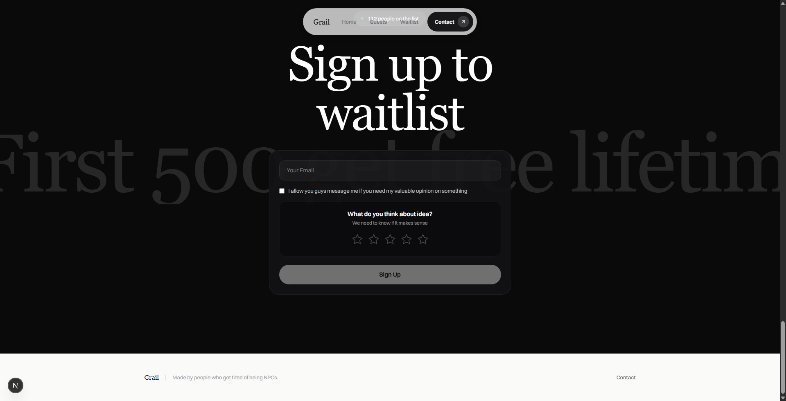
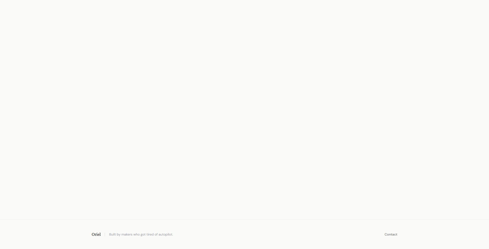
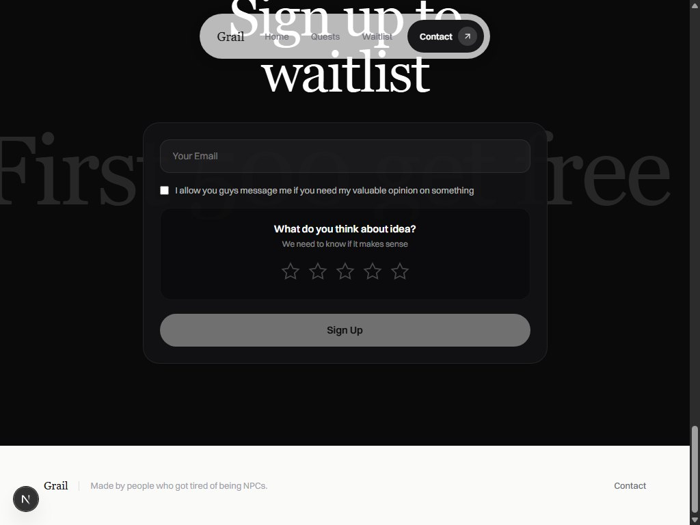
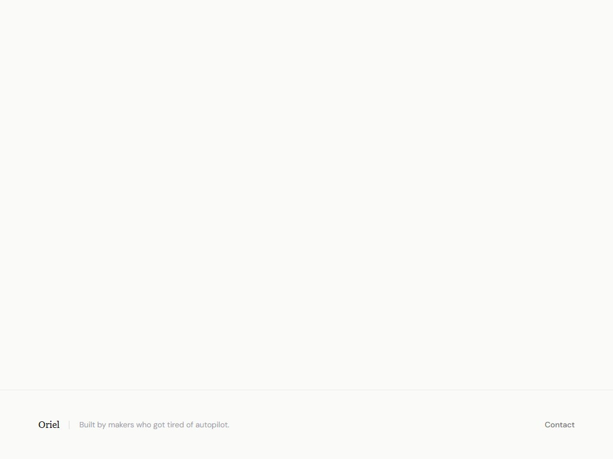

# Fidelity Report: minimal-saas-footer

Sumber: `saas-app/grail-next/src/components/LandingFooter.tsx` (`http://localhost:3002/v1`)
Ekstrak: `registry/sections/minimal-saas-footer` (`http://localhost:3000/preview/section/minimal-saas-footer`)
Style: `kinetic-obsidian` (`css-modules`, zero hardcoded `#hex`/`rgb()`, 100% terikat `--rk-*`)
Keadaan: bar footer bawah statis di atas latar terang `#fafaf8` (`var(--rk-fg)` dilukis via `::before` dalam `isolation: isolate`).

## Hasil `npm run fidelity`

| Viewport | Elemen Terukur | FAIL | WARN | Status |
| --- | --- | :---: | :---: | :---: |
| `1920x980` | 8 (`footer`, `inner`, `left`, `brand`, `divider`, `copy`, `right`, `link`) | **0** | 41 | **PASS** |
| `1024x768` | 8 (`footer`, `inner`, `left`, `brand`, `divider`, `copy`, `right`, `link`) | **0** | 38 | **PASS** |

## Screenshot berdampingan

| Viewport | Asli | Ekstrak |
| --- | --- | --- |
| 1920x980 |  |  |
| 1024x768 |  |  |

## Metrik Geometri & Tipografi

| Elemen | Metrik | Asli (`1920` / `1024`) | Ekstrak (`1920` / `1024`) | Selisih |
| --- | --- | --- | --- | :---: |
| `footer` | Tinggi & Padding | `116px` (`48/64/48/64px`) | `116px` (`48/64/48/64px`) | `0.0px` |
| `footer` | Border Top | `1px rgba(24,24,27,0.06)` | `1px color-mix(--rk-bg 6%)` | Persis (`1px`) |
| `inner` | Lebar & Tinggi | `1200 x 19px` / `881 x 19px` | `1200 x 19px` / `896 x 19px` | `0.0px` tinggi |
| `brand` | Font / Ukuran / Box | `Georgia`, `16px / 400`, `35.5 x 19px` | `Georgia`, `16px / 400`, `35.5 x 19px` | `0.0px` |
| `divider` | Ukuran | `1 x 14px` (`gap: 16px`) | `1 x 14px` (`gap: 16px`) | `0.0px` |
| `copy` | Ukuran / Tinggi / Warna | `13px / 400 / 17px`, `rgb(161,161,170)` | `13px / 400 / 17px`, `rgb(161,161,170)` | `0.0px` |
| `link` | Ukuran / Bobot / Tinggi | `13px / 500 / 17px` | `13px / 500 / 17px` | `0.0px` |

## Beda yang disengaja (WARN)

- **Font body (`Switzer` -> `DM Sans`)**: preset `kinetic-obsidian` mengikat `--rk-font-body` ke `DM Sans`. Font display `Georgia` pada `brand` identik (`35.5 x 19px`, selisih `0.0px`).
- **Pembulatan token warna (`--rk-*`)**: tinta gelap (`rgb(24, 24, 27)`), border/divider transparan (`6%`, `12%`), dan warna tautan (`rgb(113, 113, 122)`) dihitung lewat `color-mix()` dari `--rk-bg` / `--rk-fg` (selisih 1-5 kanal RGB, tanpa `#hex`/`rgb()` mentah).
- **Teks white-label**: `"Grail"` -> `"Oriel"` dan `"Made by people who got tired of being NPCs."` -> `"Built by makers who got tired of autopilot."` (tinggi 1 baris identik `17px`).
- **Lebar scrollbar**: halaman penuh asli memiliki scrollbar vertikal `15px` (`1905px` / `1009px`), sedangkan preview standalone satu section tanpa overflow vertikal (`1920px` / `1024px`).
