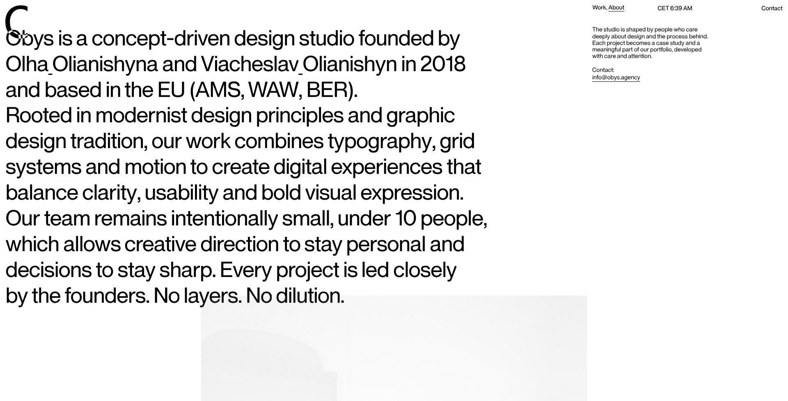
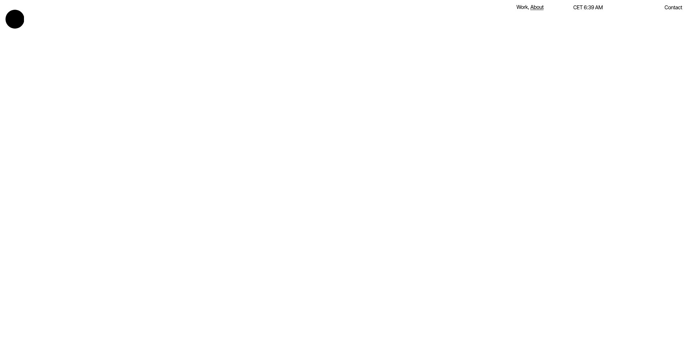
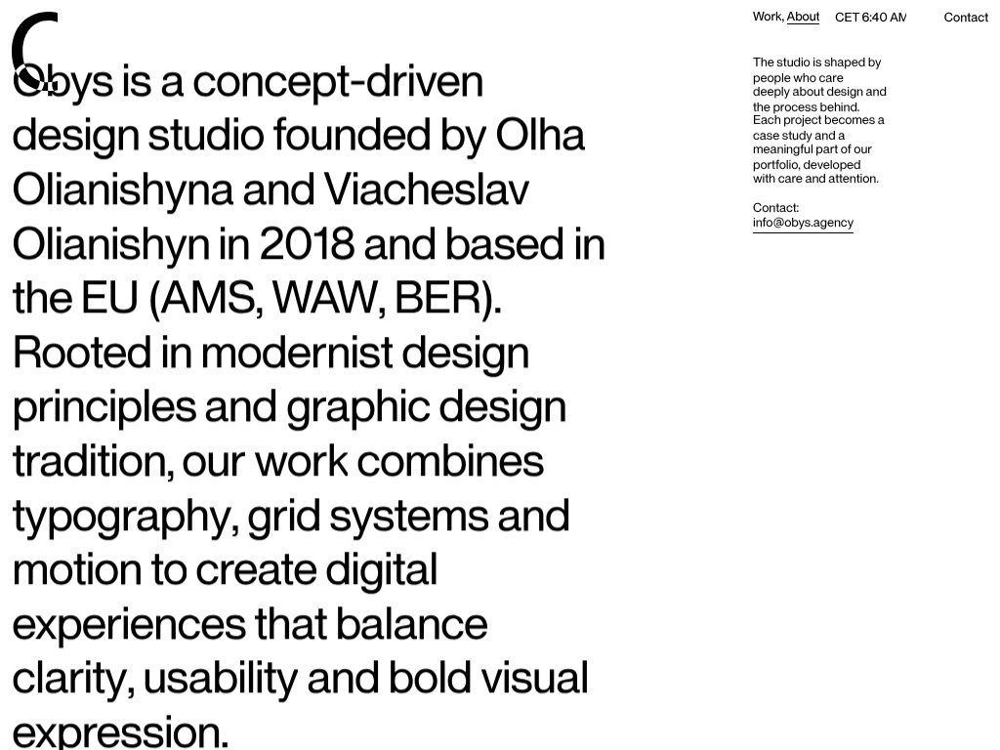
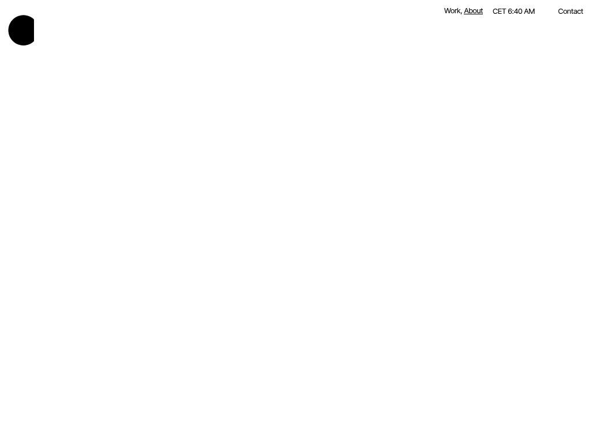
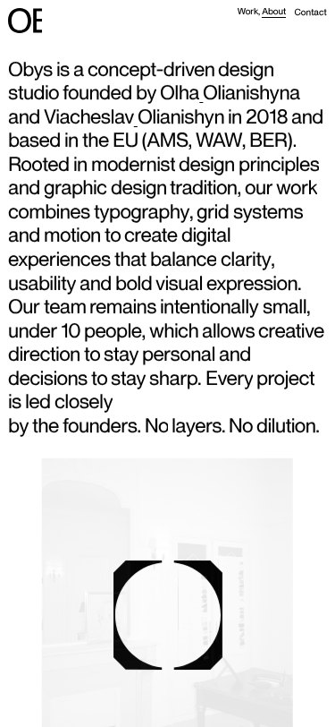
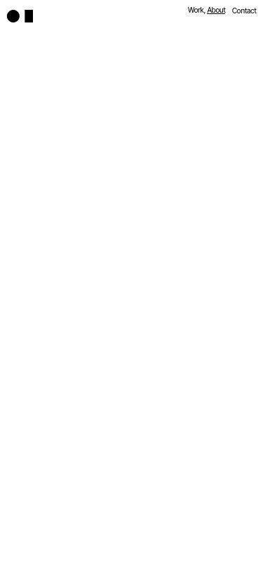

# Fidelity Report: mono-clock-header

- **Sumber:** `agency-portfolio/obys-agency-nextjs` (`src/components/shell/Header.tsx`, `#header.is-shrink`, `http://localhost:3021/about`)
- **Ekstrak:** `registry/sections/mono-clock-header` (`http://localhost:3025/preview/section/mono-clock-header`)
- **Style:** `swiss-mono` (`css-modules`, 100% token `--rk-*`)

## Hasil `npm run fidelity`

- `1920x980`: 9 elemen (`header`, `title`, `wordmark`, `right`, `menu`, `link1`, `link2`, `time`, `contact`), **0 FAIL**, 11 WARN
- `1024x768`: 9 elemen (`header`, `title`, `wordmark`, `right`, `menu`, `link1`, `link2`, `time`, `contact`), **0 FAIL**, 11 WARN
- `375x812`: 9 elemen (`time` tersembunyi `display: none` di `<= 767px`, identik dengan aslinya), **0 FAIL**, 12 WARN

## Screenshot Berdampingan

| Viewport | Asli | Ekstrak |
| --- | --- | --- |
| `1920x980` |  |  |
| `1024x768` |  |  |
| `375x812` |  |  |

## Beda yang Disengaja (WARN)

- **Font proprietary (`Obys` -> `Inter Tight`):** lebar tombol `contact` sedikit menyusut (`51.5 vs 49.3px` di `1920`, `45.5 vs 43.5px` di `1024`, `36.2 vs 34.7px` di `375`) akibat pergantian font.
- **Wordmark geometris netral:** SVG wordmark pada `preview.tsx` diganti bentuk geometris netral (`Kora home`) tanpa merek asli, dengan `compact` (`max-width: calc(var(--rk-u) * 4.05)`) identik di semua viewport.
- **Letter spacing `contact`:** tombol `contact` mewarisi `letter-spacing: -0.01em` dari `.header` (memakai `font: inherit; letter-spacing: inherit;`), muncul sebagai WARN `normal` vs `-0.146667px`.
