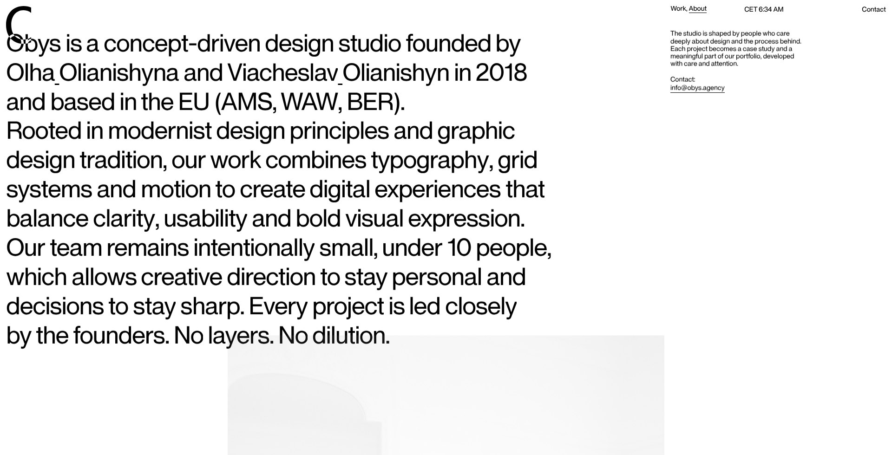
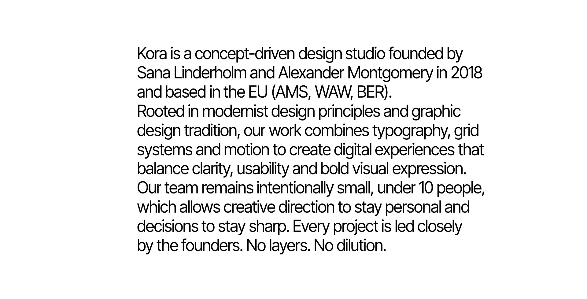
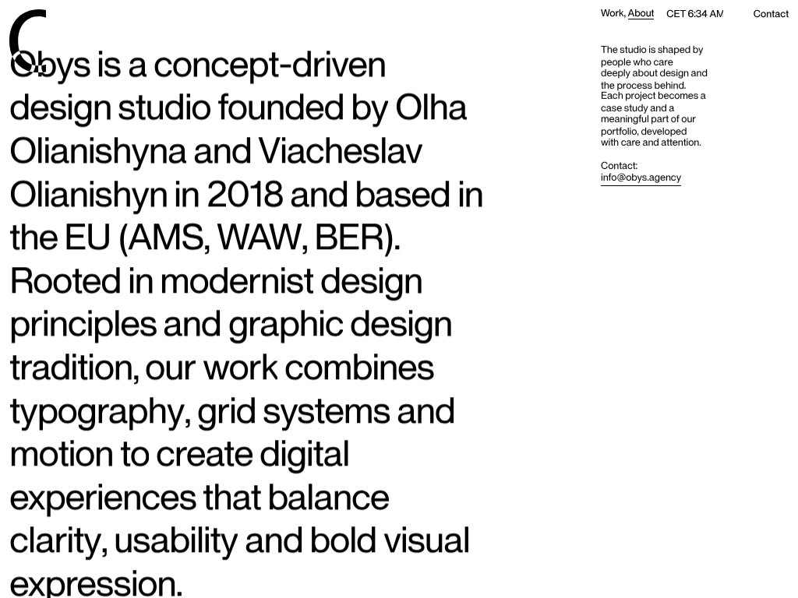
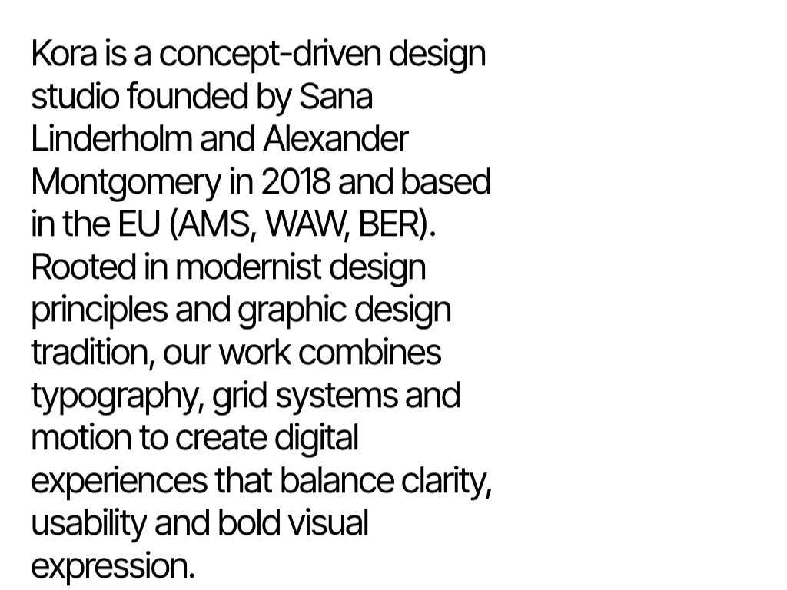

# Fidelity Report: mono-line-reveal

- **Sumber:** `agency-portfolio/obys-agency-nextjs` (`src/components/shell/PageMotion.tsx` + `.mo-ln` / `._sl` di `#ab-co-ma`, `http://localhost:3021/about`)
- **Ekstrak:** `registry/ui/mono-line-reveal` (`http://localhost:3025/preview/ui/mono-line-reveal`)
- **Style:** `swiss-mono` (`css-modules`, 100% token `--rk-*`)

## Hasil `npm run fidelity`

- `1920x980`: 5 elemen (`block`, `p1`, `p2`, `p3`, `p4`), **0 FAIL**, 17 WARN
- `1024x768`: 5 elemen (`block`, `p1`, `p2`, `p3`, `p4`), **0 FAIL**, 17 WARN

## Screenshot Berdampingan

| Viewport | Asli | Ekstrak |
| --- | --- | --- |
| `1920x980` |  |  |
| `1024x768` |  |  |

## Beda yang Disengaja (WARN)

- **Font proprietary (`Obys` -> `Inter Tight`):** token `--rk-font-body` memakai Google Font terbuka `Inter Tight` sehingga seluruh 5 elemen melaporkan WARN `fontRendered`, dengan `fontSize`, `lineHeight`, `letterSpacing`, serta jumlah baris paragraf yang identik (`0 FAIL`).
- **Teks white-label (`Kora`):** nama studio dan pendiri pada `preview.tsx` diganti data netral tanpa nama merek asli, sehingga `block.text` dan `p1.text` melaporkan WARN teks.
- **Koordinat `x`/`y` preview UI:** komponen UI di showcase ditampilkan terpusat pada panggung `/preview/ui/mono-line-reveal`, sedangkan pada halaman asli menempel di kiri grid (`x: 13.3` / `11.8`).
