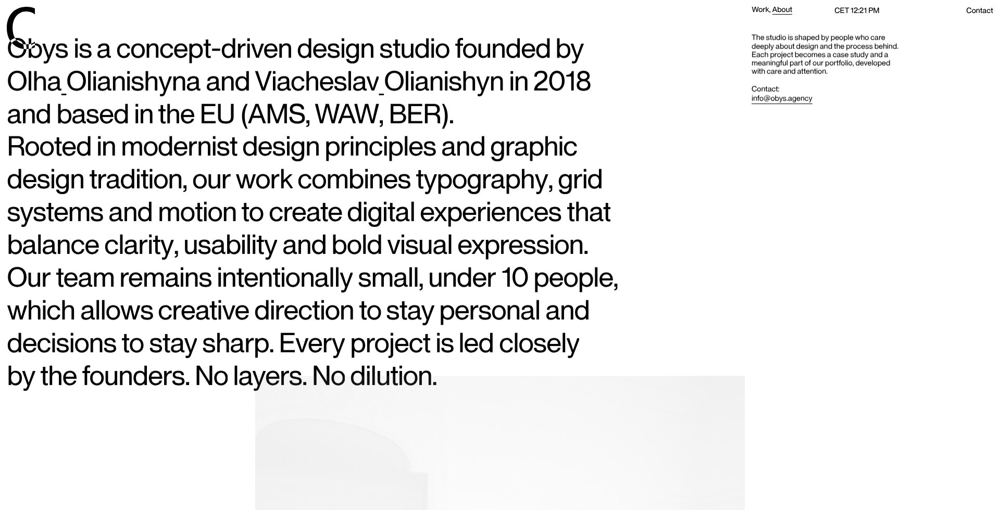
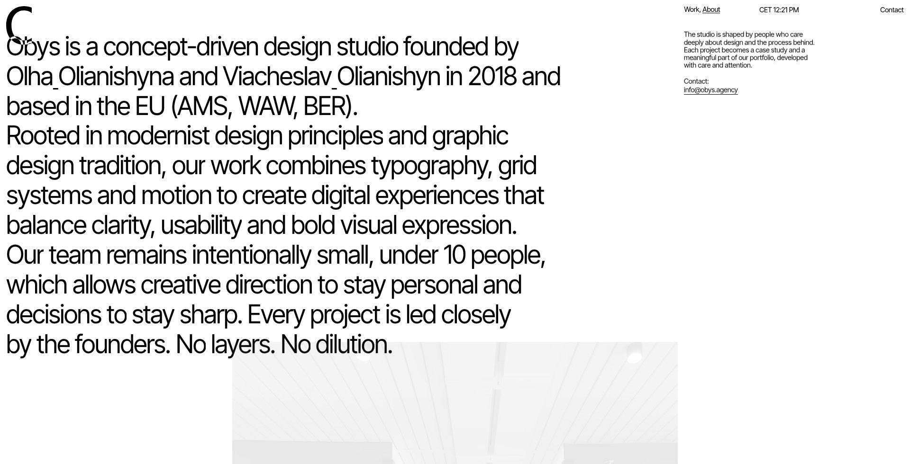
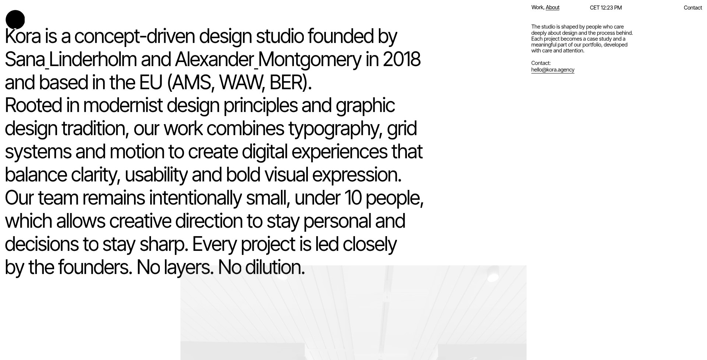
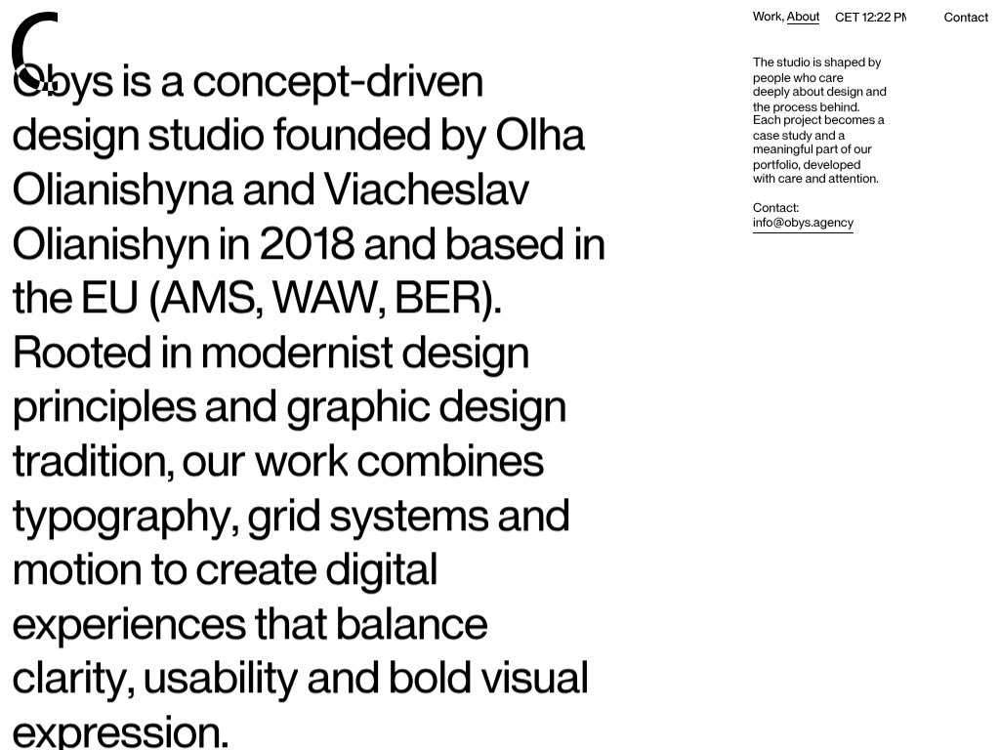
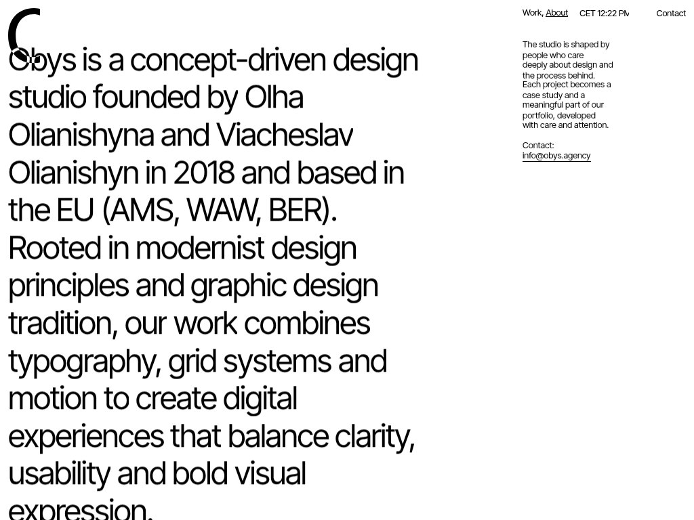
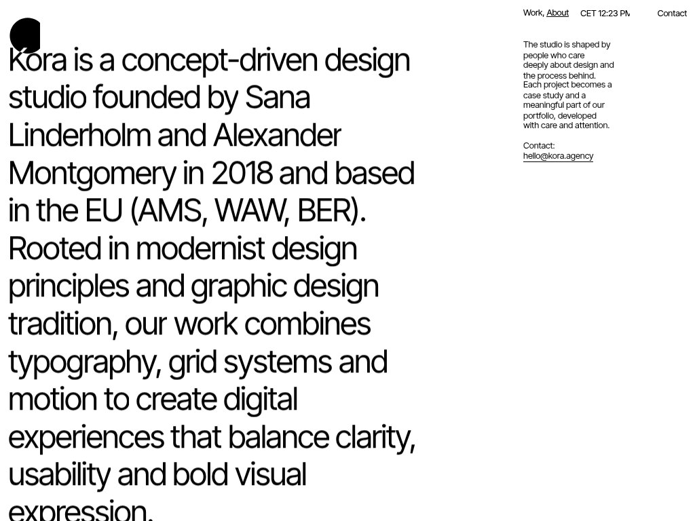
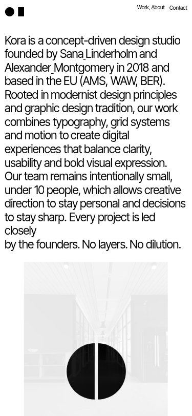

# Fidelity Report: mono-studio-about-page

- **Kind / Level:** `page` / `page`
- **Composes:** `templates/swiss-grid-shell`, `sections/mono-clock-header`, `ui/mono-studio-note`, `sections/founder-hover-manifesto`, `sections/studio-hover-reel`, `sections/credits-index-columns`, `sections/giant-wordmark-footer`
- **Sumber Referensi (Step 1):** `agency-portfolio/obys-agency-nextjs` (`http://localhost:3021/about`)
- **Live Preview (Step 2 Netral):** `http://localhost:3025/preview/page/mono-studio-about-page`
- **Style:** `swiss-mono` (`css-modules`, 100% token `--rk-*`)

## Step 1: Verifikasi Perakitan 1:1 (Data Referensi Sementara vs `/about`)

Sebelum ditukar ke data contoh netral, `demo-data.ts` dan `demo-credits.ts` diisi copy dan path SVG referensi dan diukur di seluruh 7 region halaman (`main`, `header`, `note`, `manifesto`, `reel`, `credits`, `footer`):

| Viewport | Elemen Diukur | FAIL | WARN | Status |
| --- | ---: | ---: | ---: | --- |
| `1920x980` | 7 | **0** | 7 (`fontRendered` saja) | **PASS** |
| `1024x768` | 7 | **0** | 7 (`fontRendered` saja) | **PASS** |

- Screenshot Step 1: `original-1920.jpg` vs `step1-1920.jpg`, `original-1024.jpg` vs `step1-1024.jpg`.
- Temuan yang diperbaiki di Step 1: `.main` pada `swiss-grid-shell` dikembalikan ke `display: block` (dan `display: flow-root` dipindah ke `.shell`) agar `main.display` cocok 1:1 (`0 FAIL`).

## Step 2: Verifikasi Data Contoh Netral (`Kora`) & Cek Visual

Setelah Step 1 `0 FAIL`, data halaman dikembalikan ke data netral `Kora` (`hello@kora.agency`, `Sana Linderholm`, `Alexander Montgomery`, glyph geometris, foto Unsplash) dan diukur ulang pada build produksi final:

| Viewport | Elemen Diukur | FAIL | WARN | Layout / Overflow |
| --- | ---: | ---: | ---: | --- |
| `1920x980` | 7 | **0** | 11 | `0` overlap, `0` clipping, `0` horizontal overflow |
| `1024x768` | 7 | **0** | 11 | `0` overlap, `0` clipping, `0` horizontal overflow |
| `375x812` | 7 | - | - | `main: 375 x 1963.4px` (`manifesto y=0`, `reel y=546.6`, `credits y=1082.1`, `footer y=1781.7`), `0` overflow |

## Screenshot Berdampingan

| Viewport | Asli (`localhost:3021/about`) | Step 1 (Perakitan) | Step 2 (Netral `Kora`) |
| --- | --- | --- | --- |
| `1920x980` |  |  |  |
| `1024x768` |  |  |  |
| `375x812` | - | - |  |

## Beda yang Disengaja (WARN)

- **Font proprietary (`Obys` -> `Inter Tight`):** seluruh 7 region melaporkan WARN `fontRendered`, dengan tinggi dan posisi setiap section identik (`0 FAIL`).
- **Teks dan aset white-label (`Kora`):** nama studio, pendiri, email, jam (`CET` waktu saat capture), dan foto arsip memakai data netral tanpa merek asli.
