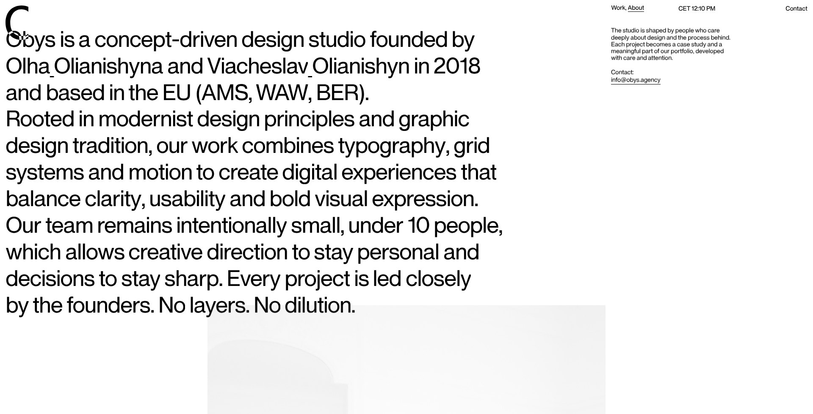
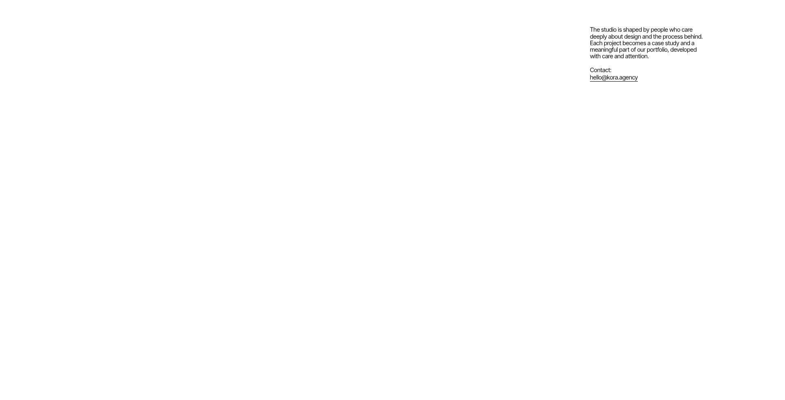
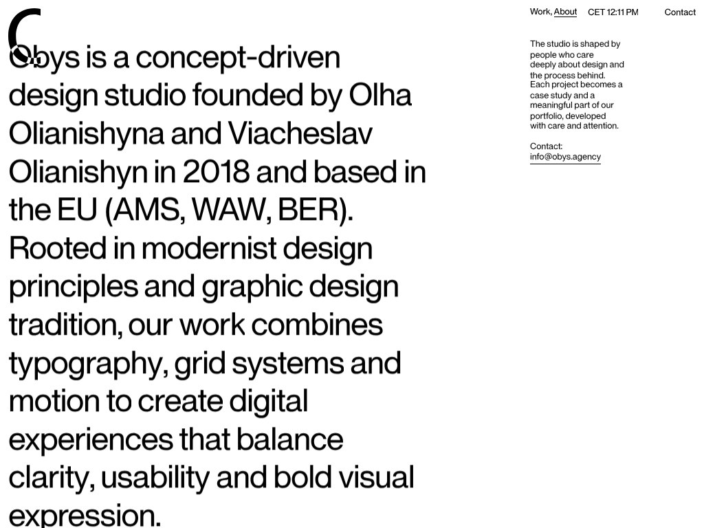
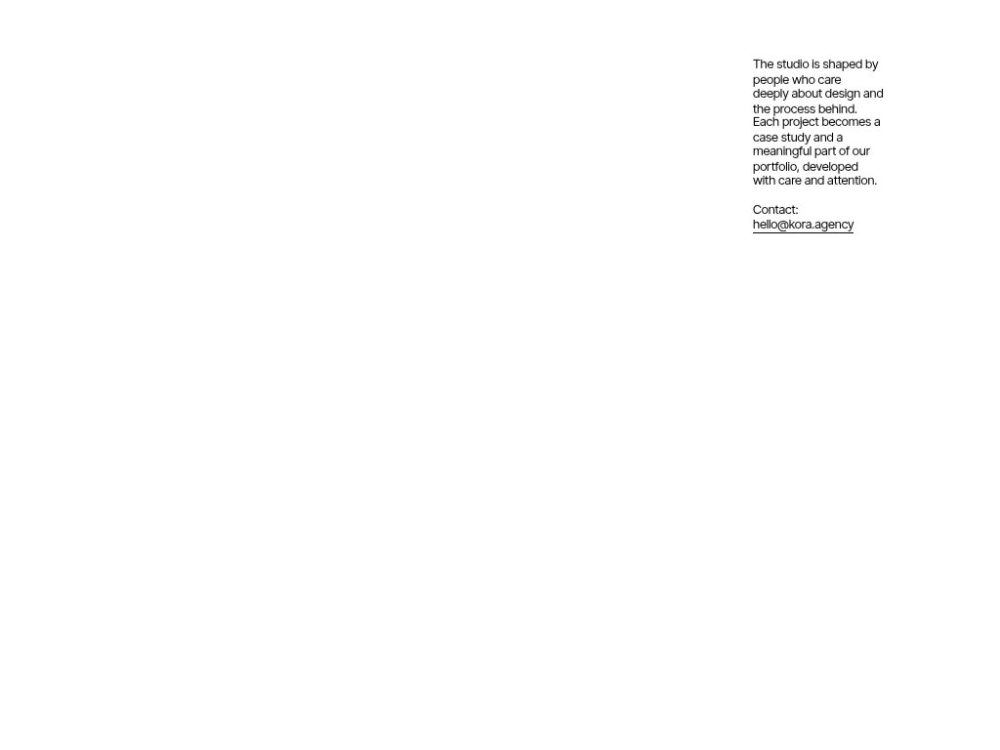
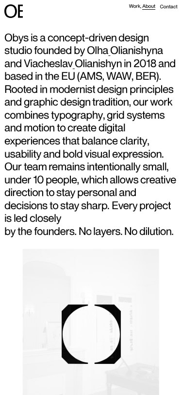
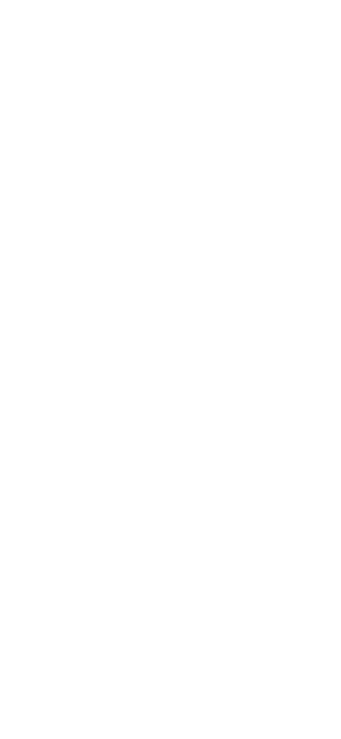

# Fidelity Report: mono-studio-note

- **Sumber:** `agency-portfolio/obys-agency-nextjs` (`src/components/shell/FixedStudioNote.tsx`, `#fix`, `http://localhost:3021/about`)
- **Ekstrak:** `registry/ui/mono-studio-note` (`http://localhost:3025/preview/ui/mono-studio-note`)
- **Style:** `swiss-mono` (`css-modules`, 100% token `--rk-*`)

## Hasil `npm run fidelity`

- `1920x980`: 6 elemen (`note`, `statement`, `line1`, `contactLabel`, `emailLink`, `rule`), **0 FAIL**, 7 WARN
- `1024x768`: 6 elemen (`note`, `statement`, `line1`, `contactLabel`, `emailLink`, `rule`), **0 FAIL**, 7 WARN
- `375x812`: 6 elemen (disembunyikan via `display: none` di `<= 767px`, identik dengan `#fix`), **0 FAIL**, 7 WARN

## Screenshot Berdampingan

| Viewport | Asli | Ekstrak |
| --- | --- | --- |
| `1920x980` |  |  |
| `1024x768` |  |  |
| `375x812` |  |  |

## Beda yang Disengaja (WARN)

- **Font proprietary (`Obys` -> `Inter Tight`):** pada `1920` dan `1024`, seluruh elemen memakai `Inter Tight` (pada `375x812`, `note` tersembunyi `display: none` sehingga font tidak dirender dan terbaca fallback `Arial`).
- **Email netral (`info@obys.agency` -> `hello@kora.agency`):** tanpa nama merek asli pada `preview.tsx`.
