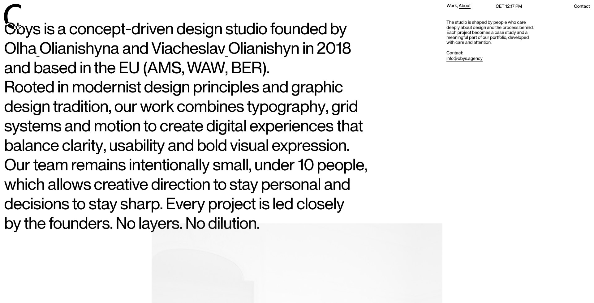
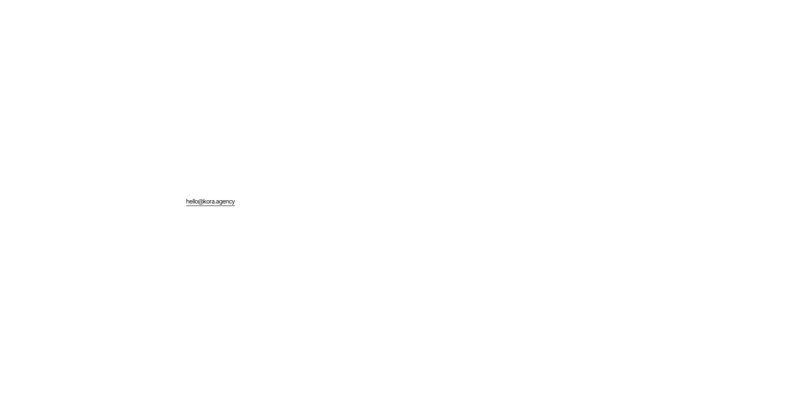
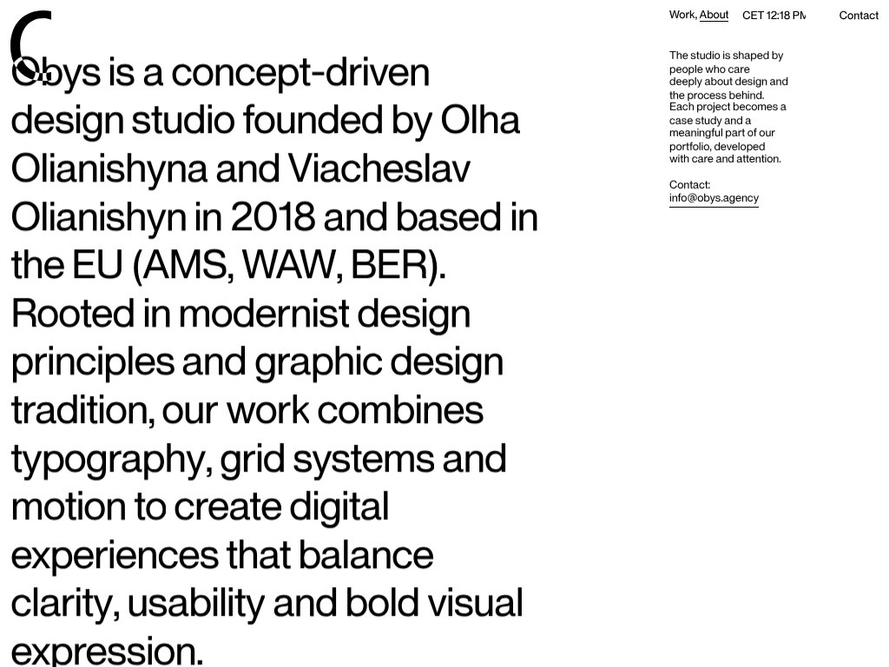
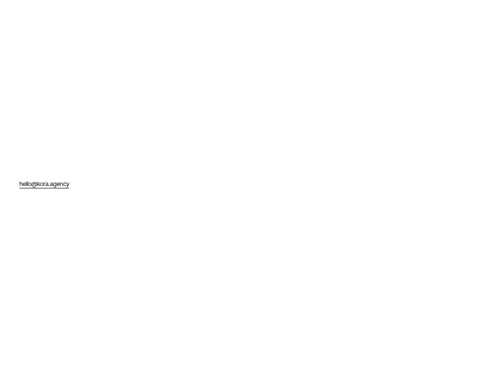

# Fidelity Report: mono-underline-link

- **Sumber:** `agency-portfolio/obys-agency-nextjs` (`#fix-co-em` di `src/components/shell/FixedStudioNote.tsx`, `http://localhost:3021/about`)
- **Ekstrak:** `registry/ui/mono-underline-link` (`http://localhost:3025/preview/ui/mono-underline-link`)
- **Style:** `swiss-mono` (`css-modules`, 100% token `--rk-*`)

## Hasil `npm run fidelity`

- `1920x980`: 4 elemen (`link`, `label`, `rule`, `stroke`), **0 FAIL**, 14 WARN
- `1024x768`: 4 elemen (`link`, `label`, `rule`, `stroke`), **0 FAIL**, 14 WARN

## Screenshot Berdampingan

| Viewport | Asli | Ekstrak |
| --- | --- | --- |
| `1920x980` |  |  |
| `1024x768` |  |  |

## Beda yang Disengaja (WARN)

- **Font proprietary (`Obys` -> `Inter Tight`):** seluruh 4 elemen melaporkan WARN `fontRendered`; tinggi link (`20.6px` di `1920`, `18.5px` di `1024`) dan tinggi garis (`1px` stroke / `3px` rule) sama persis.
- **Email netral (`info@obys.agency` -> `hello@kora.agency`):** teks link diganti alamat netral dengan lebar huruf sepadan sehingga `rule`/`stroke` tetap lolos toleransi `<= 4px`.
- **Koordinat `x`/`y` preview UI:** komponen UI di showcase berada di panggung tengah (`/preview/ui/mono-underline-link`), sedangkan pada web asli terpasang di dalam `#fix` pada kolom kanan.
