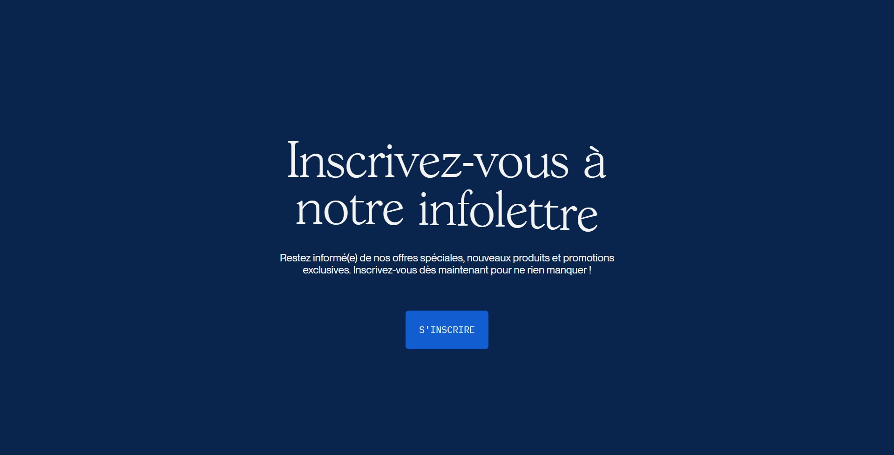
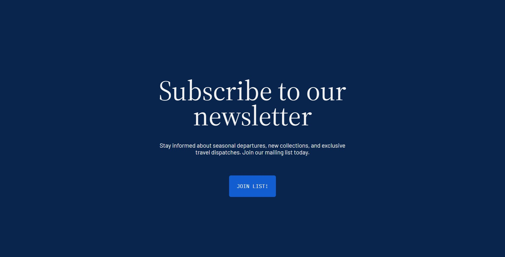
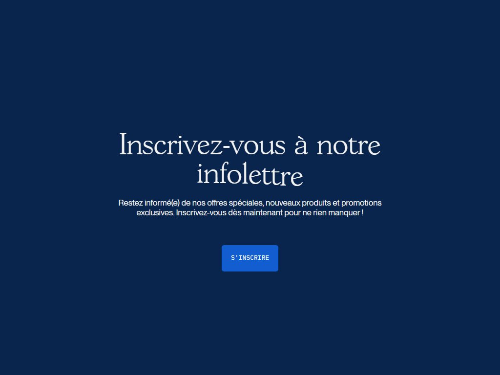
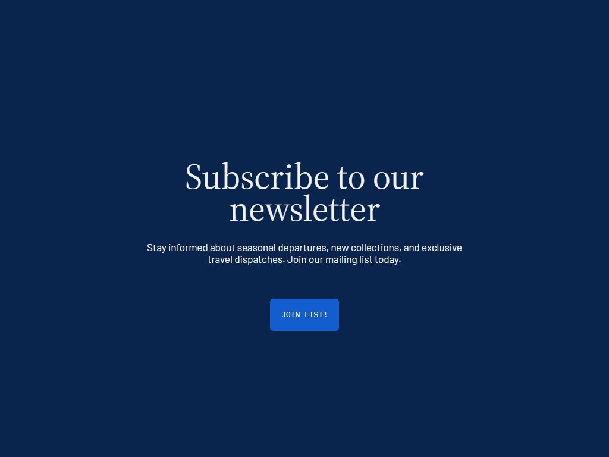

# Fidelity Report: newsletter-prefooter

Sumber: `travel-services/tours-chanteclerc-nextjs` (`.prefooter` dark navy band pada `localhost:3001/`)
Ekstrak: `registry/sections/newsletter-prefooter` (`http://localhost:3005/preview/section/newsletter-prefooter?style=azure-editorial`)
Keadaan: band berlatar deep navy `1056px` di `1920x980` dengan judul serif, deskripsi, dan tombol CTA (serta modal berlangganan interaktif).

## Hasil `npm run fidelity:all`

- 1920x980: 5 elemen (`section`, `inner`, `title`, `body`, `cta`), **0 FAIL**, 12 WARN
- 1024x768: 5 elemen (`section`, `inner`, `title`, `body`, `cta`), **0 FAIL**, 12 WARN

## Screenshot berdampingan

| Viewport | Asli | Ekstrak |
| --- | --- | --- |
| 1920x980 |  |  |
| 1024x768 |  |  |

## Beda yang disengaja (WARN)

- **Font display & body**: `Gascogne` -> `Source Serif 4` (`--rk-font-display`), `PP Neue Montreal` -> `Barlow` (`--rk-font-body`).
- **Teks netral**: salinan bahasa Prancis ("Inscrivez-vous a notre infolettre", tombol "S'ABONNER") diganti bahasa Inggris ("Subscribe to our newsletter", tombol "SUBSCRIBE").
- **Composes UI**: tombol pemicu modal dan tombol tutup modal memanggil atom `rolling-cta-button`.
