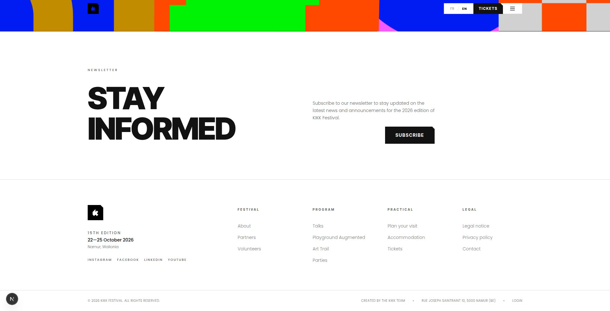
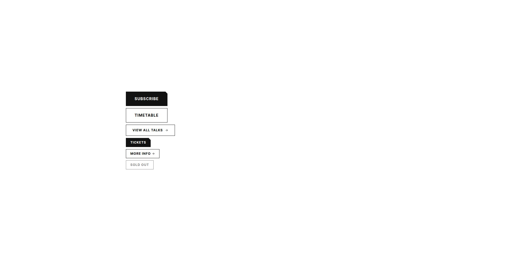
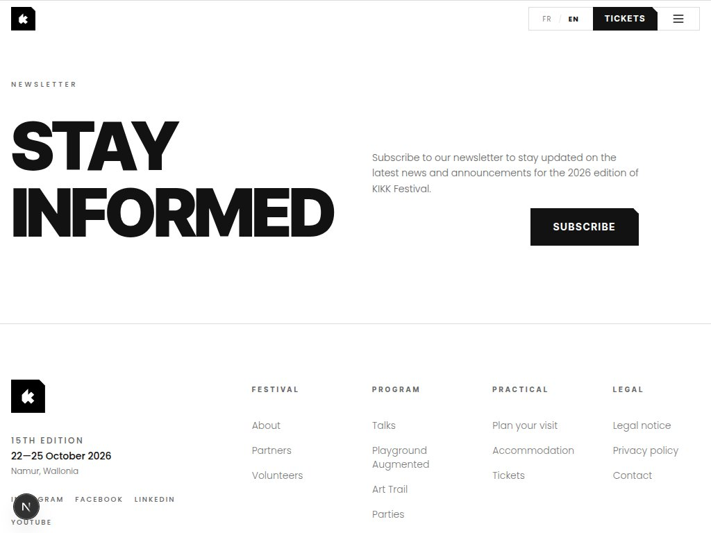
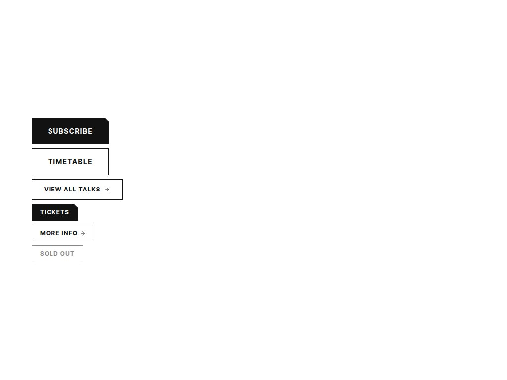

# Fidelity Report: `notched-button`

- **Kind / Level:** `ui` / `atom`
- **Source:** `education-event/kikkfestival-be-nextjs` (`src/components/ui/KikkButton.tsx` + `src/styles/globals.css`, `http://127.0.0.1:3011/`)
- **Extract:** `registry/ui/notched-button` (`http://127.0.0.1:3015/preview/ui/notched-button`)
- **Style:** `neon-brutalist` (`css-modules`, 100% `--rk-*` tokens)

## Results (`npm run fidelity`)

- `1920x980`: 5 elements (`filledLg`, `outlineMd`, `filledSm`, `outlineSm`, `outlineSmArrow`), **0 FAIL**, 12 WARN.
- `1024x768`: 5 elements (`filledLg`, `outlineMd`, `filledSm`, `outlineSm`, `outlineSmArrow`), **0 FAIL**, 12 WARN.

## Side-by-Side Screenshots

| Viewport | Original (`127.0.0.1:3011/`) | Extract (`127.0.0.1:3015/preview/ui/notched-button`) |
| --- | --- | --- |
| `1920x980` |  |  |
| `1024x768` |  |  |

## Intentional Differences (WARN)

- **Viewport coordinates (`x`, `y`):** Isolated UI showcase centers the button stack inside `StandalonePreview`, whereas original buttons live inside Header, Talks, Numbers, and Footer sections.
- **Border color inheritance (`borderTop` / `borderBottom`):** On `0px` edges, Tailwind global `* { border-color }` in the original app resolves to `rgba(18, 18, 18, 0.15)` while CSS Modules without global border reset inherits `currentColor`.
- **Disabled / extra variants:** Preview also renders `outline lg` (`Timetable`) and `disabled sm` (`Sold out`) alongside the measured variants.
