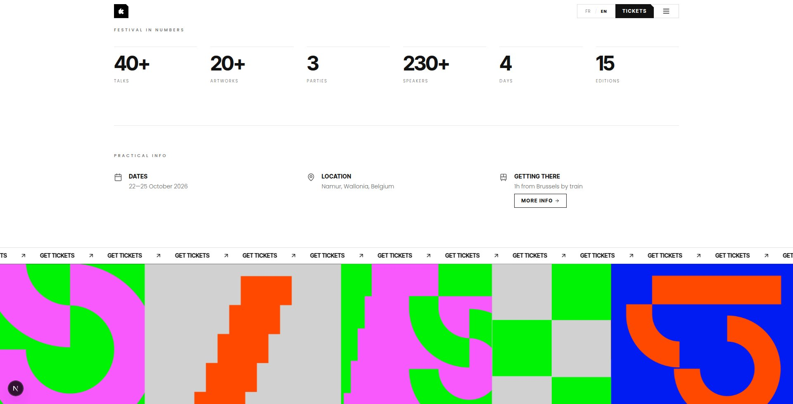
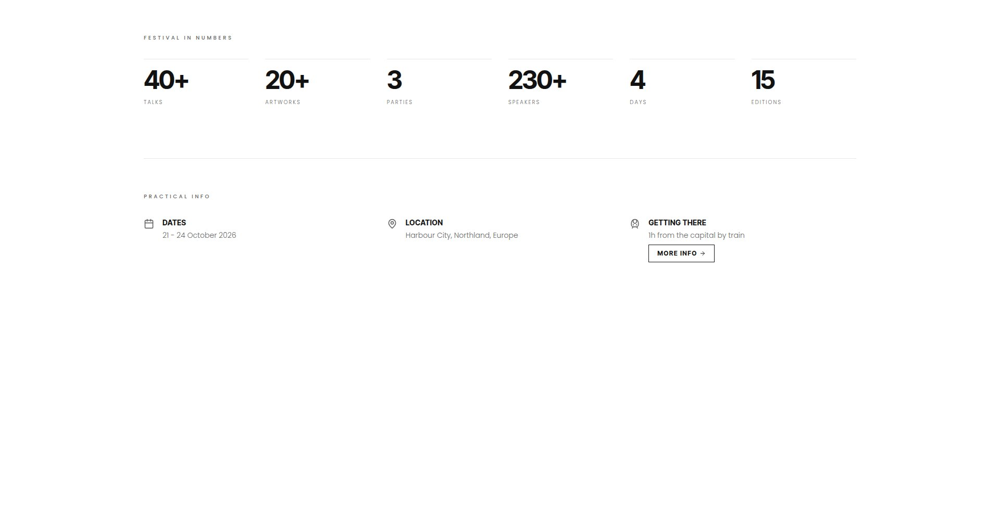
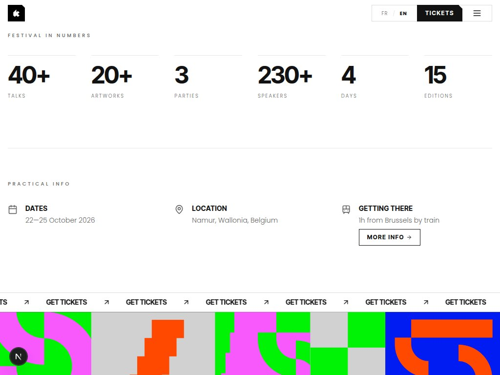
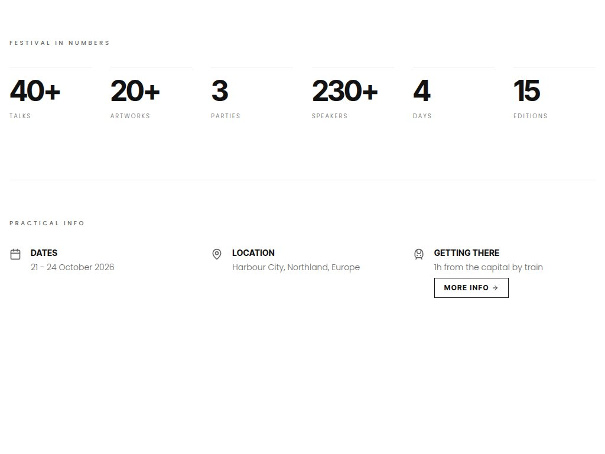

# Fidelity Report: `numbers-practical-info`

- **Kind / Level:** `section` / `organism`
- **Source:** `education-event/kikkfestival-be-nextjs` (`src/components/home/NumbersPracticalSection.tsx`, `http://127.0.0.1:3011/`)
- **Extract:** `registry/sections/numbers-practical-info` (`http://127.0.0.1:3015/preview/section/numbers-practical-info`)
- **Style:** `neon-brutalist` (`css-modules`, 100% `--rk-*` tokens)

## Results (`npm run fidelity`)

- `1920x980`: 12 elements (`section`, `numbersLabel`, `numbersGrid`, `numberCell`, `numberValue`, `numberLabel`, `infoBlock`, `infoGrid`, `infoIcon`, `infoTitle`, `infoText`, `infoAction`), **0 FAIL**, 23 WARN.
- `1024x768`: 12 elements, **0 FAIL**, 23 WARN.

## Side-by-Side Screenshots

| Viewport | Original (`127.0.0.1:3011/`) | Extract (`127.0.0.1:3015/preview/section/numbers-practical-info`) |
| --- | --- | --- |
| `1920x980` |  |  |
| `1024x768` |  |  |

## Intentional Differences (WARN)

- **White-label practical copy:** Uses neutral `21 - 24 October 2026`, `Harbour City, Northland, Europe`, and `1h from the capital by train` in place of Namur/Brussels copy.
- **Zero-width border color:** `0px` computed borders inherit element text color vs Tailwind global `* { border-color }`, while visible `1px` top hairline borders match `rgba(18, 18, 18, 0.1)`.
